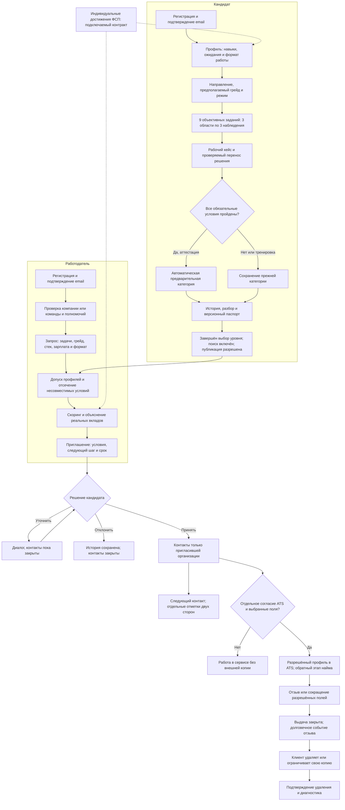
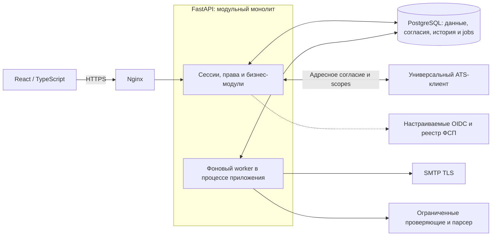

# ФСП Карьера

**Пермский звериный стиль · Пермь · Специальный трек Федерации спортивного программирования России · ЛЦТ 2026**

Сервис помогает ИТ-специалисту показать навыки в проверяемых заданиях, а работодателю — найти подходящего человека и предложить конкретные условия. Приглашение отправляется **без опубликованной вакансии и предварительного отклика**. Кандидат сам решает, кому открыть контакты и какие данные передать в ATS.

[Открыть сервис](https://pzs-fsp-career.duckdns.org/) · [Входы для жюри](docs/JURY_ACCESS.md) · [Руководство PDF](docs/delivery/2026-10-11/FSP_CAREER_GUIDE.pdf) · [Презентация PDF](docs/delivery/2026-10-11/FSP_CAREER_PRESENTATION.pdf) · [PPTX](docs/delivery/2026-10-11/FSP_CAREER_PRESENTATION.pptx)

**API 0.16.0 · PostgreSQL, схема 7 · React/TypeScript · FastAPI · Docker Compose**

## Начать проверку

Для нового пользователя доступна обычная регистрация с логином, паролем, email и одноразовым подтверждением. Чтобы оценить завершённый сценарий без ожидания собственной аттестации, используйте подготовленные обычные аккаунты:

| Логин | Роль и что посмотреть | Пароль |
|---|---|---|
| `jury.backend` | Backend Middle88,89%: паспорт, история, приглашения | `JuryBackend!2026-FSP` |
| `jury.qa` | QA Junior77,78%: контакт и этап ATS | `JuryQA!2026-FSP` |
| `jury.employer` | Команда ПЗС: два учебных запроса, подбор, приглашения и ATS | `JuryEmployer!2026-FSP` |

Это **синтетические профили для проверки механики**, а не результаты квалификации реальных людей. Аккаунты работают через обычный вход по логину и ограничены своей учебной организацией; они не дают административных прав и не заявляют подтверждение email этих операторских логинов. Обычная новая регистрация по-прежнему требует email. [Пятиминутный маршрут проверки](docs/FINAL_REVIEW_GUIDE.md), [руководство пользователя](docs/SERVICE_GUIDE.md).

## Как работает решение



**Категория даёт допуск, скоринг определяет порядок, согласие открывает конкретный доступ.** Высокий балл не компенсирует конфликт условий или отсутствие разрешения. История ФСП необязательна; введённый номер участника не подтверждает владение аккаунтом. Дополнительные схемы сборки формы, подбора, ATS и оба пользовательских пути — в [MECHANICS.md](docs/MECHANICS.md).

## Как подтверждается категория

Основной маршрут — `work_sample_v3_balanced`, план формы — `balanced-core-2026-v3`. Поддерживаются Backend Python, Frontend TypeScript, QA, DevOps, ML и ИБ; уровни Intern, Junior, Middle и Senior. В форме **9 объективных заданий**, исходный кейс, проверяемый перенос и необязательное объяснение — **12 элементов маршрута**, а не 12 коротких вопросов.

Успех требует **всех условий одновременно**:

1. Средний результат девяти объективных заданий — **не ниже 70%**.
2. В каждой из трёх основных областей заполнена квота трёх наблюдений и средний результат — **не ниже 50%**.
3. Пройдены **все обязательные проверки исходного рабочего кейса**.
4. Пройдены **все обязательные проверки переноса** при новом ограничении или в другом рабочем контексте того же направления и уровня.

Для бинарных ответов это не менее 7 из 9 и не менее 2 из 3 в каждой области. Необязательное объяснение и дополнительный ручной разбор не меняют автоматический проход. В режиме аттестации успех выдаёт предварительную категорию (`provisional`); тренировка, неуспех, отмена и техническая ошибка не понижают прежнюю. При успешном результате от 90% предлагается **отдельная** попытка выше, при неуспехе — ниже; автоматического перехода нет. После завершения первоначального выбора уровня действует интервал 90 дней, повтор того же уровня ограничен 24 часами, практика доступна отдельно.

Каждая попытка хранит собственные задания, эталоны, версии, квоты и правила. Старые попытки не пересчитываются новой формулой. Формы проверяются на повтор до пяти сборок; конечный банк не объявляется защищённым от заучивания. SQL и JSON проверяются в ограниченном контуре; произвольный пользовательский Python не запускается.

**70/50/90 — пилотные пороги.** Равная сложность вариантов и профессиональная валидность грейда на людях не установлены. IRT в текущем оценивании не используется. [Правила](docs/ASSESSMENT_POLICY.md), [сборка и рабочие модели](docs/ASSESSMENT_V3.md), [передача разработчику](docs/ASSESSMENT_DEVELOPER_HANDOFF.md).

## Как подбираются кандидаты

Сначала проверяются текущая категория, завершённый выбор уровня, публикация, поиск работы, согласия, блокировки и условия запроса. Несовместимые формат, город без переезда или сопоставимая зарплата исключаются **до ранжирования и подсчёта страниц**. Соседний грейд разрешается только явным фильтром. Неточные и неизвестные сведения обозначаются отдельно.

| Компонент `category-evidence-v2` | Максимальный вклад |
|---|---:|
| Объективный результат действующей категории | 55 |
| Совпадение требуемых технологий по известным сведениям | 20 |
| Сила проверки или индивидуального источника по требуемым навыкам | 20 |
| Свежесть проверки | 3 |
| Индивидуальные достижения ФСП | 2 |

Соседняя категория даёт поправку −8, отмеченное неизвестное условие — −2. Общий балл ограничен 0–100. Тестовое наблюдение имеет вес 1 с поправкой давности, индивидуальный источник — 0,75, одно самоописание — 0 в компоненте силы доказательств. Самоописание может показать совпадение стека, но не присваивает категорию.

Карточка показывает **реальные вклады формулы**, происхождение навыков и ограничения. Эти очки определяют порядок выдачи, а не вероятность найма. Основной маршрут работает без LLM и embeddings. [Полная формула и условия](docs/MATCHING_V2.md).

## Контакт, доверие и ATS

- Работодатель описывает запрос на подбор и приглашает с зарплатой, условиями, следующим шагом и сроком. Вакансия и предварительный отклик не требуются.
- Кандидат может уточнить, отклонить или принять. Контакт открывается только адресной организации. Отметка работодателя о контакте и подтверждение кандидата — разные события, не автоматическое трудоустройство.
- Компания и её полномочия проверяются отдельно; применяются актуальность найма, модерация, риск-сигналы, лимиты, жалобы и блокировка. Это снижение риска, а не гарантия отсутствия фиктивных вакансий.
- ATS требует собственного согласия и выбранных полей. Полный цикл: **импорт → приглашение → принятие → ATS-согласие → экспорт → обратный этап → повтор без дубля → отзыв → удаление копии → ACK**.
- Есть универсальный ATS API и Odoo-адаптер. Ключ разрешает доступ, но не создаёт адаптер к любой ATS автоматически. Обмен проверяется на разрешённых изолированных контурах с синтетическими данными; реальная партнёрская ATS не подключена.
- ФСП ID поддерживает OIDC и контракт реестра. Отдельный мок проверяет PKCE, state, nonce и подпись; это не настоящий аккаунт Федерации и не промышленный Keycloak.

[Пользовательский путь](docs/CAREER_FLOW.md) · [ATS API](docs/ATS_API.md) · [ФСП ID](docs/FSP_CONTRACT.md) · [OIDC-мок](docs/FSP_ID_MOCK.md)

## Архитектура и папки



Worker по умолчанию работает внутри процесса FastAPI; отдельный процесс поддерживается как способ запуска, но не объявляется отдельным развёрнутым микросервисом. PostgreSQL — единственная постоянная БД. SQLite применяется только **в памяти ограниченного SQL-процесса** для учебного задания. Kafka/OpenSearch/Elasticsearch не включены. Неизменяемый каталог заданий находится в образе отдельно от рабочего тома. [Подробная архитектура](docs/ARCHITECTURE.md).

| Папка | Содержимое |
|---|---|
| `backend/` | API, аттестация, подбор, согласия, администрация и интеграции |
| `frontend/src/` | Кабинеты, маршруты, формы и состояния интерфейса |
| `data/` | Публикуемый авторский каталог и метаданные; пользовательской БД нет |
| `benchmarks/` | Контрольные наборы для воспроизводимых экспериментов |
| `scripts/` | Проверки, измерения, интеграционные reference-сервисы и упаковка |
| `deploy/` | Типовые Compose-конфигурации HTTPS, ATS и OIDC |
| `tests/` | API, доменные, отрицательные и интеграционные проверки |
| `docs/` | Механика, архитектура, контракты, инструкции и комплект сдачи |
| `.github/workflows/` | Автоматические проверки исходников и контейнера |

Рабочие БД, конфигурации с секретами, персональные документы, локальные заметки, экспорты переписки и исследования конкурентов в комплект не входят.

## Запуск

Рекомендуется Docker Compose. Скопируйте `.env.example` в приватный `.env`, задайте новый пароль PostgreSQL и настройте SMTP либо почтовый API для одноразового подтверждения email:

```sh
docker compose config --quiet
docker compose up --build -d
```

Сервис — `http://localhost:8000`, интерактивная API-документация — `http://localhost:8000/api/docs`. Локальный порт по умолчанию не открыт в интернет. Для публичного экземпляра отдельно настройте HTTPS, URL и разрешённые Origin.

Для Windows без Docker нужны **Python 3.10**, Node.js 22 и отдельная PostgreSQL UTF-8. Задайте `FSP_DATABASE_URL` и почту в `.env`, оставьте `FSP_DEMO=0`, `FSP_TEST_LOGIN=0`, `FSP_ENABLE_ML=0`, `FSP_EMAIL_REQUIRED=1`, разрешите обычную регистрацию:

```powershell
py -3.10 -m venv .venv
.\setup.ps1 -WithTests
.\start.ps1 -Baseline
```

Отсутствие PostgreSQL останавливает запуск: файловая база не создаётся. [Полная установка и первый администратор](docs/INSTALLATION.md), [структура данных](docs/DATABASE.md), [почта](docs/SMTP_RELAY.md).

## Проверки и API

[OpenAPI стенда](https://pzs-fsp-career.duckdns.org/api/openapi.json) · [OpenAPI в репозитории](docs/openapi.json) · [Обзор API](docs/API.md) · [Результаты и условия проверок](docs/VERIFICATION.md)

Для тестов задайте **отдельный** `FSP_TEST_POSTGRES_DSN`. Проверки создают и удаляют свои схемы; рабочая БД не подходит:

```sh
python -m pytest tests -q
cd frontend
npm ci
npm run build
```

Проверки выпуска включают полный PostgreSQL-набор, TypeScript/Vite и контейнер, маршруты двух ролей, адаптивные размеры, сохранение, историю, согласия, ATS и границы доступа. Синтетическое сравнение подбора разделяет настройку и оценку по семействам: на 360 отложенных авторских сценариях v2 получены nDCG@3 0,9225 и Precision@3 0,8852. Это оценка политики на подготовленных данных, **не качество реального найма**. Точность квалификации людей не измерена.

## Материалы сдачи

| Материал | Назначение |
|---|---|
| [Руководство PDF](docs/delivery/2026-10-11/FSP_CAREER_GUIDE.pdf) | Полное описание, пользовательские пути, схемы, архитектура, установка и API |
| [Презентация PDF](docs/delivery/2026-10-11/FSP_CAREER_PRESENTATION.pdf) / [PPTX](docs/delivery/2026-10-11/FSP_CAREER_PRESENTATION.pptx) | Обязательный блок команды и решения, упрощённая механика и доказательства |
| [Источник DOCX](docs/delivery/2026-10-11/FSP_CAREER_GUIDE.docx) | Редактируемая документация |
| [Соответствие ТЗ](docs/REQUIREMENTS_TRACEABILITY.md) | Реализованные требования и границы |
| [Карта документации](docs/README.md) | Навигация по тематическим документам |

Решение является работающим конкурсным прототипом. Порогам и сложности нужна будущая проверка на людях; перед промышленным внедрением требуются согласование категории с оператором, политика персональных данных, реальные подключения и измерения на его каталоге и оборудовании. Наличие технических защит не заменяет юридическую оценку или независимый аудит.

## Команда и лицензия

**Георгий Покумин** — капитан, ML и задания. **Иван Урбанович** — разработка и аналитика. Команда «Пермский звериный стиль», Пермь.

Код — [MIT](LICENSE). Бренд-ресурсы ФСП сохраняют условия правообладателя. Лицензии зависимостей, шрифтов и источников — [THIRD_PARTY_NOTICES.md](THIRD_PARTY_NOTICES.md).
