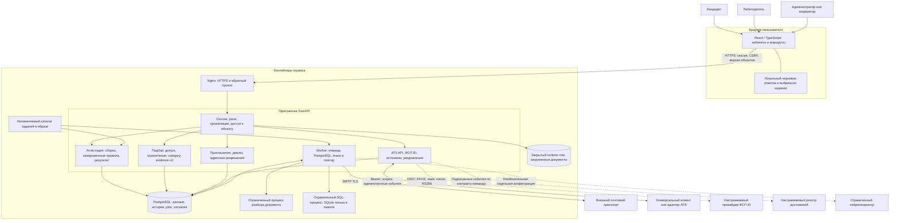
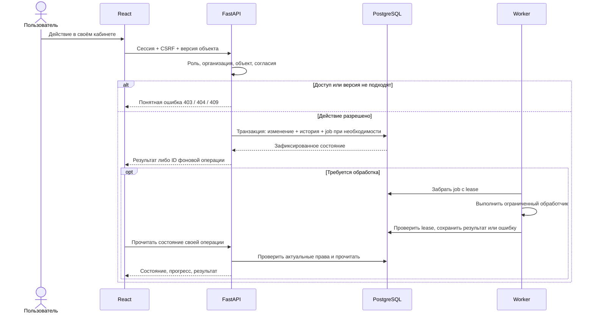

# Архитектура ФСП Карьера

Документ описывает реализованное решение API **0.16.0**, схема PostgreSQL **7**. Пользовательская механика и правила оценивания подробно разобраны в [MECHANICS.md](MECHANICS.md). Основной вариант — модульный монолит FastAPI, React/TypeScript и PostgreSQL; действующий сервис не использует Kafka, Elasticsearch, OpenSearch или IRT.

## Фактические компоненты и границы

**Сплошные линии** описывают основной путь и реализованный ATS-контракт. **Пунктирные линии** обозначают подключаемые возможности: они не означают наличие доступа к официальной системе Федерации или работающую нейросеть на публичном стенде. Коммерческая ATS партнёра не подключена. Полный ATS-обмен проверен на отдельном получателе и в изолированной Odoo Recruitment с синтетическими данными. OIDC проверяется отдельным протокольным моком; это не настоящий аккаунт ФСП и не установленный промышленный Keycloak.

В стандартном запуске `backend/main.py` запускает worker как фоновый поток **в процессе приложения**. Отдельный процесс `python -m backend.jobs` поддерживается кодом; схема не объявляет его отдельным работающим микросервисом. Настройки публичного стенда отключают ML-поиск; действующая аттестация v3 собирается из собственных проверяемых форм без нейрогенерации.

## Разделение ответственности

| Слой | Основные файлы | Ответственность |
|---|---|---|
| Браузер | `frontend/src/App.tsx`, `navigation.ts`, `api.ts`, `ui.tsx` | Авторизация, маршруты кабинетов, история браузера, запросы API, общие компоненты |
| Кабинет кандидата | `profile.tsx`, `assessment.tsx`, `assessmentJourney.tsx`, `complaints.tsx`, `career.tsx` | Профиль, попытки, ответы, результаты, согласия, жалобы и следующий шаг |
| Кабинет работодателя | `stages.tsx`, `pages.tsx`, `ats.tsx`, `product.tsx` | Компания, запросы на подбор, приглашения, вакансии, ATS и диагностика |
| HTTP и доступ | `backend/main.py`, `auth.py`, `accounts.py`, `members.py` | Сессии, CSRF, подтверждение email, восстановление, роли организации, административные операции |
| База и миграции | `db.py`, `postgres.py`, `schema.py`, `accounts_schema.py`, `migrations.py` | Единственное постоянное хранилище PostgreSQL, транзакции, схема и совместимость |
| Аттестация | `assessments.py`, `assessment_forms.py`, `assessment_journey.py`, `assessment_catalog.py` | План формы, выдача, сохранение, оценка и автоматическая категория |
| Практические задания | `work_samples.py`, `work_cases_v2.py`, `work_projects_v3.py`, `work_reference_v3.py`, `work_transfers.py`, `partner_cases.py` | Ограниченные артефакты, независимая реализация эталонов новых моделей, альтернативы и перенос |
| Каталог и источники | `content_registry.py`, `case_bank.py`, `grade_scenarios.py`, `professional_items.py`, `screening_operations.py` | Авторский банк, версии, предметные инварианты и операции выбранного уровня |
| Паспорта | `skill_passports.py`, `certification_evidence.py`, `certification_validity.py` | Версионный снимок, целостность, область проверки, актуальность и право чтения |
| Основной подбор | `recruiting.py`, `evidence_ranking.py`, `privacy.py`, `domain.py` | Допуск, фильтры, прозрачные веса, пагинация и адресная видимость |
| Каталог вакансий и прежний поисковый путь | `product.py`, `matching.py`, `ml.py` | Вакансии, отклики, PostgreSQL полнотекстовый поиск, необязательный ML-путь |
| Контакт и доверие | `recruiting.py`, `contact_policy.py`, `career.py`, `trust.py` | Приглашения без вакансии, актуальность найма, компании, модерация и жалобы |
| ATS | `ats_gateway.py`, `ats_client.py`, `ats_bridge.py`, `ats_odoo.py`, `ats_state.py`, `ats_diagnostics.py`, `integration_privacy.py` | Контракт, адаптер, scopes, повторы, этапы, отзыв и подтверждение удаления |
| Федерация и почта | `fsp_identity.py`, `identity.py`, `delivery_gateway.py` | Привязка ID, OIDC, входящие подписанные события, уведомления и SMTP |
| Фоновая работа | `jobs.py`, `document_runner.py`, `sql_runner.py`, `child_limits.py` | Очередь, lease, восстановление после сбоя и ограниченные дочерние процессы |

Это тематические модули одного backend, а не отдельные сервисы с собственной БД. Проверка доступа находится на сервере; скрытая кнопка в интерфейсе не считается механизмом авторизации.

## Папки репозитория

| Папка или файл | Назначение |
|---|---|
| `backend/` | Реализация HTTP API, бизнес-правил, интеграций и фоновых обработчиков |
| `frontend/` | Исходники React/TypeScript, зависимости и сборка Vite |
| `data/` | Публикуемый неизменяемый каталог авторских заданий, метаданные источников и версии моделей; не пользовательская БД |
| `tests/` | Автоматические проверки API, доступа, аттестации, жизненного цикла, интеграций и совместимости |
| `scripts/` | Воспроизводимые проверки, эталонный ATS-клиент и утилиты для изолированных стендов |
| `docs/` | Описание решения, API, правил, установки и ограничений; `docs/delivery/2026-10-11/` — итоговые материалы |
| `deploy/` | Типовые конфигурации контейнеров, HTTPS и необязательных интеграционных стендов |
| `.github/workflows/` | Автоматическая проверка исходников и сборки |
| `Dockerfile`, `compose.yaml` | Сборка приложения и основной запуск с PostgreSQL |

Постоянные данные приложения создаются в Docker-томах и в БД во время работы. Название `data/` не означает публикацию записей кандидатов, секретов или истории стенда. Заполненные конфигурации интеграций и окружения в комплект исходников не включаются. Подготовленные для проверки обычные аккаунты содержат синтетические профили; их пароли для жюри отделены от персональных и административных доступов.

## Как проходит пользовательское действие

Проверка задания, разбор резюме и отправка письма не удерживают HTTP-запрос до окончания всей работы. Jobs сохраняются в PostgreSQL. Обработчик получает временную аренду, продлевает её и перед фиксацией проверяет владельца аренды. После сбоя работа может повториться; ключи запросов и проверки текущего состояния предотвращают повторную выдачу сертификата или повторную операцию с тем же телом. Это очередь с обработкой как минимум один раз, а не обещание глобального exactly-once.

## Данные и воспроизводимость

| Сущность | Что сохраняется | Зачем |
|---|---|---|
| Профиль кандидата | Самоописание, ожидания, видимость, версия | Редактирование с защитой от потери изменений; самоописание отделено от проверки |
| Попытка | Условия, private-эталоны, версии, план сборки, политика, срок и ответы | Старый результат использует выданную форму; текущая настройка не пересчитывает его задним числом |
| Категория | Направление, запрошенный уровень, балл, источник-попытка, статус и активность | Допуск к подбору основан на текущем пригодном подтверждении |
| Паспорт результата | Снимок области, количества заданий, оценок, метода и ограничений; SHA-256; ревизия | Повторное использование без раскрытия ответов и скрытых ключей |
| Сессия подбора | Фильтры и кадры истории, версии запроса, ID кандидатов и ревизия данных | Восстановление собственного поиска; новые права проверяются снова |
| Приглашение | Условия, снимок подбора, диалог, версия, следующий шаг и события контакта | Условия не исчезают после изменения запроса; отметки сторон различимы |
| Согласия | События обработки/публикации, адресные контакты, поля передачи ATS | Разные разрешения не подменяют друг друга |
| ATS | Подключение, хеш ключа, scopes, external ID, журнал, этап и отзыв | Идемпотентность, диагностика и незавершённые удаления |
| Управление | Жалобы, решения, аудит, роли и состояния аккаунтов | История контроля доступа и действий модерации |

Исторический снимок не является постоянным правом доступа. API каждый раз заново проверяет право работодателя, публикацию, блокировки и адресные разрешения. SHA-256 паспорта проверяет совпадение с экземпляром сервиса; это не подпись Федерации и не независимое удостоверение.

## Безопасность исполнения и интеграций

- Сессия браузера хранится в HttpOnly-cookie; в HTTPS-конфигурации используется Secure. Изменяющие браузерные запросы проверяют CSRF и разрешённый Origin. Пароли хранятся как PBKDF2-HMAC-SHA256 с индивидуальной солью; одноразовые коды имеют сроки и защиту от повторного использования.
- Роли кандидата, работодателя, владельца организации, рекрутера, наблюдателя, администратора и модератора проверяются сервером. Другой организации недоступны чужие запросы, ключи, этапы и журнал. Административная роль не выдаёт автоматически контакты кандидата.
- В практических JSON-заданиях не исполняются Python, shell-команды, пользовательские контейнеры или произвольные программы. Проверяются известные поля и зарегистрированная модель; дублирующиеся ключи и неизвестные стратегии отклоняются.
- SQL-ответ проверяется в отдельном ограниченном процессе с SQLite **только в памяти**, без базы сервиса. Разрешены чтение и список функций; ограничены память, CPU, шаги и размер результата. Это проверка учебного диалекта, а не выполнение запроса в PostgreSQL с пользовательскими данными.
- Разбор загруженных резюме ограничивает размер и ресурсы дочернего процесса. Документы не превращаются в публичные статические файлы.
- ATS использует организационный bearer-ключ, сроки и scopes. Секрет показывается владельцу один раз; в БД хранится хеш. Сам ключ не создаёт vendor-адаптер.
- OIDC проверяет discovery, issuer, audience, RS256/JWKS, PKCE S256, state и nonce. Тестовый issuer остаётся явно тестовым. Подписанные события реестра имеют отдельную проверку источника и защиту от повторов.
- Базовый контейнер работает от непривилегированного пользователя; в Compose отключены лишние capabilities и включено `no-new-privileges`. Docker socket приложению не предоставляется. Рабочие секреты не входят в исходники или итоговые документы.

Это реализованные защиты прототипа, а не заключение независимого аудита или гарантия отсутствия уязвимостей. Операционные детали — [DATABASE.md](DATABASE.md), [ACCOUNT_ADMINISTRATION.md](ACCOUNT_ADMINISTRATION.md), [UNIVERSAL_INTEGRATIONS.md](UNIVERSAL_INTEGRATIONS.md).

## Поиск, нагрузка и развитие

Основной подбор по запросу работодателя использует пакетное чтение профилей, сертификатов, источников и согласий; после отсечения несовместимых записей вычисляет `category-evidence-v2`, сортирует стабильно и выдаёт ограниченную страницу. Перед включением каждой карточки права проверяются ещё раз. Этот путь работает на CPU и не зависит от загрузки большой модели.

Существующий дополнительный каталог вакансий использует отдельные правила и PostgreSQL полнотекстовый индекс. Код необязательных embeddings/reranker сохранён, но `FSP_ENABLE_ML=0` в основной конфигурации. Нельзя описывать этот резервный путь как нейронную вероятность принятия приглашения или приписывать его результат основному подбору.

Технические проверки и синтетические эксперименты приведены в [VERIFICATION.md](VERIFICATION.md). Изолированное измерение не является SLA публичного сервера или доказательством качества найма на реальных людях.

При подтверждённой необходимости масштабирования возможен **будущий** вариант CQRS/EDA: PostgreSQL для записи, поисковая read-модель, outbox и брокер. Эти компоненты не включены в работающий релиз. Решение о внедрении требует замеров, правил задержки индекса, повторной проверки прав и проверки восстановления.
