# Пользовательский путь и адресный контакт

Выпуск 0.16.0. [Полная механика со схемами](MECHANICS.md) объясняет аттестацию, подбор и ATS; здесь описаны переходы между кабинетами и значение событий.

## Кандидат: от регистрации к приглашению

1. **Создать аккаунт и подтвердить email.** Обычная регистрация принимает логин, пароль, имя и роль. Обработка данных, публикация и передача в ATS не объединены в одно согласие.
2. **Заполнить профиль.** Стек, опыт, город, формат, переезд и зарплатные ожидания помогают сопоставить условия. Сведения из резюме сохраняют происхождение; они остаются самоописанием, пока нет отдельного основания проверки.
3. **Выбрать направление, уровень и режим.** Тренировка знакомит с форматом; аттестация может выдать предварительную категорию. Текущий маршрут содержит 9 объективных заданий, исходный кейс, перенос и необязательное объяснение.
4. **Получить разбор и паспорт.** Автоматический успех требует среднего от 70%, результата каждой основной области от 50% и всех проверок двух рабочих артефактов. Внешний эксперт не является обязательным условием текущего маршрута. Исторические попытки сохраняют собственные правила.
5. **Завершить первоначальный выбор уровня.** Подтверждение допуска отдельно от успешного ответа: кандидат может ещё проверить соседний уровень либо завершить выбор и перейти к поиску.
6. **Разрешить подбор.** Нужны пригодная категория, согласия на обработку и публикацию, видимый профиль и включённый поиск работы. Контакты не становятся общедоступными.
7. **Рассмотреть приглашение.** До принятия видны компания, зарплата, условия, следующий шаг и срок его выполнения. Можно уточнить без раскрытия контактов.
8. **Принять подходящее приглашение.** Открыть контакты только организации отправителя. ATS-копия возможна лишь после дополнительного согласия с выбранными полями.

«Мой путь» показывает состояние допуска и ближайшее действие. В приглашениях есть диалог, этап ATS, срок следующего контакта и отдельные отметки сторон. Жалобы и история решений доступны кандидату. [Входы жюри](JURY_ACCESS.md) показывают заранее подготовленные синтетические примеры через обычные аккаунты; это не подтверждение человеческой квалификации.

## Работодатель: от команды к адресному предложению

1. **Зарегистрироваться и подтвердить email.** Работодатель получает свой кабинет и организацию.
2. **Описать компанию или команду.** Для команды без юридического лица сайт и ИНН необязательны; вымышленные реквизиты не требуются. Представитель предоставляет сведения для отдельной проверки полномочий.
3. **Создать запрос на подбор.** Направление, грейд, технологии, реальные задачи, зарплатный диапазон, net/gross, формат, город, команда и срок.
4. **Посмотреть подбор.** Категория и текущие разрешения дают допуск; конфликты условий исключаются; `category-evidence-v2` определяет порядок. Матрица различает проверку, индивидуальный источник, самоописание и отсутствие сведений.
5. **Предложить следующий шаг.** Приглашение содержит конкретные условия, сообщение и срок. Публикация вакансии и предварительный отклик кандидата не нужны.
6. **Ответить на уточнение или дождаться решения.** До принятия контакты закрыты. Принятие адресно открывает контакт организации, но ещё не передаёт данные в ATS.
7. **Зафиксировать взаимодействие.** Отметить контакт, интервью или решение; кандидат отдельно подтверждает факт. При согласии ATS адаптер передаёт этап обратно в оба кабинета.

Компания также может публиковать вакансии, обрабатывать обычные отклики, добавлять сотрудников и создавать регулярные кейсы. Эти дополнительные действия не заменяют основной маршрут приглашения.

## Приглашение и диалог

```mermaid
stateDiagram-v2
    [*] --> sent: Работодатель отправил
    sent --> viewed: Кандидат посмотрел
    sent --> clarification: Кандидат уточняет
    viewed --> clarification: Кандидат уточняет
    clarification --> clarification: Работодатель отвечает; история дополнена
    sent --> accepted: Принять и открыть адресный контакт
    viewed --> accepted: Принять и открыть адресный контакт
    clarification --> accepted: Принять после уточнения
    sent --> declined: Отклонить
    viewed --> declined: Отклонить
    clarification --> declined: Отклонить
    sent --> withdrawn: Работодатель отозвал
    viewed --> withdrawn: Работодатель отозвал
    clarification --> withdrawn: Работодатель отозвал
    accepted --> [*]: Далее события контакта и отдельные согласия
    declined --> [*]
    withdrawn --> [*]
```

У приглашения есть версия. Действие с устаревшей версией возвращает конфликт и требует обновить список. Повтор отправки с тем же идемпотентным ключом и тем же телом возвращает прежнее приглашение; новое сообщение или иной следующий шаг с прежним ключом не создают вторую запись.

Статус принятия отделён от права контакта: приглашение может исторически оставаться принятым после отзыва разрешения. Это не разрешает новые действия с контактными данными. Уточнения кандидата до принятия очищаются от распознаваемых контактов.

## Актуальность запроса и следующий шаг

Создание или обновление запроса фиксирует актуальность найма на **14 дней**, не дольше срока самого запроса. Работодатель повторно подтверждает продолжающийся найм и утверждённый диапазон оплаты. Это заявление представителя, а не доказательство трудоустройства или самостоятельная внешняя проверка.

Просроченная актуальность запрещает новое приглашение и принятие существующего. Повторное подтверждение не снимает блокировку, модерацию и не продлевает истёкший запрос. Обновление требует прав владельца или рекрутера своей организации и актуальной версии.

При отправке задаются `next_step` и `response_days` от 1 до 14 дней; по умолчанию — короткая встреча и 3 дня. Срок начинается **после принятия**. Старое приглашение без такого плана не получает выдуманный срок задним числом.

| Автор события | Доступные отметки | Значение |
|---|---|---|
| Работодатель | Контакт состоялся, интервью назначено, решение отправлено | Заявление работодателя |
| Кандидат | Контакт подтверждён, контакта не было | Отдельное подтверждение или спор |
| ATS | Текущий этап найма | Сообщение внешнего клиента при действующем согласии |

Сводка «Мой найм» показывает события собственной организации. Отметка работодателя не становится подтверждением кандидата; спор не вызывает автоматическую блокировку. Даже согласованные отметки контакта не объявляются доказанным трудоустройством.

## Публикация, контакт и ATS — три разных разрешения

| Действие кандидата | Кому и что доступно |
|---|---|
| Разрешить публикацию | Допущенный профиль без контактов для разрешённой выдачи |
| Принять приглашение | Контакты только организации отправителя |
| Разрешить ATS и выбрать поля | Актуальная ограниченная копия для ATS этой организации |
| Отозвать ATS или сократить поля | Новая выдача прекращается или сужается; записывается запрос удаления прежней копии |
| Отозвать адресный контакт | Новые действия с контактом и ATS-передача прекращаются |
| Отозвать обработку или публикацию | Профиль скрывается; контакты и ATS-передачи отзываются; история сохраняется |
| Заблокировать организацию | Её доступ и новые действия прекращаются; передача отзывается |

Сервер перепроверяет разрешения при чтении карточки, паспорта и интеграционного профиля. Сохранённый снимок подбора или наличие ID не даёт бессрочного доступа. Подробнее — [ATS_API.md](ATS_API.md), [COMPLAINTS.md](COMPLAINTS.md).

## Восстановление и ошибки

Кабинеты имеют отдельные URL, поддерживают Назад/Вперёд и восстановление раздела. Проверка хранит номер задания и локальный черновик; сервер хранит сохранённые ответы. При потере связи интерфейс показывает предупреждение, а не заявляет об успешной отправке. Истёкшая попытка не принимает новые ответы; собственная история доступна.

Технический сбой проверки не понижает грейд. Паспорта и результаты используют замороженную политику своей попытки; новая настройка формы не меняет ранее выданные задания. Тренировка, отмена и неуспех сохраняют действующую категорию.

Проверки `tests/test_career_contact.py`, `tests/test_balanced_lifecycle.py`, `tests/test_ats_withdrawals.py` и браузерные проходы проверяют переходы, версии, изоляцию и отзыв. Условия приведены в [VERIFICATION.md](VERIFICATION.md). Синтетические данные не заменяют оценку навыков людей.
