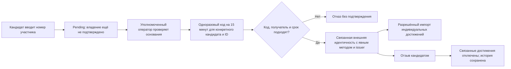

# ФСП ID и контракт реестра достижений

Выпуск **0.16.0**. Официальный API Федерации и доступ к общему провайдеру ФСП ID не предоставлены. Реализованы OIDC-клиент, ручной процесс проверки принадлежности ID и предложенный командой контракт реестра. Профиль **без истории ФСП участвует на общих основаниях аттестации**.

[OpenAPI](openapi.json), [полная механика](MECHANICS.md), [изолированный OIDC-мок](FSP_ID_MOCK.md), [проверки](VERIFICATION.md).

## Привязка введённого ID



`POST /api/fsp/link` сохраняет номер со статусом `pending`; это не создаёт достижений и не доказывает владение. Администратор после проверки выдаёт код конкретным `candidate_id` и `participant_id` через `/api/admin/fsp/proofs`. Код хранится хешем, живёт 15 минут, применяется один раз и не подходит другому кандидату.

`POST /api/fsp/confirm` фиксирует метод `authorized_one_time_proof`. В тестовом режиме статус и issuer остаются тестовыми. Ручное подтверждение в рабочем режиме подразумевает реальные проверяемые основания уполномоченного оператора; само наличие административной роли не доказывает связь с Федерацией.

## OIDC

`GET /api/fsp/oidc/start` начинает Authorization Code + PKCE S256 для уже вошедшего кандидата. Привязка не заменяет обычный вход сервиса. Callback возвращает в раздел ФСП ID.

Проверяются:

- server-configured issuer и discovery; endpoint не выбирается произвольным `jku` токена;
- зарегистрированный redirect URI и клиент;
- одноразовые `state`, `nonce` и код; состояние приложения живёт 10 минут;
- RS256 и ключ JWKS с нужным `kid`;
- `iss`, `aud`, `azp` при нескольких аудиториях, `exp`, `iat`, `sub`;
- непустой participant ID в настроенном claim.

Связь уникальна по provider/issuer/subject. Настройки: `FSP_OIDC_ISSUER`, `FSP_OIDC_CLIENT_ID`, необязательный `FSP_OIDC_CLIENT_SECRET`, `FSP_OIDC_PARTICIPANT_CLAIM` и `FSP_PUBLIC_URL`. URL задаёт оператор; нормальный внешний обмен использует HTTPS.

`FSP_OIDC_DEMO_ISSUER=1`, подтверждённый `fsp_mock` в discovery или токене дают тестовый статус. Тестовый провайдер не становится официальным только потому, что подпись криптографически корректна. [Отдельный совместимый с URL-схемой Keycloak mock](FSP_ID_MOCK.md) проверяет этот путь; промышленный Keycloak не объявляется установленным.

## Предложенная запись достижения

| Поле или группа | Назначение |
|---|---|
| `external_id` | Стабильный ID записи у конкретного issuer |
| Подтверждённая идентичность | Связь записи с кандидатом, не произвольный ввод пользователя |
| Название, соревнование, дата, результат | Контекст события с проверкой даты |
| Роль, `role_label`, `individual_evidence` | Отделение индивидуального основания от командного результата |
| `task_skills` | Известные навыки конкретной задачи, а не вывод из спортивного разряда |
| `sports_rank`, `source_url` | Дополнительные сведения и безопасная ссылка источника |
| Issuer, версия, active | Происхождение и текущая пригодность |

Командная победа и спортивный разряд сами по себе не подтверждают профессиональный стек. Только активное индивидуальное основание участвует в соответствующем компоненте подбора; оно не заменяет тестовую категорию. Нет достижений — нет фиктивного отрицательного вывода о навыке.

## Импорт и событие реестра

`POST /api/admin/fsp/registry/achievements` доступен администратору и требует уже подтверждённую идентичность. Запись маркируется `source=proposed_fsp_registry` и сохраняет issuer. Этот метод не выдаётся за официальный API Федерации.

Внешний вариант — `POST /api/integration-events/fsp-achievements`:

```json
{
  "schema_version": "fsp-registry-entry-v1",
  "event_id": "example-event-001",
  "issuer": "https://registry.example.org",
  "participant_id": "example-participant",
  "achievement": {
    "external_id": "example-result-001",
    "title": "Пример результата",
    "contest": "Тестовое соревнование",
    "date": "2026-10-01",
    "result": "Синтетический пример",
    "individual_evidence": false,
    "task_skills": [],
    "source_url": "https://registry.example.org/results/example-result-001"
  }
}
```

Это пример схемы, не настоящее достижение. Внешнее тело **не содержит `identity_id`**: сервер находит единственную подтверждённую связь по разрешённому issuer/participant. Нужны отдельный реестровый ключ, HMAC-SHA256, timestamp, окно ±300 секунд и тело не больше 8192 байт. Конфликт event ID с другим телом отвергается; одинаковый повтор возвращает прежний результат. Импорт существующего внешнего ID обновляет собственную запись.

В этом контракте нет отдельного внешнего webhook отзыва достижения. Кандидат может отозвать идентичность через `/api/fsp/identities/{id}/revoke`; связанные импортированные достижения становятся неактивными. История и выданные задания сохраняются; новый грейд автоматически не выдумывается, текущие объяснения и снимки подбора учитывают изменение источников.

## Проверка и пределы

Тесты проверяют невозможность присвоить чужой ID, одноразовость, сроки, PKCE, state/nonce, подпись, issuer/audience, неоднозначную связь, повтор события и отзыв. Эти проверки подтверждают протокол в разрешённом изолированном контуре. Они не подтверждают настоящий аккаунт Федерации, спортивный результат человека или качество его профессионального грейда.
