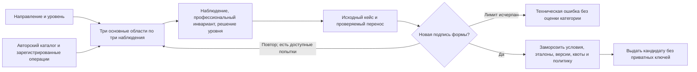

# Сборка заданий и необязательный нейропровайдер

Выпуск **0.16.0**. Главный маршрут аттестации — `work_sample_v3_balanced`, сборка — `balanced-core-2026-v3`, программа — `competencies-2026-10-v14`. **Действующие формы собираются из собственного проверяемого банка, `generator=balanced_owned_forms`, `neural_items=0`.** Ни включённый endpoint, ни наличие модели в lock-файле не означают её использование в текущей выдаче.

[Механика и схемы](MECHANICS.md), [план формы](ASSESSMENT_V3.md), [правила категории](ASSESSMENT_POLICY.md), [контракты](UNIVERSAL_INTEGRATIONS.md).

## Основная сборка v3

В каждой основной области отбираются три разные роли; форма чередует области. Недостаточный пул отклоняется, а не дополняется копиями для длины. Случайные ID и перестановка ответов не считаются разнообразием. Девять объективных заданий дополняются исходным кейсом, переносом и необязательным объяснением.

Подпись учитывает условия и эталоны. Перед активацией она сравнивается с последними 1000 попытками направления. При совпадении собирается новый вариант и проверяется снова; всего разрешены 5 сборок. Исчерпание даёт техническое сообщение без присвоения нулевого грейда. Контроль касается целой формы в ограниченном окне, не всех возможных смысловых совпадений каждого вопроса.

Банк конечен. Между формами и уровнями могут повторяться фундаментальные операции и инварианты. Нельзя обещать защиту от заучивания, одинаковую сложность или профессиональную валидность только потому, что условия параметризуются. Исторические формы сохраняют собственные правила, задания и подписи.

## Подключаемый нейрогенератор

Для отдельных экспериментальных или исторических путей код поддерживает Ollama, private llama.cpp `/completion` и универсальный `fsp-json-v1`. Они не заменяют сборку текущей v3. Провайдер создаёт **ограниченный контекст одного числового задания**, а не независимую программу проверки профессии или оценку кандидата.

Провайдер не получает резюме, имя, контакты, ответы кандидата и скрытые эталоны. Передаётся анонимное направление/уровень, описание предметного контекста и математические условия. Для llama.cpp и `fsp-json-v1` параметры заранее выбирает приложение; ответ не может изменить закреплённые `values`, `threshold`, `operation`. Эталон и балл вычисляются кодом.

Проверяются строгая схема, диапазоны, типы, значения по обе стороны порога, разнообразие чисел, отсутствие лишних полей, решений, метаинструкций и скопированного примера. Контекст должен содержать русский текст и завершённую фразу. Технические фильтры не заменяют содержательную проверку экспертом или пользователями.

Одновременно один процесс приложения обращается к провайдеру не более одного раза. Занятость, сеть, таймаут и непригодный ответ возвращают проверяемый резервный вариант с явной метаданной причины. Ожидание по умолчанию 30 секунд, настройка ограничена 45. Бесконечных повторов нет. Генератор не назначает кандидату неуспех из-за собственной недоступности.

`fsp-json-v1` передаёт `schema=fsp-generator-request-v1` и ожидает `fsp-generator-response-v1`. `mock=true` маркирует протокольный симулятор; его ответ не считается выполнением настоящей модели. [Полный транспорт](UNIVERSAL_INTEGRATIONS.md).

## Необязательный CPU-контейнер

`deploy/compose.generator.yaml` содержит профиль `generation`, закреплённый digest образа llama.cpp, непривилегированный UID, read-only модель, отдельный токен, лимиты памяти/CPU/процессов и отсутствие публичного порта. Это образ для отдельной разрешённой проверки, не обязательная часть запуска сервиса.

`data/generation_gguf_lock.json` фиксирует модель Qwen2.5-0.5B-Instruct-GGUF Q5_K_M, ревизию, размер и SHA-256. `scripts/download_generator_gguf.py` проверяет загрузку; веса не входят в Git или основной образ. Оператор подготавливает отдельный локальный каталог модели и защищённый файл токена по типовой конфигурации. URL и ключи не принимаются из пользовательского ввода.

Малая CPU-модель испытывалась технически, но наблюдённого качества русских контекстов оказалось недостаточно для основной выдачи. Активная v3 использует собственные формы без нейропровайдера. Наличие транспортного адаптера не доказывает пригодность модели, превосходство над банком или сопоставимость сложности.

## Валидация и следующий промышленный шаг

Автоматические проверки покрывают квоты, версии, повторы, приватность ключей, допустимые решения, отрицательные ответы и перенос. Синтетические эксперименты сравнивают длину формы и чувствительность политики на заданных моделях; они не измеряют профессиональный грейд человека.

Для будущего внедрения нейрогенерации нужны заранее заданные метрики содержательного качества, корректный независимый эталон, контроль области компетенции, сопоставимость вариантов, задержки и поведение при сбоях. Пороги текущей категории остаются пилотными; IRT — исследовательская гипотеза, а не встроенное доказательство. Условия проверок — [VERIFICATION.md](VERIFICATION.md).
