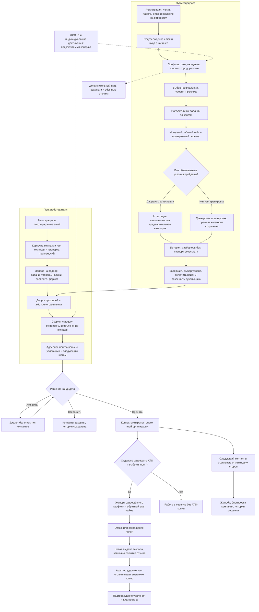
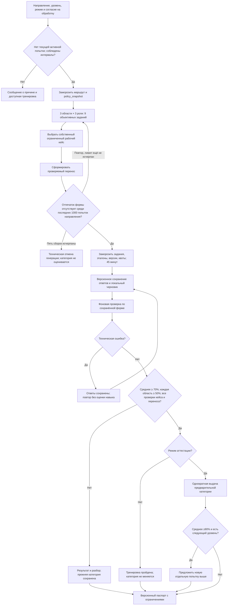
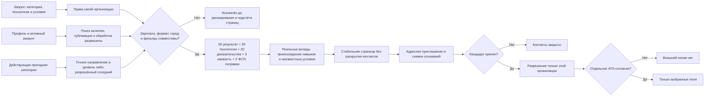

# Как работает ФСП Карьера

Действующий API **0.16.0**, схема БД **7**. Этот документ объясняет полный путь соискателя и работодателя, автоматическую аттестацию, подбор и правила передачи данных. [Архитектура и файлы](ARCHITECTURE.md) описаны отдельно.

ФСП Карьера связывает **проверенный в ограниченных заданиях результат** с **конкретными задачами и условиями работодателя**. Основной контакт начинается с адресного приглашения работодателя: публикация вакансии и предварительный отклик кандидата для этого не нужны. Кандидат сначала видит условия и решает, открывать ли контакты конкретной организации. Передача в её ATS требует ещё одного отдельного согласия.

## Полная механика



Схема не объявляет реальные ФСП ID, реестр достижений или коммерческую ATS подключёнными. Эти границы проверяются протокольными и интеграционными стендами. Рабочий результат аттестации имеет пилотную шкалу; это не подтверждённая на людях профессиональная квалификация.

## Путь кандидата

### 1. Аккаунт и личный кабинет

Новый пользователь выбирает роль кандидата, задаёт логин, пароль и email, отдельно принимает согласие на обработку. Письмо содержит одноразовую ссылку. До подтверждения email интерфейс показывает следующий шаг и повторную отправку; полноценная работа требует подтверждённого аккаунта. Вход доступен по логину или email. Существующие операторские аккаунты по логину сохраняют совместимость и не выдаются за аккаунты с подтверждённым email.

Раздел «Мой путь» показывает состояние профиля, категории и допуска к подбору. Основные действия — профиль, проверка навыков, приглашения и вакансии. В дополнительных разделах находятся паспорта, ФСП ID, отклики, регулярные кейсы, жалобы, уведомления и безопасность аккаунта. URL каждого раздела меняется; история браузера возвращает к предыдущему разделу кабинета.

Для проверки жюри подготовлены **обычные аккаунты с синтетическими профилями**. Вход и сохранённый пример позволяют воспроизвести пользовательский сценарий, но не удостоверяют квалификацию реального человека. Отдельные входы жюри не предоставляют административных прав; персональные аккаунты и приватные административные доступы не публикуются.

### 2. Профиль и происхождение навыков

Кандидат указывает специализацию, технологии, опыт, город, допустимые форматы работы, переезд, минимальную зарплату и собственное описание. Резюме можно загрузить для извлечения текста и навыков; импортированные сведения сохраняют происхождение. **Самоописание и извлечённый стек не превращаются в подтверждённые навыки автоматически.**

Профиль различает три основания: собственное заявление, наблюдение в конкретной проверке и индивидуальный внешний источник. Командное достижение без индивидуальной связи не становится доказательством навыка участника. ФСП ID привязывается отдельным процессом: введённый номер остаётся запросом до подтверждения владения.

Включение публикации не означает раскрытие телефона или почты всем работодателям. Текстовые поля редактируются при выдаче профиля без права контакта: контакты и распознаваемые контактные фрагменты скрываются. Доступ к собственному профилю и истории не зависит от его присутствия в подборе.

### 3. Выбор проверки

Поддерживаются Backend Python, Frontend TypeScript, QA, DevOps, ML и информационная безопасность; уровни Intern, Junior, Middle и Senior. Кандидат выбирает **направление, предполагаемый уровень и режим**:

- **Тренировка:** показывает задания, обратную связь и паспорт, но не выдаёт новую категорию и не меняет действующую.
- **Аттестация:** при успехе автоматически выдаёт предварительную категорию выбранного направления и уровня. Внешний эксперт не требуется для текущего автоматического маршрута.

После первой успешной аттестации кандидат может завершить выбор уровня и разрешить подбор либо сначала попробовать предложенный соседний уровень. Рекомендация не меняет категорию сама по себе. Неуспех, отмена и технический сбой не понижают ранее полученный результат.

### 4. Ответы и восстановление

Проверка показывает одно задание за раз, общий прогресс, таймер и состояние сохранения. После генерации срок активной попытки составляет **45 минут**. Номер задания, выбранная собственная попытка и локальный черновик восстанавливаются после перезагрузки; сервер отдельно хранит сохранённые ответы.

При потере сети черновик не считается отправленным: интерфейс показывает предупреждение, а восстановление связи позволяет повторить сохранение. При изменении той же попытки в другой вкладке сервер возвращает конфликт версии и требует обновить состояние. Завершение отправляет сохранённые ответы на фоновую проверку; пропущенный обязательный ответ не компенсируется объяснением.

После истечения времени новые ответы и финальная отправка не принимаются. Уже сохранённые ответы и история остаются доступными. Отмена требует подтверждения; только ещё генерируемая или активная попытка может отменяться обычным действием кандидата. Неожиданный сбой проверки возвращает попытку в доступное для восстановления состояние с техническим сообщением, а не выдаёт «0 баллов» как квалификационный вывод.

### 5. Результат и паспорт

Кандидат видит средний результат короткого теста, оценки трёх областей, проверки исходного артефакта и переноса, причину успеха или неуспеха и рекомендации. Выданная категория связана с конкретной попыткой. Историческая более ранняя попытка не перезаписывает более новую активную категорию.

Паспорт можно скачать в JSON и отдельно разрешить показ работодателям. В нём есть дата, область, запрошенный уровень, версии, число заданий, квоты, оценки, методы проверки, текущая активность категории и пределы доказательств. Ответы, скрытые эталоны, контакты и свободные заметки рецензента в паспорт не включаются. Хеш проверяется относительно авторизованного сервиса; он не является подписью ФСП.

### 6. Допуск к подбору

В подбор попадает активный аккаунт с завершённым выбором уровня, пригодной действующей категорией, включённым поиском работы, видимым профилем и согласиями на обработку и публикацию. Отозванная, повреждённая, отключённая или явно просроченная категория не используется. Отсутствие истории ФСП не закрывает участие.

Для каждой организации отдельно учитывается блокировка кандидатом. Отзыв обработки или публикации скрывает профиль, прекращает адресные контактные разрешения и отзывает передачу ATS. Исторические попытки и события не стираются из-за прекращения текущего доступа.

### 7. Приглашение и безопасность контакта

Приглашение заранее содержит компанию, условия работы, зарплату, сообщение работодателя, согласованный следующий шаг и срок его выполнения после принятия. Кандидат может посмотреть, уточнить, отклонить или принять. Уточнение не раскрывает контакты; в истории видны обе стороны диалога.

Принятие открывает контакты **только организации отправителя**, а не всему каталогу работодателей. ATS ещё не получает копию. Кандидат может разрешить передачу отдельно, выбрать поля, сократить их или отозвать разрешение. Работодатель отдельно отмечает контакт, назначенное интервью либо отправленное решение; кандидат отдельно подтверждает состоявшийся контакт или сообщает, что его не было. Отметка работодателя не становится автоматически подтверждённым наймом.

Жалобу можно отправить из кабинета по доступному связанному объекту; видны история, статус и обоснование решения модератора. Блокировка организации прекращает её новые действия и передачу данных. Автоматическая блокировка по одной спорной отметке контакта не выполняется.

## Как собирается и оценивается аттестация



### План формы

Новая форма имеет версию `balanced-core-2026-v3`; маршрут — `work_sample_v3_balanced`, политика — `grade-policy-v3-balanced`. В каждой области форма включает генерируемое наблюдение, профессиональный инвариант и решение с ограничениями выбранного уровня. Области чередуются, чтобы одна последовательность не заполняла всю форму.

| Направление | Три основные области |
|---|---|
| Backend Python | Обработка данных, SQL, контракты API |
| Frontend TypeScript | Обработка данных, асинхронное состояние, доступность |
| QA | Тест-дизайн, контракты API, воспроизведение ошибок |
| DevOps | Ресурсный бюджет, развёртывание, граф CI |
| ML | Метрики, разбиение данных, утечки |
| ИБ | Права на объекты, сетевые правила, минимальные привилегии |

Это **ограниченная область проверки**, а не полный перечень компетенций профессии. Сборка сохраняет квоты, уровень, роли, версии и основания в попытке. Собственный каталог и предметные операции не требуют копирования чужого банка собеседований или запуска нейросети.

В форме **9 объективных заданий**, затем один исходный рабочий артефакт, один проверяемый перенос и необязательное объяснение — всего **12 элементов маршрута**. «Двенадцать элементов» не означает двенадцать коротких вопросов. Экспериментальные формы с иной длиной в действующий маршрут не включены.

### Разнообразие и ограничения утечки

Сборка предпочитает разные структурные семейства и разные условия внутри семейства. Случайный ID и перестановка ответов не считаются новизной. Подпись формы учитывает условия и эталон; перед выдачей она сравнивается с последними 1000 попытками направления. Если обнаружен повтор, собирается новый вариант, который **проверяется снова**; после пяти неудачных сборок выдаётся техническое сообщение, категория не оценивается.

Существующий банк конечен. Некоторые предметные инварианты и фундаментальные вопросы могут повторяться между формами и уровнями. Описанная проверка снижает повтор всей формы, но не доказывает невозможность утечки, равную сложность вариантов или устойчивость к обучению на публичном каталоге. На основном стенде v3 использует `balanced_owned_forms`, `neural_items=0`; необязательный нейрогенератор не объявляется работающим источником текущих форм.

### Рабочие кейсы и перенос

Варианты выбираются из собственных ограниченных моделей v2, предметных моделей v3 и рабочих контекстов. Примеры: повтор и атомарность API, состояние независимых React-каналов, независимые ожидаемые ответы QA, ресурсы развёртывания, временное разбиение ML, объектная авторизация, резервирование остатков. Конкретное семейство зависит от направления и уровня; все семейства не обещаны для каждого сочетания.

В моделях v3 допустимы несколько корректных стратегий, если они проходят необходимые условия. Например, атомарная запись и transactional outbox проверяются по соответствующим контрактам; в React необходим контроль последнего выданного запроса, а одна отмена старого запроса не считается достаточной защитой. В QA принимаются разные достаточно полные наборы с независимыми ожиданиями и отрицательными проверками.

Эталон новых моделей вычисляется декларативными правилами `work_reference_v3.py`, проверяющая реализация воспроизводит переходы в `work_projects_v3.py`. Это независимость реализаций, а не независимая экспертная разметка.

Перенос меняет значимое ограничение: срок доступа, отдельный канал, null, временной снимок, стоимость ошибки или ресурсный бюджет. Для рабочего контекста partner-кейса перенос может проверяться **в другом контексте того же направления и уровня** с новым JSON-контрактом. Он не всегда является редактированием того же артефакта. Правильное повторное использование решения разрешено, если оно действительно проходит новые условия.

Ответ — ограниченный артефакт, преимущественно JSON с заданными полями, до 5000 символов. Проверяются нормальные и отрицательные условия, неизвестные стратегии, дубликаты ключей и полнота контрактов. Произвольный пользовательский Python или shell не исполняются. SQL-проверка имеет отдельный ограниченный процесс и временную SQLite в памяти, изолированную от PostgreSQL сервиса.

### Правило успеха и переходы

Пусть `S` — среднее баллов девяти коротких заданий, `D1..D3` — средние трёх областей, `W` и `X` — результаты всех обязательных проверок исходного кейса и переноса. Успех требует одновременно:

```text
S ≥ 70%
D1 ≥ 50%, D2 ≥ 50%, D3 ≥ 50%
квота каждой области заполнена ровно тремя наблюдениями
W = все проверки пройдены
X = все проверки пройдены
```

Для бинарных коротких ответов это не менее **7 из 9** и не менее **2 из 3** в каждой области. Высокий средний процент не компенсирует полностью слабую область, ошибку кейса или переноса. Балл сертификата — среднее короткого теста; обязательные рабочие проверки являются отдельными условиями, не добавочными процентами к нему.

| Ситуация | Изменение категории | Следующий шаг |
|---|---|---|
| Успешная аттестация | Предварительная категория выбранного уровня выдаётся один раз | Завершить первоначальный выбор уровня или продолжить его отдельной попыткой |
| Успех и `S ≥ 90%` | Автоматического повышения нет | Предложен следующий уровень, если он существует; при бинарном тесте 9/9 |
| Неуспех | Предыдущая категория сохраняется | Предложен соседний нижний уровень, если он существует; новая попытка отдельная |
| Успех или неуспех тренировки | Категория не меняется | Разобрать результат и практиковаться |
| Отмена или истечение | Новая категория не выдаётся | История сохранена; начать новую доступную попытку |
| Технический сбой | Категория не оценивается | Восстановить проверку; сохранённые ответы не подменяются нулём |
| Поздняя обработка старой попытки | Более новая категория не перезаписывается | Старый результат остаётся историческим |

После завершения первоначального выбора уровня переход доступен через **90 дней** от действующей категории. Повтор завершённой аттестации того же направления и уровня ограничен **24 часами**; практика доступна отдельно. Возраст результата влияет на подбор, но сам по себе не аннулирует категорию через 90 дней. Явный `expires_at` и отзыв проверяются отдельно.

Пороги 70/50/90, различия Intern/Junior/Middle/Senior и интервалы — **пилотная инженерная политика**. Они не откалиброваны на людях. IRT не используется для выдачи результата, балл не является вероятностью профессиональной пригодности. Дополнительное объяснение и ручной структурированный разбор сохраняются отдельно и не меняют автоматический успех v3. Старые v1/v2/legacy-попытки продолжают использовать собственные замороженные правила.

## Путь работодателя

### 1. Аккаунт, компания и полномочия

Работодатель регистрируется, подтверждает email и заполняет карточку организации или команды: описание, отрасль, контакт, правовое название либо название команды, сведения о команде, при наличии — домен и ИНН. Команда не выдаётся за юридическое лицо. Изменение существенных сведений возвращает карточку на проверку.

Администратор отдельно фиксирует основание проверки организации и полномочий её представителя. До подтверждения массовый контакт и создание ключа ATS ограничены. Проверка не объявляется автоматической сверкой со всеми государственными реестрами. Роли внутри организации — владелец, рекрутер и наблюдатель — дают разные действия; ключ ATS создаёт владелец.

### 2. Запрос на подбор

Запрос описывает реальную работу: название, задачи, специализацию, предполагаемый грейд, навыки, зарплатный диапазон и net/gross, формат, город, команду, способ связи и срок. Этот запрос не требует отдельной публичной вакансии. Подозрительные условия или ссылки направляют запись на модерацию; импорт ATS не обходит блокировку.

Текущий найм подтверждается работодателем и сохраняется на 14 дней, не дольше срока самого запроса. Просроченное подтверждение запрещает новые приглашения и принятие старого до обновления актуальности. Это заявление работодателя; оно не заменяет проверку компании и не доказывает существование найма. Повторное подтверждение не снимает модерацию и не возобновляет истёкшую публикацию.

### 3. Допуск и подбор



Сначала применяются права и явные ограничения. Для основного подбора нужны профиль, пригодная категория того же направления и выбранный грейд; соседний допускается только явным фильтром и только на один уровень. При нескольких пригодных категориях точное совпадение предпочитается соседнему, затем более новая запись. Блокировки и отказы в согласиях не компенсируются высоким баллом.

Нельзя выдавать кандидата при конфликте формата, города без согласия на переезд или сопоставимой зарплаты ниже ожиданий. Для gross неизвестная сопоставимость с net обозначается как неопределённость, а не выдуманный пересчёт. Недостаток доказательств не равен установленному отсутствию навыка.

### 4. Объяснимый скоринг `category-evidence-v2`

| Компонент | Расчёт и смысл | Максимум |
|---|---|---:|
| Результат категории | `0,55 × процент короткого теста` | 55 |
| Совпадение технологий | Доля требуемых навыков среди известных по самоописанию, проверке или индивидуальному источнику | 20 |
| Сила доказательств | Средний вес по требуемым навыкам: проверка 1 с поправкой давности; индивидуальный источник 0,75; одно заявление 0 | 20 |
| Свежесть | От 3 до 0 за 365 дней | 3 |
| Индивидуальные достижения ФСП | До двух активных индивидуальных источников | 2 |
| Соседняя категория | Только если разрешена фильтром | −8 |
| Неопределённые условия | По два балла за отмеченное неизвестное условие | −2 каждое |

Сумма ограничивается 0–100. Вес тестового наблюдения не уменьшается первые 90 дней, затем линейно снижается до нижней границы 0,5. Неизвестная или некорректная будущая дата не объявляется свежей проверкой. Политика давности не доказывает реальный темп утраты навыка.

Фактические вклады возвращаются в `score_components`; интерфейс показывает их вместе с происхождением навыков. Балл — **очки приоритета в данной выдаче**, а не `P(принятия)` или вероятность найма. Ни embeddings, ни LLM, ни IRT в основной формуле не используются. Возможности старого поиска вакансий и необязательного ML не подменяют этот маршрут.

### 5. Карточка, снимок и приглашение

Работодатель может уточнять фильтры, включать соседний грейд, просматривать объяснение и опубликованный паспорт. Сессия подбора сохраняет собственные фильтры и кадры истории. Восстановление пересчитывает актуальную выдачу, заново проверяет права и не добавляет фиктивный кадр.

При отправке приглашения создаётся паспорт-снимок условий, версии профиля, категории, источников и алгоритма. Он позволяет понять основание первоначального решения; при изменении данных помечается устаревшим. Снимок не становится правом на текущие контакты. Повтор отправки с тем же ключом и телом возвращает прежнее приглашение; изменение тела даёт конфликт.

Перед отправкой проверяются компания, срок запроса, актуальность найма, допуск кандидата, блокировки и дневной лимит. Кандидат видит зарплату и следующий шаг **до принятия**. Для создания такого контакта предварительный отклик не нужен.

### 6. Контакт и реальный результат взаимодействия

Срок обещанного следующего шага начинается после принятия. Работодатель отмечает контакт, интервью или решение; кандидат отдельно подтверждает либо оспаривает контакт. В кабинете показаны источник отметки и просрочка. Это измеримые события платформы, а не автоматически подтверждённое трудоустройство.

Если кандидат отзывает доступ к контактам, новые отметки и ATS-передача прекращаются. Старые события сохраняются. Смена этапа ATS показывается обеим сторонам в приглашении; она не заменяет статус принятия и согласия.

## Полный ATS-сценарий

```mermaid
sequenceDiagram
    actor E as Владелец организации
    actor C as Кандидат
    participant API as ФСП Карьера
    participant ATS as Клиент или адаптер ATS
    E->>API: Создать подключение: scopes и срок
    API-->>E: Секрет один раз; хранится хеш
    ATS->>API: Импорт запроса с external_id и Idempotency-Key
    API-->>ATS: Стабильный локальный ID
    E->>API: Пригласить кандидата
    ATS->>API: Получить профили
    API-->>ATS: Этот профиль недоступен
    C->>API: Принять приглашение
    ATS->>API: Получить профили
    API-->>ATS: Всё ещё недоступен без отдельного согласия
    C->>API: Разрешить ATS и выбрать поля
    ATS->>API: Получить разрешённое представление
    API-->>ATS: Только выбранные поля и ID приглашения
    ATS->>ATS: Создать или обновить собственную копию
    ATS->>API: Обратный этап с Idempotency-Key
    API-->>E: Этап в приглашении
    API-->>C: Этап в приглашении
    ATS->>API: Повтор того же события
    API-->>ATS: Прежний ответ без дубля
    C->>API: Отозвать передачу или сократить поля
    API->>API: Закрыть следующую выдачу; событие отзыва
    ATS->>API: Получить журнал с cursor
    API-->>ATS: consent_revoked, awaiting_ack
    ATS->>ATS: Удалить или ограничить собственную копию
    ATS->>API: ACK: deleted=true
    API-->>E: acknowledged; незавершённых отзывов нет
```

Универсальный ATS API позволяет любой системе реализовать контракт напрямую либо через адаптер. **Создание ключа разрешает доступ, но не пишет готовый адаптер к произвольному поставщику.** Реализован первый Odoo Recruitment-адаптер с отдельным модулем; в изолированном тесте проверяется настоящий API Odoo на синтетических данных. Это не подключение к ATS партнёра.

Передаваемые поля выбираются кандидатом из `name`, `title`, `contacts`, `categories`, `skills`, `city`, `experience_years`. Исходное резюме, ответы, задания, свободное bio и скрытые эталоны не передаются. Профиль выдаётся только по принятому приглашению той же организации, с актуальным ATS-согласием, контактом и обработкой.

Машинный API имеет организационные scopes: импорт запросов, чтение профилей, запись этапов и чтение событий. Идемпотентность проверяет ключ и тело: одинаковый повтор безопасен, другое тело возвращает 409. Cursor событий сохраняется клиентом. Для полной сверки профилей обход выполняется заново; пустая страница ещё не означает конец, если `has_more=true`.

Отзыв создаёт долговечное событие без контактных данных. Оно не исчезает от чтения журнала. Адаптер сначала удаляет или ограничивает прежнюю копию, затем подтверждает это через ACK; потерянный ответ допускает повтор. При сокращении полей после обработки отзыва можно получить новое актуальное представление.

Диагностика показывает последнюю активность API, запуск, успешное обновление, ошибки, срок ключа и неподтверждённые отзывы. ACK является **заявлением клиента**: сам сервис не может доказать удаление всех независимых копий внутри чужой компании. Проверяемый эталонный получатель позволяет подтвердить удаление его копии, а не обещать тотальную защиту чужой ATS.

## Связь с Федерацией

Профиль поддерживает ID участника, подтверждаемую внешнюю идентичность и индивидуальные достижения. Реализован OIDC-клиент с PKCE S256, state, nonce, JWKS/RS256, issuer и audience, а также контракт входящих подписанных событий реестра. Самостоятельно введённый номер не подтверждает принадлежность аккаунта.

Для проверки поставляется изолированный провайдер с URL-путями, совместимыми с Keycloak. Его подписанный ответ остаётся явно тестовым; протокол не выдаёт настоящую спортивную квалификацию. Это mock-интеграция, предусмотренная для проверки без партнёрских доступов; промышленный общий Keycloak не установлен.

Индивидуальный источник может участвовать в доказательствах подбора, но не компенсирует отсутствие действующей тестовой категории. Официальный реестр Федерации не предоставлен и не объявляется подключённым. [Контракт ФСП](FSP_CONTRACT.md), [OIDC-стенд](FSP_ID_MOCK.md).

## Дополнительные пути и модерация

Каталог вакансий, обычные отклики и регулярные кейсы сохраняются как дополнительные пути. Обычный отклик требует собственного адресного согласия на контакт; он не открывает контакты всему рынку. Работодатель может вести отклик и отзыв отдельно от независимого приглашения. Оценка регулярного кейса не присваивает категорию автоматически.

Защита от недобросовестных работодателей включает проверку организации и полномочий, риск-сигналы запроса, модерацию вакансий и запросов, актуальность найма, лимиты приглашений, жалобы с решениями, блокировку организации кандидатом и отзыв ATS. Эти механизмы уменьшают риск, но не гарантируют отсутствие фиктивной позиции или мошенничества.

Администрирование пользователей включает просмотр, блокировку, управление правами, отзыв сессий, восстановление доступа и журнал действий. Последнего активного администратора нельзя отключить обычной операцией. Администратор и модератор имеют разные полномочия; служебные действия не выдаются за действия кандидата или работодателя.

## Что доказано и чего пока нельзя утверждать

| Уровень доказательств | Что относится к нему |
|---|---|
| Техническая корректность | Автоматические API-проверки, ограничения прав, версии, паспорта, сохранение, обратный ATS-этап, повтор и отзыв; браузерный путь и адаптивные размеры |
| Синтетическая валидация | Условные профили и эталоны, чувствительность порогов, сравнение политики подбора на одинаковых подготовленных данных, проверка разнообразия формы |
| Проверка на людях | Независимость выполнения, устойчивость результатов, профессиональная валидность уровней, справедливость между группами и реальные результаты найма; в текущем прототипе не подтверждены |

Подробные условия и пределы проверок находятся в [VERIFICATION.md](VERIFICATION.md), правила — в [ASSESSMENT_POLICY.md](ASSESSMENT_POLICY.md), формула — в [MATCHING_V2.md](MATCHING_V2.md), API — в [API.md](API.md). При демонстрации подготовленных аккаунтов необходимо обозначать учебные данные и автоматический способ проверки. Нельзя называть их человеческим пилотом, реальным трудоустройством или откалиброванной квалификацией.
