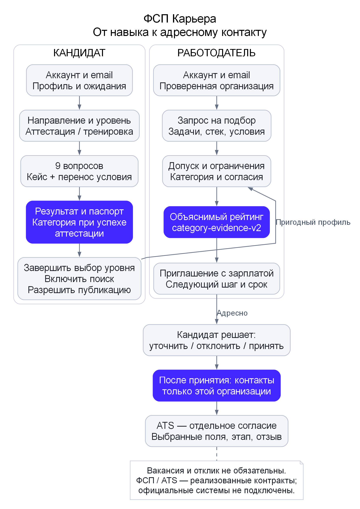
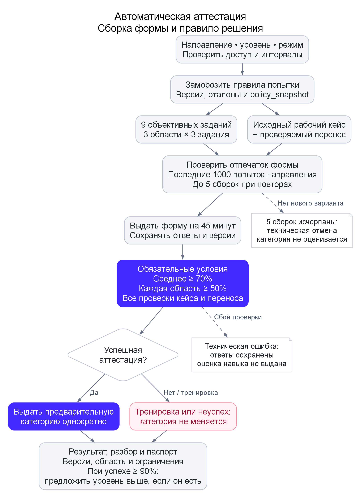
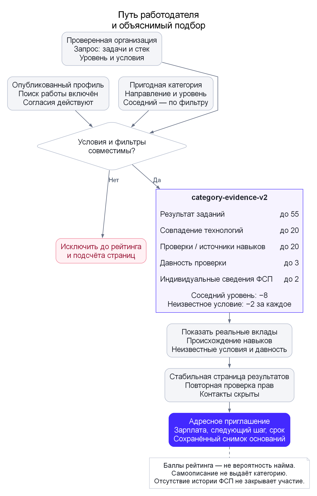
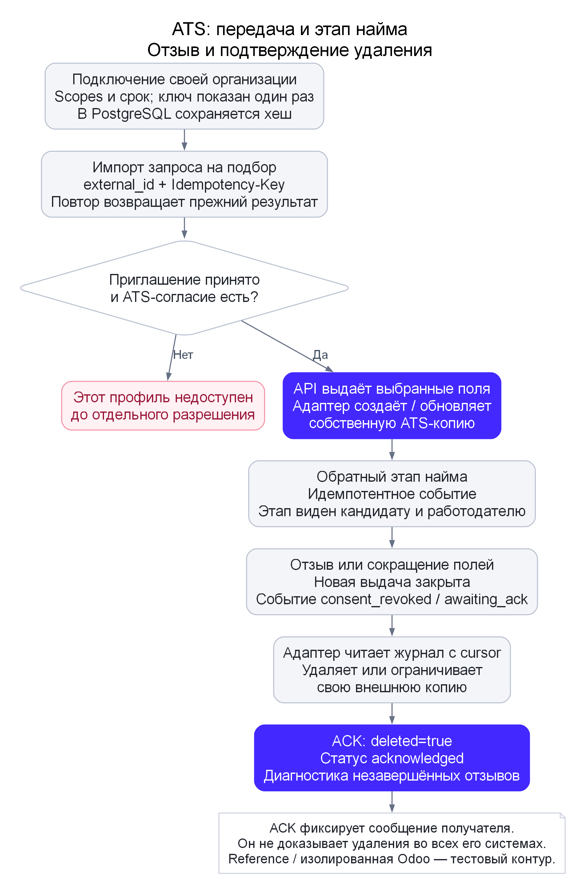
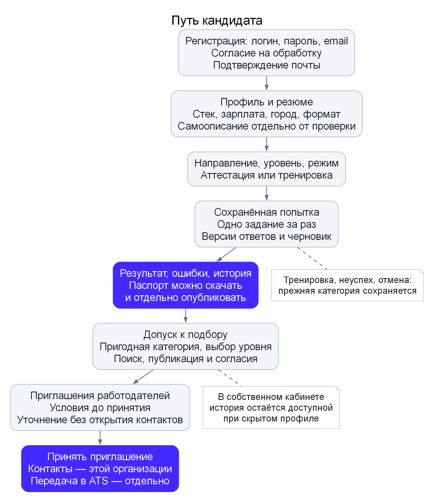
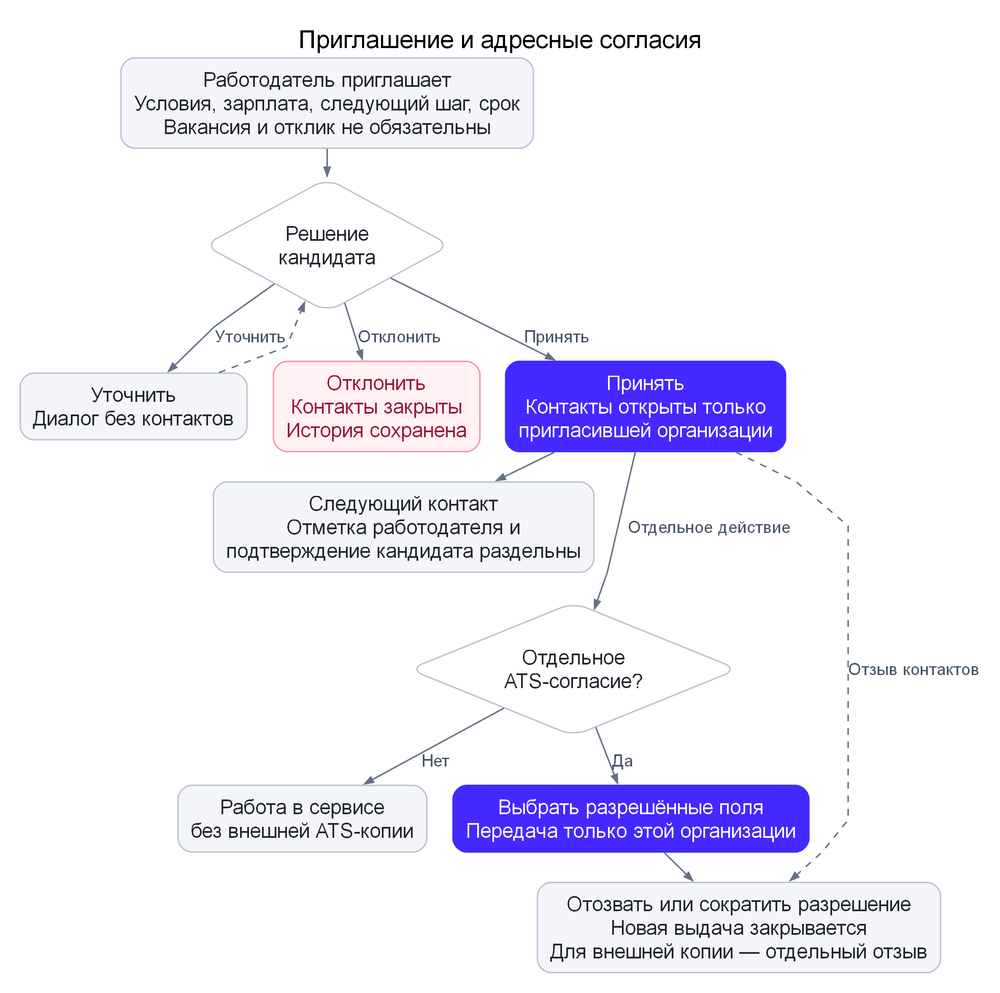
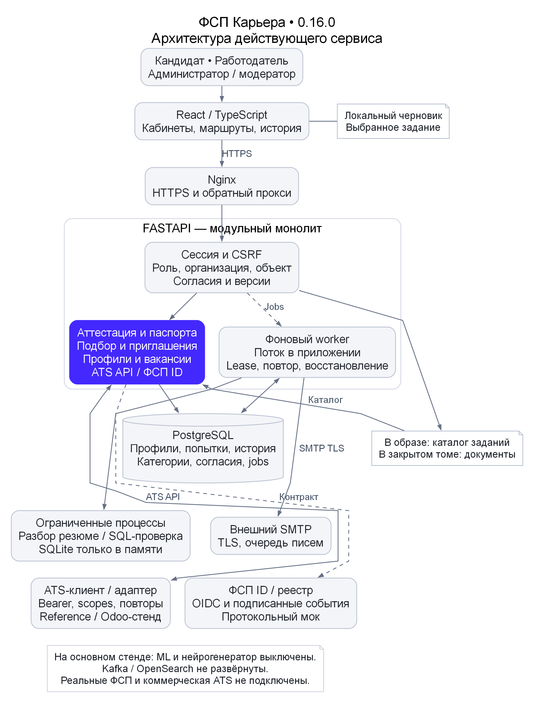

# ФСП Карьера

Руководство по сервису и техническая документация

API 0.16.0 · PostgreSQL schema 7 · 11 октября 2026 года

Сервис: https://pzs-fsp-career.duckdns.org/

## 1 Как читать руководство

Для знакомства начните с раздела 2: там приведены разрешённые публичные тестовые входы и короткий маршрут. Разделы 3–7 объясняют механики без обращения к внутренним рабочим заметкам. Разделы 8–10 показывают конкретные задания. Разделы 11–20 описывают обмен, безопасность, API и воспроизводимый запуск.

Категория относится к ограниченной области задания и его версии. В действующей системе нет эмпирически откалиброванной IRT-шкалы или вероятности успешного найма. Оценка подбора — объяснимый инженерный балл; самоописание, объективные наблюдения и официальные достижения учитываются раздельно.

Новые пользователи подтверждают email. Входы жюри выданы оператором для отдельной искусственной компании, без административных прав. Действия в них сохраняются; для независимого полного прохождения можно создать собственный аккаунт.

## 2 Входы и быстрый маршрут для жюри

Откройте **https://pzs-fsp-career.duckdns.org/** и введите логин и пароль. Это отдельные тестовые пароли, созданные только для подготовленных аккаунтов конкурсного стенда. Административных прав у них нет.

| Кабинет | Логин | Пароль | Что посмотреть |
|---|---|---|---|
| Кандидат Backend | `jury.backend` | `JuryBackend!2026-FSP` | Профиль, предварительная категория Middle, история успешной аттестации и тренировок, опубликованный паспорт, уточнение условий приглашения |
| Кандидат QA | `jury.qa` | `JuryQA!2026-FSP` | Предварительная категория Junior, принятое приглашение, отдельное ATS-согласие, этап найма и история подтверждённого учебного контакта |
| Работодатель | `jury.employer` | `JuryEmployer!2026-FSP` | Команда «Пермский звериный стиль», два учебных запроса, подбор кандидатов, объяснения, приглашения и диагностика ATS |

Профили и результаты заданий подготовлены программным проверочным сценарием. Они показывают работу сервиса и не подтверждают квалификацию человека. Запросы и приглашения учебные; реальный найм не проводится. Тестовая компания видит только выделенные для неё тестовые профили. Реальные пользователи и административный доступ в эти кабинеты не входят.

### Маршрут знакомства за пять минут

1. Войдите как `jury.backend`. В разделе «Мой профиль» сравните самоописание и результаты заданий. Через «Мой путь» откройте паспорт: видны область, дата, версия и пределы проверки.
2. Откройте «Проверка навыков». В истории успешной попытки посмотрите короткие задания, рабочий артефакт и перенос на изменённое условие. Для самостоятельной практики выберите тренировку: она сохраняет текущую категорию.
3. Выйдите и войдите как `jury.employer`. Откройте «Поиск кандидатов», выберите запрос Backend и нажмите «Найти кандидатов». Сравните причины подбора и подтверждённые либо заявленные сведения. До принятия приглашения контакты Backend закрыты.
4. Откройте «Приглашения». Для Backend сохранены вопрос кандидата и ответ работодателя; для QA — принятие и история учебного контакта. Зарплата и следующий шаг известны до принятия.
5. Откройте «ATS». Посмотрите отдельное согласие, актуальный этап, синхронизацию и подтверждение удаления ранее отозванной копии. Это проверяемый мок-контур универсального API, а не подключённая коммерческая ATS.
6. При необходимости войдите как `jury.qa`: в приглашении видны ATS-этап и отдельная кнопка отзыва передачи. Отзыв контактов и отзыв передачи в ATS — разные действия.
### Самостоятельный проход

Общие аккаунты сохраняют действия проверяющих: новая тренировка, сообщение или отзыв согласия может изменить экран следующего посетителя. История не сбрасывается автоматически.

Для независимого полного прохождения создайте собственный аккаунт кандидата или работодателя через «Создать аккаунт» и подтвердите email. Подготовленные входы по логину выданы оператором; они не заменяют подтверждение адреса при новой регистрации. Новый работодатель представляет свою организацию или команду и отправляет сведения на проверку, после которой открываются приглашения.

Подробный путь каждой роли: [руководство](https://github.com/onedanoken/pzs-fsp-career-service/blob/master/docs/SERVICE_GUIDE.md). Правила аттестации, подбора и согласий: [механика](https://github.com/onedanoken/pzs-fsp-career-service/blob/master/docs/MECHANICS.md).

## 3 Полная механика сервиса

Действующий API **0.16.0**, схема БД **7**. Этот документ объясняет полный путь соискателя и работодателя, автоматическую аттестацию, подбор и правила передачи данных. [Архитектура и файлы](https://github.com/onedanoken/pzs-fsp-career-service/blob/master/docs/ARCHITECTURE.md) описаны отдельно.

ФСП Карьера связывает **проверенный в ограниченных заданиях результат** с **конкретными задачами и условиями работодателя**. Основной контакт начинается с адресного приглашения работодателя: публикация вакансии и предварительный отклик кандидата для этого не нужны. Кандидат сначала видит условия и решает, открывать ли контакты конкретной организации. Передача в её ATS требует ещё одного отдельного согласия.



Схема не объявляет реальные ФСП ID, реестр достижений или коммерческую ATS подключёнными. Эти границы проверяются протокольными и интеграционными стендами. Рабочий результат аттестации имеет пилотную шкалу; это не подтверждённая на людях профессиональная квалификация.

### Путь кандидата

#### 1. Аккаунт и личный кабинет

Новый пользователь выбирает роль кандидата, задаёт логин, пароль и email, отдельно принимает согласие на обработку. Письмо содержит одноразовую ссылку. До подтверждения email интерфейс показывает следующий шаг и повторную отправку; полноценная работа требует подтверждённого аккаунта. Вход доступен по логину или email. Существующие операторские аккаунты по логину сохраняют совместимость и не выдаются за аккаунты с подтверждённым email.

Раздел «Мой путь» показывает состояние профиля, категории и допуска к подбору. Основные действия — профиль, проверка навыков, приглашения и вакансии. В дополнительных разделах находятся паспорта, ФСП ID, отклики, регулярные кейсы, жалобы, уведомления и безопасность аккаунта. URL каждого раздела меняется; история браузера возвращает к предыдущему разделу кабинета.

Для проверки жюри подготовлены **обычные аккаунты с синтетическими профилями**. Вход и сохранённый пример позволяют воспроизвести пользовательский сценарий, но не удостоверяют квалификацию реального человека. Отдельные входы жюри не предоставляют административных прав; персональные аккаунты и приватные административные доступы не публикуются.

#### 2. Профиль и происхождение навыков

Кандидат указывает специализацию, технологии, опыт, город, допустимые форматы работы, переезд, минимальную зарплату и собственное описание. Резюме можно загрузить для извлечения текста и навыков; импортированные сведения сохраняют происхождение. **Самоописание и извлечённый стек не превращаются в подтверждённые навыки автоматически.**

Профиль различает три основания: собственное заявление, наблюдение в конкретной проверке и индивидуальный внешний источник. Командное достижение без индивидуальной связи не становится доказательством навыка участника. ФСП ID привязывается отдельным процессом: введённый номер остаётся запросом до подтверждения владения.

Включение публикации не означает раскрытие телефона или почты всем работодателям. Текстовые поля редактируются при выдаче профиля без права контакта: контакты и распознаваемые контактные фрагменты скрываются. Доступ к собственному профилю и истории не зависит от его присутствия в подборе.

#### 3. Выбор проверки

Поддерживаются Backend Python, Frontend TypeScript, QA, DevOps, ML и информационная безопасность; уровни Intern, Junior, Middle и Senior. Кандидат выбирает **направление, предполагаемый уровень и режим**:

- **Тренировка:** показывает задания, обратную связь и паспорт, но не выдаёт новую категорию и не меняет действующую.
- **Аттестация:** при успехе автоматически выдаёт предварительную категорию выбранного направления и уровня. Внешний эксперт не требуется для текущего автоматического маршрута.
После первой успешной аттестации кандидат может завершить выбор уровня и разрешить подбор либо сначала попробовать предложенный соседний уровень. Рекомендация не меняет категорию сама по себе. Неуспех, отмена и технический сбой не понижают ранее полученный результат.

#### 4. Ответы и восстановление

Проверка показывает одно задание за раз, общий прогресс, таймер и состояние сохранения. После генерации срок активной попытки составляет **45 минут**. Номер задания, выбранная собственная попытка и локальный черновик восстанавливаются после перезагрузки; сервер отдельно хранит сохранённые ответы.

При потере сети черновик не считается отправленным: интерфейс показывает предупреждение, а восстановление связи позволяет повторить сохранение. При изменении той же попытки в другой вкладке сервер возвращает конфликт версии и требует обновить состояние. Завершение отправляет сохранённые ответы на фоновую проверку; пропущенный обязательный ответ не компенсируется объяснением.

После истечения времени новые ответы и финальная отправка не принимаются. Уже сохранённые ответы и история остаются доступными. Отмена требует подтверждения; только ещё генерируемая или активная попытка может отменяться обычным действием кандидата. Неожиданный сбой проверки возвращает попытку в доступное для восстановления состояние с техническим сообщением, а не выдаёт «0 баллов» как квалификационный вывод.

#### 5. Результат и паспорт

Кандидат видит средний результат короткого теста, оценки трёх областей, проверки исходного артефакта и переноса, причину успеха или неуспеха и рекомендации. Выданная категория связана с конкретной попыткой. Историческая более ранняя попытка не перезаписывает более новую активную категорию.

Паспорт можно скачать в JSON и отдельно разрешить показ работодателям. В нём есть дата, область, запрошенный уровень, версии, число заданий, квоты, оценки, методы проверки, текущая активность категории и пределы доказательств. Ответы, скрытые эталоны, контакты и свободные заметки рецензента в паспорт не включаются. Хеш проверяется относительно авторизованного сервиса; он не является подписью ФСП.

#### 6. Допуск к подбору

В подбор попадает активный аккаунт с завершённым выбором уровня, пригодной действующей категорией, включённым поиском работы, видимым профилем и согласиями на обработку и публикацию. Отозванная, повреждённая, отключённая или явно просроченная категория не используется. Отсутствие истории ФСП не закрывает участие.

Для каждой организации отдельно учитывается блокировка кандидатом. Отзыв обработки или публикации скрывает профиль, прекращает адресные контактные разрешения и отзывает передачу ATS. Исторические попытки и события не стираются из-за прекращения текущего доступа.

#### 7. Приглашение и безопасность контакта

Приглашение заранее содержит компанию, условия работы, зарплату, сообщение работодателя, согласованный следующий шаг и срок его выполнения после принятия. Кандидат может посмотреть, уточнить, отклонить или принять. Уточнение не раскрывает контакты; в истории видны обе стороны диалога.

Принятие открывает контакты **только организации отправителя**, а не всему каталогу работодателей. ATS ещё не получает копию. Кандидат может разрешить передачу отдельно, выбрать поля, сократить их или отозвать разрешение. Работодатель отдельно отмечает контакт, назначенное интервью либо отправленное решение; кандидат отдельно подтверждает состоявшийся контакт или сообщает, что его не было. Отметка работодателя не становится автоматически подтверждённым наймом.

Жалобу можно отправить из кабинета по доступному связанному объекту; видны история, статус и обоснование решения модератора. Блокировка организации прекращает её новые действия и передачу данных. Автоматическая блокировка по одной спорной отметке контакта не выполняется.



#### План формы

Новая форма имеет версию `balanced-core-2026-v3`; маршрут — `work_sample_v3_balanced`, политика — `grade-policy-v3-balanced`. В каждой области форма включает генерируемое наблюдение, профессиональный инвариант и решение с ограничениями выбранного уровня. Области чередуются, чтобы одна последовательность не заполняла всю форму.

| Направление | Три основные области |
|---|---|
| Backend Python | Обработка данных, SQL, контракты API |
| Frontend TypeScript | Обработка данных, асинхронное состояние, доступность |
| QA | Тест-дизайн, контракты API, воспроизведение ошибок |
| DevOps | Ресурсный бюджет, развёртывание, граф CI |
| ML | Метрики, разбиение данных, утечки |
| ИБ | Права на объекты, сетевые правила, минимальные привилегии |

Это **ограниченная область проверки**, а не полный перечень компетенций профессии. Сборка сохраняет квоты, уровень, роли, версии и основания в попытке. Собственный каталог и предметные операции не требуют копирования чужого банка собеседований или запуска нейросети.

В форме **9 объективных заданий**, затем один исходный рабочий артефакт, один проверяемый перенос и необязательное объяснение — всего **12 элементов маршрута**. «Двенадцать элементов» не означает двенадцать коротких вопросов. Экспериментальные формы с иной длиной в действующий маршрут не включены.

#### Разнообразие и ограничения утечки

Сборка предпочитает разные структурные семейства и разные условия внутри семейства. Случайный ID и перестановка ответов не считаются новизной. Подпись формы учитывает условия и эталон; перед выдачей она сравнивается с последними 1000 попытками направления. Если обнаружен повтор, собирается новый вариант, который **проверяется снова**; после пяти неудачных сборок выдаётся техническое сообщение, категория не оценивается.

Существующий банк конечен. Некоторые предметные инварианты и фундаментальные вопросы могут повторяться между формами и уровнями. Описанная проверка снижает повтор всей формы, но не доказывает невозможность утечки, равную сложность вариантов или устойчивость к обучению на публичном каталоге. На основном стенде v3 использует `balanced_owned_forms`, `neural_items=0`; необязательный нейрогенератор не объявляется работающим источником текущих форм.

#### Рабочие кейсы и перенос

Варианты выбираются из собственных ограниченных моделей v2, предметных моделей v3 и рабочих контекстов. Примеры: повтор и атомарность API, состояние независимых React-каналов, независимые ожидаемые ответы QA, ресурсы развёртывания, временное разбиение ML, объектная авторизация, резервирование остатков. Конкретное семейство зависит от направления и уровня; все семейства не обещаны для каждого сочетания.

В моделях v3 допустимы несколько корректных стратегий, если они проходят необходимые условия. Например, атомарная запись и transactional outbox проверяются по соответствующим контрактам; в React необходим контроль последнего выданного запроса, а одна отмена старого запроса не считается достаточной защитой. В QA принимаются разные достаточно полные наборы с независимыми ожиданиями и отрицательными проверками.

Эталон новых моделей вычисляется декларативными правилами `work_reference_v3.py`, проверяющая реализация воспроизводит переходы в `work_projects_v3.py`. Это независимость реализаций, а не независимая экспертная разметка.

Перенос меняет значимое ограничение: срок доступа, отдельный канал, null, временной снимок, стоимость ошибки или ресурсный бюджет. Для рабочего контекста partner-кейса перенос может проверяться **в другом контексте того же направления и уровня** с новым JSON-контрактом. Он не всегда является редактированием того же артефакта. Правильное повторное использование решения разрешено, если оно действительно проходит новые условия.

Ответ — ограниченный артефакт, преимущественно JSON с заданными полями, до 5000 символов. Проверяются нормальные и отрицательные условия, неизвестные стратегии, дубликаты ключей и полнота контрактов. Произвольный пользовательский Python или shell не исполняются. SQL-проверка имеет отдельный ограниченный процесс и временную SQLite в памяти, изолированную от PostgreSQL сервиса.

#### Правило успеха и переходы

Пусть `S` — среднее баллов девяти коротких заданий, `D1..D3` — средние трёх областей, `W` и `X` — результаты всех обязательных проверок исходного кейса и переноса. Успех требует одновременно:

```text
S ≥ 70%
D1 ≥ 50%, D2 ≥ 50%, D3 ≥ 50%
квота каждой области заполнена ровно тремя наблюдениями
W = все проверки пройдены
X = все проверки пройдены
```

Для бинарных коротких ответов это не менее **7 из 9** и не менее **2 из 3** в каждой области. Высокий средний процент не компенсирует полностью слабую область, ошибку кейса или переноса. Балл сертификата — среднее короткого теста; обязательные рабочие проверки являются отдельными условиями, не добавочными процентами к нему.

| Ситуация | Изменение категории | Следующий шаг |
|---|---|---|
| Успешная аттестация | Предварительная категория выбранного уровня выдаётся один раз | Завершить первоначальный выбор уровня или продолжить его отдельной попыткой |
| Успех и `S ≥ 90%` | Автоматического повышения нет | Предложен следующий уровень, если он существует; при бинарном тесте 9/9 |
| Неуспех | Предыдущая категория сохраняется | Предложен соседний нижний уровень, если он существует; новая попытка отдельная |
| Успех или неуспех тренировки | Категория не меняется | Разобрать результат и практиковаться |
| Отмена или истечение | Новая категория не выдаётся | История сохранена; начать новую доступную попытку |
| Технический сбой | Категория не оценивается | Восстановить проверку; сохранённые ответы не подменяются нулём |
| Поздняя обработка старой попытки | Более новая категория не перезаписывается | Старый результат остаётся историческим |

После завершения первоначального выбора уровня переход доступен через **90 дней** от действующей категории. Повтор завершённой аттестации того же направления и уровня ограничен **24 часами**; практика доступна отдельно. Возраст результата влияет на подбор, но сам по себе не аннулирует категорию через 90 дней. Явный `expires_at` и отзыв проверяются отдельно.

Пороги 70/50/90, различия Intern/Junior/Middle/Senior и интервалы — **пилотная инженерная политика**. Они не откалиброваны на людях. IRT не используется для выдачи результата, балл не является вероятностью профессиональной пригодности. Дополнительное объяснение и ручной структурированный разбор сохраняются отдельно и не меняют автоматический успех v3. Старые v1/v2/legacy-попытки продолжают использовать собственные замороженные правила.

### Путь работодателя

#### 1. Аккаунт, компания и полномочия

Работодатель регистрируется, подтверждает email и заполняет карточку организации или команды: описание, отрасль, контакт, правовое название либо название команды, сведения о команде, при наличии — домен и ИНН. Команда не выдаётся за юридическое лицо. Изменение существенных сведений возвращает карточку на проверку.

Администратор отдельно фиксирует основание проверки организации и полномочий её представителя. До подтверждения массовый контакт и создание ключа ATS ограничены. Проверка не объявляется автоматической сверкой со всеми государственными реестрами. Роли внутри организации — владелец, рекрутер и наблюдатель — дают разные действия; ключ ATS создаёт владелец.

#### 2. Запрос на подбор

Запрос описывает реальную работу: название, задачи, специализацию, предполагаемый грейд, навыки, зарплатный диапазон и net/gross, формат, город, команду, способ связи и срок. Этот запрос не требует отдельной публичной вакансии. Подозрительные условия или ссылки направляют запись на модерацию; импорт ATS не обходит блокировку.

Текущий найм подтверждается работодателем и сохраняется на 14 дней, не дольше срока самого запроса. Просроченное подтверждение запрещает новые приглашения и принятие старого до обновления актуальности. Это заявление работодателя; оно не заменяет проверку компании и не доказывает существование найма. Повторное подтверждение не снимает модерацию и не возобновляет истёкшую публикацию.



Сначала применяются права и явные ограничения. Для основного подбора нужны профиль, пригодная категория того же направления и выбранный грейд; соседний допускается только явным фильтром и только на один уровень. При нескольких пригодных категориях точное совпадение предпочитается соседнему, затем более новая запись. Блокировки и отказы в согласиях не компенсируются высоким баллом.

Нельзя выдавать кандидата при конфликте формата, города без согласия на переезд или сопоставимой зарплаты ниже ожиданий. Для gross неизвестная сопоставимость с net обозначается как неопределённость, а не выдуманный пересчёт. Недостаток доказательств не равен установленному отсутствию навыка.

#### 4. Объяснимый скоринг `category-evidence-v2`

| Компонент | Расчёт и смысл | Максимум |
|---|---|---:|
| Результат категории | `0,55 × процент короткого теста` | 55 |
| Совпадение технологий | Доля требуемых навыков среди известных по самоописанию, проверке или индивидуальному источнику | 20 |
| Сила доказательств | Средний вес по требуемым навыкам: проверка 1 с поправкой давности; индивидуальный источник 0,75; одно заявление 0 | 20 |
| Свежесть | От 3 до 0 за 365 дней | 3 |
| Индивидуальные достижения ФСП | До двух активных индивидуальных источников | 2 |
| Соседняя категория | Только если разрешена фильтром | −8 |
| Неопределённые условия | По два балла за отмеченное неизвестное условие | −2 каждое |

Сумма ограничивается 0–100. Вес тестового наблюдения не уменьшается первые 90 дней, затем линейно снижается до нижней границы 0,5. Неизвестная или некорректная будущая дата не объявляется свежей проверкой. Политика давности не доказывает реальный темп утраты навыка.

Фактические вклады возвращаются в `score_components`; интерфейс показывает их вместе с происхождением навыков. Балл — **очки приоритета в данной выдаче**, а не `P(принятия)` или вероятность найма. Ни embeddings, ни LLM, ни IRT в основной формуле не используются. Возможности старого поиска вакансий и необязательного ML не подменяют этот маршрут.

#### 5. Карточка, снимок и приглашение

Работодатель может уточнять фильтры, включать соседний грейд, просматривать объяснение и опубликованный паспорт. Сессия подбора сохраняет собственные фильтры и кадры истории. Восстановление пересчитывает актуальную выдачу, заново проверяет права и не добавляет фиктивный кадр.

При отправке приглашения создаётся паспорт-снимок условий, версии профиля, категории, источников и алгоритма. Он позволяет понять основание первоначального решения; при изменении данных помечается устаревшим. Снимок не становится правом на текущие контакты. Повтор отправки с тем же ключом и телом возвращает прежнее приглашение; изменение тела даёт конфликт.

Перед отправкой проверяются компания, срок запроса, актуальность найма, допуск кандидата, блокировки и дневной лимит. Кандидат видит зарплату и следующий шаг **до принятия**. Для создания такого контакта предварительный отклик не нужен.

#### 6. Контакт и реальный результат взаимодействия

Срок обещанного следующего шага начинается после принятия. Работодатель отмечает контакт, интервью или решение; кандидат отдельно подтверждает либо оспаривает контакт. В кабинете показаны источник отметки и просрочка. Это измеримые события платформы, а не автоматически подтверждённое трудоустройство.

Если кандидат отзывает доступ к контактам, новые отметки и ATS-передача прекращаются. Старые события сохраняются. Смена этапа ATS показывается обеим сторонам в приглашении; она не заменяет статус принятия и согласия.



Универсальный ATS API позволяет любой системе реализовать контракт напрямую либо через адаптер. **Создание ключа разрешает доступ, но не пишет готовый адаптер к произвольному поставщику.** Реализован первый Odoo Recruitment-адаптер с отдельным модулем; в изолированном тесте проверяется настоящий API Odoo на синтетических данных. Это не подключение к ATS партнёра.

Передаваемые поля выбираются кандидатом из `name`, `title`, `contacts`, `categories`, `skills`, `city`, `experience_years`. Исходное резюме, ответы, задания, свободное bio и скрытые эталоны не передаются. Профиль выдаётся только по принятому приглашению той же организации, с актуальным ATS-согласием, контактом и обработкой.

Машинный API имеет организационные scopes: импорт запросов, чтение профилей, запись этапов и чтение событий. Идемпотентность проверяет ключ и тело: одинаковый повтор безопасен, другое тело возвращает 409. Cursor событий сохраняется клиентом. Для полной сверки профилей обход выполняется заново; пустая страница ещё не означает конец, если `has_more=true`.

Отзыв создаёт долговечное событие без контактных данных. Оно не исчезает от чтения журнала. Адаптер сначала удаляет или ограничивает прежнюю копию, затем подтверждает это через ACK; потерянный ответ допускает повтор. При сокращении полей после обработки отзыва можно получить новое актуальное представление.

Диагностика показывает последнюю активность API, запуск, успешное обновление, ошибки, срок ключа и неподтверждённые отзывы. ACK является **заявлением клиента**: сам сервис не может доказать удаление всех независимых копий внутри чужой компании. Проверяемый эталонный получатель позволяет подтвердить удаление его копии, а не обещать тотальную защиту чужой ATS.

### Связь с Федерацией

Профиль поддерживает ID участника, подтверждаемую внешнюю идентичность и индивидуальные достижения. Реализован OIDC-клиент с PKCE S256, state, nonce, JWKS/RS256, issuer и audience, а также контракт входящих подписанных событий реестра. Самостоятельно введённый номер не подтверждает принадлежность аккаунта.

Для проверки поставляется изолированный провайдер с URL-путями, совместимыми с Keycloak. Его подписанный ответ остаётся явно тестовым; протокол не выдаёт настоящую спортивную квалификацию. Это mock-интеграция, предусмотренная для проверки без партнёрских доступов; промышленный общий Keycloak не установлен.

Индивидуальный источник может участвовать в доказательствах подбора, но не компенсирует отсутствие действующей тестовой категории. Официальный реестр Федерации не предоставлен и не объявляется подключённым. [Контракт ФСП](https://github.com/onedanoken/pzs-fsp-career-service/blob/master/docs/FSP_CONTRACT.md), [OIDC-стенд](https://github.com/onedanoken/pzs-fsp-career-service/blob/master/docs/FSP_ID_MOCK.md).

### Дополнительные пути и модерация

Каталог вакансий, обычные отклики и регулярные кейсы сохраняются как дополнительные пути. Обычный отклик требует собственного адресного согласия на контакт; он не открывает контакты всему рынку. Работодатель может вести отклик и отзыв отдельно от независимого приглашения. Оценка регулярного кейса не присваивает категорию автоматически.

Защита от недобросовестных работодателей включает проверку организации и полномочий, риск-сигналы запроса, модерацию вакансий и запросов, актуальность найма, лимиты приглашений, жалобы с решениями, блокировку организации кандидатом и отзыв ATS. Эти механизмы уменьшают риск, но не гарантируют отсутствие фиктивной позиции или мошенничества.

Администрирование пользователей включает просмотр, блокировку, управление правами, отзыв сессий, восстановление доступа и журнал действий. Последнего активного администратора нельзя отключить обычной операцией. Администратор и модератор имеют разные полномочия; служебные действия не выдаются за действия кандидата или работодателя.

### Что доказано и чего пока нельзя утверждать

| Уровень доказательств | Что относится к нему |
|---|---|
| Техническая корректность | Автоматические API-проверки, ограничения прав, версии, паспорта, сохранение, обратный ATS-этап, повтор и отзыв; браузерный путь и адаптивные размеры |
| Синтетическая валидация | Условные профили и эталоны, чувствительность порогов, сравнение политики подбора на одинаковых подготовленных данных, проверка разнообразия формы |
| Проверка на людях | Независимость выполнения, устойчивость результатов, профессиональная валидность уровней, справедливость между группами и реальные результаты найма; в текущем прототипе не подтверждены |

Подробные условия и пределы проверок находятся в [VERIFICATION.md](https://github.com/onedanoken/pzs-fsp-career-service/blob/master/docs/VERIFICATION.md), правила — в [ASSESSMENT_POLICY.md](https://github.com/onedanoken/pzs-fsp-career-service/blob/master/docs/ASSESSMENT_POLICY.md), формула — в [MATCHING_V2.md](https://github.com/onedanoken/pzs-fsp-career-service/blob/master/docs/MATCHING_V2.md), API — в [API.md](https://github.com/onedanoken/pzs-fsp-career-service/blob/master/docs/API.md). При демонстрации подготовленных аккаунтов необходимо обозначать учебные данные и автоматический способ проверки. Нельзя называть их человеческим пилотом, реальным трудоустройством или откалиброванной квалификацией.

## 4 Самостоятельный путь кандидата и работодателя

Сервис: **https://pzs-fsp-career.duckdns.org/**. Версия 0.16.0. Стартовый экран кабинета показывает следующий шаг. Для готового примера используйте [обычные входы жюри](https://github.com/onedanoken/pzs-fsp-career-service/blob/master/docs/JURY_ACCESS.md); все подготовленные профили синтетические. [Полная механика и схемы](https://github.com/onedanoken/pzs-fsp-career-service/blob/master/docs/MECHANICS.md), [быстрый маршрут](https://github.com/onedanoken/pzs-fsp-career-service/blob/master/docs/FINAL_REVIEW_GUIDE.md).

### Кандидат

1. **Создайте аккаунт.** Выберите кандидата, заполните имя, логин, email и пароль, разрешите обработку данных. Откройте одноразовую ссылку из письма. Если письмо задержалось, проверьте спам и используйте повторную отправку.
2. **Заполните «Мой профиль».** Стек, опыт, город, формат работы, переезд и ожидаемая зарплата. Это самоописание, а не подтверждение квалификации. Сведения из резюме также не подтверждаются автоматически.
3. **Начните тренировку в «Проверка навыков».** Выберите направление и предполагаемый уровень. Видны одно задание, таймер, прогресс и сохранение. Пройдите 9 объективных заданий, исходный кейс и перенос; объяснение дополнительно.
4. **Проверьте сохранение.** После перезагрузки должны восстановиться ответы и выбранное задание. При потере сети локальный черновик не считается доставленным; после восстановления сохраните снова. Если изменилась версия в другой вкладке, обновите попытку.
5. **Получите результат.** Тренировка не выдаёт новую категорию. Для неё начните отдельную аттестацию. Автоматический проход требует среднего ≥ 70%, каждой области ≥ 50%, заполненных квот и всех рабочих проверок. Неуспех, отмена или технический сбой сохраняют прошлую категорию.
6. **Завершите выбор уровня и разрешите подбор.** Можно сначала проверить рекомендованный соседний уровень либо завершить первоначальный выбор. Отдельно разрешите публикацию, включите поиск работы и видимость профиля. Контакты остаются закрытыми.
7. **Откройте «Паспорта навыков».** Посмотрите дату, направление, версии, оценки, область и ограничения. Паспорт скачивается в JSON; публикация работодателям включается отдельно. В нём нет ваших ответов и контактов.
8. **Рассмотрите «Приглашения».** До принятия видны компания, зарплата, условия и следующий шаг. Можно уточнить, отклонить или принять. После принятия контакты доступны только пригласившей организации.
9. **Управляйте ATS.** В принятом приглашении отдельно разрешите передачу и выберите поля. Передачу можно отозвать или сократить. Этап найма приходит от внешнего клиента; история удаления и подтверждения сохраняется.
10. **Проверьте контакт или подайте жалобу.** Отметьте, состоялся ли контакт. В «Мои жалобы» отправьте обращение по доступному объекту и отслеживайте решение. Нужную организацию можно заблокировать.
Вакансии и обычные отклики доступны отдельно. Отклик открывает адресный контакт только этой организации и не публикует ваши контакты всем работодателям. ФСП ID необязателен для участия; вручную введённый номер требует подтверждения принадлежности.

### Работодатель

1. **Создайте аккаунт работодателя и подтвердите email.** Для готового сценария используйте `jury.employer` из [входов жюри](https://github.com/onedanoken/pzs-fsp-career-service/blob/master/docs/JURY_ACCESS.md).
2. **Откройте «Компания».** Опишите организацию либо команду, её задачи, отрасль и контакт. Для команды без юридического лица сайт и ИНН необязательны. Администратор отдельно проверяет сведения и полномочия; регистрация сама по себе не подтверждает добросовестность.
3. **Создайте «Запрос на подбор».** Направление, грейд, навыки, зарплата, формат, город и реальные условия. Опубликованная вакансия не нужна. Поддерживайте актуальность найма; подтверждение действует до 14 дней, не дольше срока запроса. Повторное подтверждение не продлевает истёкший запрос и не снимает модерацию.
4. **Изучите «Поиск кандидатов».** Поменяйте фильтры и разрешение соседнего грейда. Несовместимые условия исключаются до ранжирования. Откройте причины и паспорт: проверка, источник и самоописание различаются, недостающие данные обозначены отдельно.
5. **Отправьте приглашение.** Укажите понятный следующий шаг и срок. Кандидат видит условия до принятия; пока он не принял, контакты закрыты. При уточнении ответьте в том же диалоге.
6. **После принятия организуйте контакт.** Отметьте контакт, назначенное интервью либо отправленное решение. Кандидат подтверждает событие отдельно; отметка не превращается в доказанное трудоустройство.
7. **Откройте «ATS» при необходимости передачи.** Владелец создаёт подключение со scopes и сроком. Ключ показывается один раз. Для чужой системы нужен её клиент или адаптер; согласие кандидата не заменяется наличием ключа.
8. **Посмотрите диагностику.** Последний запуск, успешное обновление, API-активность, ошибки и неподтверждённые отзывы. После отзыва клиент удаляет собственную копию и подтверждает это; сервер не может доказать удаление всех независимых копий чужой компании.
Работодатель также может вести вакансии, отклики, сотрудников и регулярные кейсы. Роли владельца, рекрутера и наблюдателя различаются. Блокировка организации прекращает текущий доступ, сохраняя историю.

### Администратор и модератор

Публичная регистрация не выдаёт административных прав. Оператор создаёт первого администратора по [INSTALLATION.md](https://github.com/onedanoken/pzs-fsp-career-service/blob/master/docs/INSTALLATION.md); далее используется собственная админзона. В ней проверяются компании, вакансии, запросы и жалобы; владелец сервиса также управляет пользователями, сессиями и регистрацией.

Административная роль не открывает контакты кандидата автоматически. Последнего активного администратора нельзя отключить обычным действием. Публичные аккаунты жюри не имеют таких прав. [Описание управления](https://github.com/onedanoken/pzs-fsp-career-service/blob/master/docs/ACCOUNT_ADMINISTRATION.md).



## 5 Жизненный цикл поиска и контакта

Выпуск 0.16.0. [Полная механика со схемами](https://github.com/onedanoken/pzs-fsp-career-service/blob/master/docs/MECHANICS.md) объясняет аттестацию, подбор и ATS; здесь описаны переходы между кабинетами и значение событий.

### Кандидат: от регистрации к приглашению

1. **Создать аккаунт и подтвердить email.** Обычная регистрация принимает логин, пароль, имя и роль. Обработка данных, публикация и передача в ATS не объединены в одно согласие.
2. **Заполнить профиль.** Стек, опыт, город, формат, переезд и зарплатные ожидания помогают сопоставить условия. Сведения из резюме сохраняют происхождение; они остаются самоописанием, пока нет отдельного основания проверки.
3. **Выбрать направление, уровень и режим.** Тренировка знакомит с форматом; аттестация может выдать предварительную категорию. Текущий маршрут содержит 9 объективных заданий, исходный кейс, перенос и необязательное объяснение.
4. **Получить разбор и паспорт.** Автоматический успех требует среднего от 70%, результата каждой основной области от 50% и всех проверок двух рабочих артефактов. Внешний эксперт не является обязательным условием текущего маршрута. Исторические попытки сохраняют собственные правила.
5. **Завершить первоначальный выбор уровня.** Подтверждение допуска отдельно от успешного ответа: кандидат может ещё проверить соседний уровень либо завершить выбор и перейти к поиску.
6. **Разрешить подбор.** Нужны пригодная категория, согласия на обработку и публикацию, видимый профиль и включённый поиск работы. Контакты не становятся общедоступными.
7. **Рассмотреть приглашение.** До принятия видны компания, зарплата, условия, следующий шаг и срок его выполнения. Можно уточнить без раскрытия контактов.
8. **Принять подходящее приглашение.** Открыть контакты только организации отправителя. ATS-копия возможна лишь после дополнительного согласия с выбранными полями.
«Мой путь» показывает состояние допуска и ближайшее действие. В приглашениях есть диалог, этап ATS, срок следующего контакта и отдельные отметки сторон. Жалобы и история решений доступны кандидату. [Входы жюри](https://github.com/onedanoken/pzs-fsp-career-service/blob/master/docs/JURY_ACCESS.md) показывают заранее подготовленные синтетические примеры через обычные аккаунты; это не подтверждение человеческой квалификации.

### Работодатель: от команды к адресному предложению

1. **Зарегистрироваться и подтвердить email.** Работодатель получает свой кабинет и организацию.
2. **Описать компанию или команду.** Для команды без юридического лица сайт и ИНН необязательны; вымышленные реквизиты не требуются. Представитель предоставляет сведения для отдельной проверки полномочий.
3. **Создать запрос на подбор.** Направление, грейд, технологии, реальные задачи, зарплатный диапазон, net/gross, формат, город, команда и срок.
4. **Посмотреть подбор.** Категория и текущие разрешения дают допуск; конфликты условий исключаются; `category-evidence-v2` определяет порядок. Матрица различает проверку, индивидуальный источник, самоописание и отсутствие сведений.
5. **Предложить следующий шаг.** Приглашение содержит конкретные условия, сообщение и срок. Публикация вакансии и предварительный отклик кандидата не нужны.
6. **Ответить на уточнение или дождаться решения.** До принятия контакты закрыты. Принятие адресно открывает контакт организации, но ещё не передаёт данные в ATS.
7. **Зафиксировать взаимодействие.** Отметить контакт, интервью или решение; кандидат отдельно подтверждает факт. При согласии ATS адаптер передаёт этап обратно в оба кабинета.
Компания также может публиковать вакансии, обрабатывать обычные отклики, добавлять сотрудников и создавать регулярные кейсы. Эти дополнительные действия не заменяют основной маршрут приглашения.

У приглашения есть версия. Действие с устаревшей версией возвращает конфликт и требует обновить список. Повтор отправки с тем же идемпотентным ключом и тем же телом возвращает прежнее приглашение; новое сообщение или иной следующий шаг с прежним ключом не создают вторую запись.

Статус принятия отделён от права контакта: приглашение может исторически оставаться принятым после отзыва разрешения. Это не разрешает новые действия с контактными данными. Уточнения кандидата до принятия очищаются от распознаваемых контактов.

### Актуальность запроса и следующий шаг

Создание или обновление запроса фиксирует актуальность найма на **14 дней**, не дольше срока самого запроса. Работодатель повторно подтверждает продолжающийся найм и утверждённый диапазон оплаты. Это заявление представителя, а не доказательство трудоустройства или самостоятельная внешняя проверка.

Просроченная актуальность запрещает новое приглашение и принятие существующего. Повторное подтверждение не снимает блокировку, модерацию и не продлевает истёкший запрос. Обновление требует прав владельца или рекрутера своей организации и актуальной версии.

При отправке задаются `next_step` и `response_days` от 1 до 14 дней; по умолчанию — короткая встреча и 3 дня. Срок начинается **после принятия**. Старое приглашение без такого плана не получает выдуманный срок задним числом.

| Автор события | Доступные отметки | Значение |
|---|---|---|
| Работодатель | Контакт состоялся, интервью назначено, решение отправлено | Заявление работодателя |
| Кандидат | Контакт подтверждён, контакта не было | Отдельное подтверждение или спор |
| ATS | Текущий этап найма | Сообщение внешнего клиента при действующем согласии |

Сводка «Мой найм» показывает события собственной организации. Отметка работодателя не становится подтверждением кандидата; спор не вызывает автоматическую блокировку. Даже согласованные отметки контакта не объявляются доказанным трудоустройством.

### Публикация, контакт и ATS — три разных разрешения

| Действие кандидата | Кому и что доступно |
|---|---|
| Разрешить публикацию | Допущенный профиль без контактов для разрешённой выдачи |
| Принять приглашение | Контакты только организации отправителя |
| Разрешить ATS и выбрать поля | Актуальная ограниченная копия для ATS этой организации |
| Отозвать ATS или сократить поля | Новая выдача прекращается или сужается; записывается запрос удаления прежней копии |
| Отозвать адресный контакт | Новые действия с контактом и ATS-передача прекращаются |
| Отозвать обработку или публикацию | Профиль скрывается; контакты и ATS-передачи отзываются; история сохраняется |
| Заблокировать организацию | Её доступ и новые действия прекращаются; передача отзывается |

Сервер перепроверяет разрешения при чтении карточки, паспорта и интеграционного профиля. Сохранённый снимок подбора или наличие ID не даёт бессрочного доступа. Подробнее — [ATS_API.md](https://github.com/onedanoken/pzs-fsp-career-service/blob/master/docs/ATS_API.md), [COMPLAINTS.md](https://github.com/onedanoken/pzs-fsp-career-service/blob/master/docs/COMPLAINTS.md).

### Восстановление и ошибки

Кабинеты имеют отдельные URL, поддерживают Назад/Вперёд и восстановление раздела. Проверка хранит номер задания и локальный черновик; сервер хранит сохранённые ответы. При потере связи интерфейс показывает предупреждение, а не заявляет об успешной отправке. Истёкшая попытка не принимает новые ответы; собственная история доступна.

Технический сбой проверки не понижает грейд. Паспорта и результаты используют замороженную политику своей попытки; новая настройка формы не меняет ранее выданные задания. Тренировка, отмена и неуспех сохраняют действующую категорию.

Проверки `tests/test_career_contact.py`, `tests/test_balanced_lifecycle.py`, `tests/test_ats_withdrawals.py` и браузерные проходы проверяют переходы, версии, изоляцию и отзыв. Условия приведены в [VERIFICATION.md](https://github.com/onedanoken/pzs-fsp-career-service/blob/master/docs/VERIFICATION.md). Синтетические данные не заменяют оценку навыков людей.



## 6 Аттестация и правила выдачи категории

API 0.16.0, схема БД 7. Сборка новых форм — `balanced-core-2026-v3`. В каждой области фиксируются три роли: генерируемое наблюдение, профессиональный инвариант и решение с ограничениями выбранного грейда. Маршрут `work_sample_v3_balanced` применяется только к новым попыткам. Все выданные формы сохраняют задания, ответы, правила, даты и паспорта.

### Что проверяет форма

Девять коротких заданий: по три наблюдения в каждой из трёх основных областей. Квоты, выбранный уровень сложности, версии и область проверки замораживаются в `assembly_plan` попытки.

В `backend/grade_scenarios.py` находятся 72 собственных сценария: шесть направлений, три области, четыре уровня. Intern проверяет локальный инвариант, Junior — границу или типичную ошибку, Middle — конкуренцию, повтор или изменение условий, Senior — согласование ограничений нескольких компонентов. Это авторская интерпретация уровня сложности, а не измеренная сложность IRT.

У новых предметных операций четыре варианта ответа и отдельное объяснение эталона. Варианты перемешиваются, а ID не кодируют правильный ответ. Объяснение появляется только после завершения и оценки попытки, в разделе «Мои ответы». Две соседние фундаментальные операции чередуются между формами. Ограниченные рабочие артефакты и перенос остаются обязательными.

### Проверка правил решения

Для бинарных коротких ответов правило 70% и минимум 50% в каждой области означает не менее 7 верных из 9 и не менее 2 из 3 в каждой области. Дополнительно должны пройти все проверки исходного артефакта и переноса. Эти дискретные условия проверены перебором 512 комбинаций коротких ответов. Ещё 4 096 комбинаций проверяют экспериментальную форму длины 12, которая в рабочий режим не включена.

При независимых вероятностях верного ответа .95/.95/.15 увеличение длины до 12 с прежним минимумом 50% увеличивает допуск слабой области: 5.53% против 9.77% после двух модельных рабочих проверок с вероятностью успеха .97. Поэтому изменение длины отвергнуто. Это точный расчёт в условной модели ответов, а не частота ошибок среди людей. Порог 70% остаётся пилотным. `scripts/measure_assessment_policy.py` публикует также пограничный профиль, отказы сильному и чувствительность к сдвигу сложности ±.05.

При сборке 20 форм для каждого из 24 сочетаний точное совпадение условия и эталона между формами снизилось с 67.23% до 52.88% относительно a72dc9a. Это наблюдение за выдачей заданий, а не доказательство устойчивости к обучению на публичном банке или стабильности человеческого грейда. Исходные сравнения остаются локальными. Скрипт `scripts/measure_form_content.py` требует настоящие замороженные исходники сборки, операций и JSON банка базовой версии.

| Направление | Основные области |
|---|---|
| Backend Python | Обработка данных, SQL, контракты API |
| Frontend TypeScript | Обработка данных, асинхронное состояние, доступность |
| QA | Тест-дизайн, контракты API, воспроизведение ошибок |
| DevOps | Ресурсный бюджет, развёртывание, граф CI |
| ML | Метрики, разбиение данных, утечки |
| ИБ | Права на объекты, сетевые правила, минимальные привилегии |

Это основные области ограниченной формы, а не полное покрытие профессии. Дополнительные области рабочего кейса и непроверенные области показываются отдельно. Уровень сложности задаётся наблюдаемыми ограничениями задач; его психометрическая эквивалентность не установлена.

Сборка выбирает разные семейства, если они доступны, затем разные условия внутри семейства. Порядок ответов и случайные ID не считаются разнообразием. Недостаточный банк отклоняется; копии заданий ради длины не выдаются. Для некоторых сочетаний направления и уровня формы из двенадцати вопросов пока недоступны.

### Правило категории

Все условия обязательны:

1. Средний балл девяти коротких заданий не ниже 70%.
2. Средний балл каждой основной области не ниже 50%; квота действительно заполнена.
3. Все проверки исходного рабочего кейса пройдены.
4. Все проверки изменённого условия пройдены.
Равный вес коротких заданий обеспечивает прозрачный расчёт; минимум по области предотвращает компенсацию полного пробела одной сильной областью. Рабочие проверки — отдельные обязательные условия: их ошибки не компенсируются высоким тестовым процентом. Пороги остаются пилотными и не являются эмпирически откалиброванными профессиональными границами.

При успешной аттестации предварительная категория появляется автоматически. Тренировка не выдаёт категорию. Неуспех сохраняет действующую категорию; более старая попытка не перезаписывает более новый результат. Объяснение и структурированный ручной разбор дополнительны и не изменяют объективную категорию. Политика 90 дней и cooldown сохранены.

### Рабочие артефакты

Сохранены двенадцать моделей v2. Добавлены три мини-модели:

- **API:** атомарный ключ операции, пространство организации, конфликт тела, повторная проверка доступа и срока. Допустимы `atomic_record` и `transactional_outbox`; ожидаемые статусы учитывают выбранную стратегию.
- **React:** независимое состояние каналов, последний выданный запрос, ошибки HTTP, незавершённый запрос и закрытие канала. Допустимы `latest_issued` и `abort_and_id`; одна отмена без проверки ID недостаточна.
- **QA:** независимые ожидаемые статусы API и обнаружение заданных дефектов. Принимаются разные достаточно полные наборы, а не один фиксированный список.
Ожидаемые результаты новых моделей вычисляются отдельными декларативными правилами в `work_reference_v3.py`; проверяющая реализация воспроизводит переходы состояния в `work_projects_v3.py`. Это независимость реализации эталона, а не независимая экспертная разметка.

Следующее обязательное задание меняет значимое условие: доступ истёк, появился независимый канал, изменилась политика null, границы снимка, стоимость ошибок или ограничение ресурсов. Требуется новый проверяемый артефакт. Правильное повторно использованное решение не запрещается только за повтор; зарегистрированные сценарии требуют изменения наблюдаемого результата.

Пустой список может быть правильным ответом в старой модели. Он не отклоняется произвольно. В новых упражнениях исходный артефакт действительно требует исправления; старые выданные задания не меняются.

Проверка ограничена JSON до 5000 символов, известными полями и моделями. Дубликаты ключей, неизвестные стратегии, некорректные структуры и неполные отрицательные проверки отклоняются. Произвольный пользовательский код, команды, сетевые адреса и контейнеры из ответа не запускаются. Существующий ограниченный SQL-валидатор сохранён.

### Паспорт и совместимость

Для v3 выдаётся `fsp-skill-passport-v2`: фактическое число заданий, квоты, баллы по основным областям, метод исходного кейса, результат переноса и версия политики. Ответы, скрытые эталоны, контакты и свободные заметки рецензента не включаются. Публикация, отзыв и проверка текущих прав работают по прежним правилам.

Старые паспорта сохраняют свой schema и SHA. Хеш проверяется относительно авторизованного экземпляра сервиса; это не подпись Федерации и не переносимое независимое удостоверение.

### Валидация и её пределы

`tests/test_balanced_assessment.py` проверяет квоты, скрытые ключи, альтернативы, отрицательные ответы, перенос и невозможность компенсировать пробел. `tests/test_balanced_lifecycle.py` проверяет категорию, паспорта, дополнительный разбор, режим тренировки, истечение и работу выданной v3 после возврата настроек к v2.

`scripts/measure_assessment_forms.py` сравнивает длины 3/6/9/12 на явно заданной модели ответов. Для одинаковой области сравнения используется balanced3 против balanced9; прежняя v2 может выбирать другие области. Влияние сложности задаётся предположением, не оценивается по людям. Результаты для пограничных профилей могут ухудшаться. Скрипт не оценивает реальную точность грейда, усталость, время человека или справедливость между группами.

`scripts/measure_work_transfers.py` проверяет эталоны и отрицательные случаи, но не различение профессиональных уровней на людях. `scripts/browser_balanced.py` проверяет функциональный первый проход на синтетических данных; он не заменяет наблюдение самостоятельного пользователя.

IRT не используется для выдачи категории. Будущий опыт требует реальных разрешённых ответов, проверки структуры компетенций, связности форм, параметров заданий и качества вне данных настройки. Введение модели само по себе не доказывает точность. Общая исследовательская основа: [ETS, Basic Concepts of Item Response Theory](https://www.ets.org/research/policy_research_reports/publications/report/2020/kbxx.html). Для собственных вопросов доступности использован [W3C Dialog Pattern](https://www.w3.org/WAI/ARIA/apg/patterns/dialog-modal/); в репозитории хранится только отпечаток и метаданные источника.

### Включение и откат

Сначала развёртывается совместимая сборка с валидаторами v1/v2/v3 и неизменной схемой 7. Затем включается `FSP_ASSESSMENT_PATH=work_sample_v3_balanced`. Старт фиксирует маршрут в попытке; изменение настройки не меняет уже выданную форму.

После появления v3 откат должен использовать последнюю совместимую сборку, понимающую v3, а не произвольный старый образ 0.12. Совместимая сборка может создавать новые v2 и при этом завершать сохранённые v3. База, секреты, согласия и история не восстанавливаются из другой копии и не переинициализируются.

Текущий сравнительный опыт и его пределы — в [VERIFICATION.md](https://github.com/onedanoken/pzs-fsp-career-service/blob/master/docs/VERIFICATION.md). Основные короткие операции могут быть общими между грейдами; ограничениями рабочего кейса задаётся авторская сложность, её психометрическая эквивалентность не подтверждена.

## 7 Доказательства и ранжирование кандидатов

Выдача по-прежнему требует активной категории нужного направления, допустимого уровня и совместимых явных условий. Опубликованный профиль, согласия, текущие права работодателя и блокировки проверяются перед выдачей. Высокий балл не компенсирует несовместимую зарплату, формат, город или отсутствие категории.

В 0.16.0 проверка текущего подтверждения едина для поиска, банка, страницы профиля и статуса паспорта (`backend/certification_validity.py`). Отозванный, явно просроченный, выключенный или повреждённый результат не становится основанием подбора. Если источник задал `expires_at`, проверяется эта дата; возраст сам по себе не аннулирует категорию. Исторические попытки остаются в личном кабинете. Незавершённый выбор уровня и выключенный поиск работы исключаются до подсчёта страниц. Возвращаемая версия алгоритма теперь соответствует фактическому скорингу.

`scripts/measure_matching_lifecycle.py` проверяет 12 состояний на 24 сочетаниях направления и грейда через настоящий API в отдельной PostgreSQL-схеме. Повреждённые и отозванные записи моделируют миграцию или изменение внешнего источника; обычная регистрация не создаёт такие подтверждения. Это техническая проверка допуска и страниц, не новая оценка качества найма. Сравнение выполняется на одинаковых исходных записях и остаётся локальным. Формула `category-evidence-v2` в этом выпуске не перенастраивается.

При явно включённом соседнем уровне учитывается поправка. Если у одного профиля присутствуют разные активные записи, подходящая точная категория выбирается перед соседней; среди подходящих записей предпочтительна более новая. Некорректные числовые оценки не используются.

### Формула

| Компонент | Максимум |
|---|---:|
| Результат заданий действующей категории | 55 |
| Совпадение требуемых технологий по известным сведениям | 20 |
| Проверки и индивидуальные источники по требуемым навыкам | 20 |
| Давность проверки | 3 |
| Индивидуальные достижения ФСП | 2 |

Запись о тестировании навыка имеет базовый вес 1, индивидуальный источник —0,75, одно самоописание —0 для компонента силы доказательств. Указанный стек остаётся сигналом совпадения; он не становится доказательством навыка и не позволяет присвоить категорию.

До 90 дней вес наблюдений теста не уменьшается. Далее применяется линейное уменьшение с нижней границей 0,5; свежесть уменьшается до нуля за 365 дней. Неизвестная или некорректная будущая дата отмечается как неопределённость. Это инженерная политика, не доказанный срок утраты навыка и не автоматическое истечение категории.

Соседняя категория даёт поправку−8 баллов, неопределённое условие —−2. Общий балл ограничен диапазоном 0–100. Net и gross не объявляются сопоставимыми без необходимых сведений. Неизвестная дата или ожидание не называются установленным несоответствием.

`score_components` содержит реальные вклады формулы; `evidence_summary` — область имеющихся сведений и давность. В интерфейсе подробности свернуты. Балл подбора не является вероятностью успешного найма. Проценты заданий разных версий ещё не откалиброваны как единая профессиональная шкала.

Наличие проверенного навыка учитывается при явном фильтре, даже если кандидат не повторил его в самоописании. Разрешение на профиль не смешивается с разрешением на контакты или ATS. Факторы контактов, приватные решения и свободные заметки не включаются в объяснение.

### Проверки

`scripts/measure_ranking_v3.py` замораживает эталон до загрузки политик, сравнивает v1 и v2 на одинаковых профилях и разделяет разработку и оценку по семействам: в оценке используются составные источники, шум резюме, сочетания условий, давности и неопределённые метаданные. Считаются NDCG@3, precision@3, попарные предпочтения и запрещённые выдачи. Примерные числовые веса не подбираются на контрольной части.

Данные и разметка — синтетические, заданные командой. Это воспроизводимое исследование политики, а не качество настоящего найма, независимая экспертная разметка или сравнение с чужими метриками. Тестовые записи о проверенных навыках предполагаются корректными; текущий банк не проверяет каждый стек целиком. Отчёты и внутренняя сверка сохраняются локально.

`tests/test_evidence_ranking.py` проверяет семейства, явные конфликты, даты, категорию, состав балла и фильтрацию по наблюдению без самоописания. Существующие тесты продолжают проверять отзыв доступа, адресные согласия и стабильную пагинацию. Версия скоринга входит в новый отпечаток подбора; старые снимки остаются историческими и помечаются как устаревшие при смене политики.

Операторская настройка `FSP_MATCH_POLICY=category-evidence-v1` сохраняет исходную формулу для воспроизведения и отката. V2 включается после сравнительных проверок. Права и явные ограничения одинаково обязательны для обеих политик.

## 8 Рабочие кейсы и перенос решения

Выпуск **0.16.0**, схема PostgreSQL 7. Семь собственных предметных моделей дополняют общий банк ограниченных артефактов. Это рабочие контексты команды, а не полученные от официального партнёра реальные проекты. [Каталог и контракты](https://github.com/onedanoken/pzs-fsp-career-service/blob/master/docs/cases/README.md), [сборка формы](https://github.com/onedanoken/pzs-fsp-career-service/blob/master/docs/ASSESSMENT_V3.md), [полная механика](https://github.com/onedanoken/pzs-fsp-career-service/blob/master/docs/MECHANICS.md).

### Что проверяется

| Направление | Контекст | Доступные уровни |
|---|---|---|
| Backend | Резервирование остатков, границы, повтор и восстановление | Junior/Middle |
| Backend | Оплата, истечение резерва, надёжные возвраты | Senior |
| Frontend | Кэширование, отмена, независимые каналы и устаревшие ответы | Junior/Middle |
| QA | Независимые ожидаемые результаты, отрицательные проверки и мутации | Junior/Middle |
| DevOps | Проверки артефакта, rollout и откат | Junior/Middle |
| ML | Временные выборки, preprocessing, доступность меток и утечки | Junior/Middle |
| ИБ | Объектная/межтенантная авторизация и повторная проверка разрешений | Junior/Middle |

Текущая программа — `competencies-2026-10-v14`. Формы `work_sample_v3_balanced` включают 9 объективных заданий по квотам, исходный рабочий кейс, проверяемый перенос и необязательное объяснение. Это 12 элементов маршрута,11 оцениваемых заданий и одно необязательное объяснение. Предметные семейства выбираются внутри доступного направления и уровня вместе с существующими моделями; достижимость одного семейства не означает, что оно всегда будет в каждой попытке.

### Перенос знаний

После предметного кейса дополнительный обязательный артефакт проверяет **другой ограниченный контекст того же направления и уровня**, с новым JSON-контрактом и собственным проверяемым результатом. Это перенос инвариантов; он не обещает изменение того же проекта. Предыдущий план не засчитывается как новый ответ автоматически.

Для общих семейств сохраняется изменение значимого условия исходного кейса: временной доступ, политика null, отдельный канал, снимок, стоимость ошибки или ограничение ресурса. Правильное повторное использование решения разрешено, если оно действительно проходит новый контракт.

Предметная рубрика описывает корректность, проверку, обоснование и пределы. Объяснение и дополнительный ручной разбор полезны для обратной связи, но не меняют автоматический проход текущей v3.

### Оценка и безопасность

Все обязательные условия: среднее короткого теста ≥ 70%, каждая основная область ≥ 50% при заполненной квоте, все проверки исходного артефакта и все проверки переноса. Балл категории — результат короткого теста, а кейсы являются отдельными условиями успеха. Высокий процент не компенсирует их ошибки.

Проверяющие принимают JSON-планы и воспроизводят зарегистрированные модели. Пользовательские программы и команды не исполняются. Неизвестные версии, поля, некорректные структуры и несогласованные проверки отклоняются. Условия, семейство, версии модели и рубрики сохраняются в форме; техническая несовместимость даёт ошибку без потери ответов и не подменяется неуспехом навыка.

Исторические маршруты используют собственные замороженные правила. Старые задания и результаты не пересчитываются после обновления. Авторские пороги и ограничения уровней не откалиброваны на людях; расширение семейства не доказывает равную сложность вариантов или профессиональную точность.

### Показ результатов и права

Кандидат видит собственные оценки и историю. Работодатель получает подробные основания **конкретной попытки действующей категории**, если опубликован соответствующий паспорт и текущие права разрешают чтение. Более новая тренировка не заменяет доказательство прежней категории. Отзыв публикации закрывает подробности при следующем запросе.

В снимки подбора и приглашений не переносятся ответы, приватные параметры или скрытые эталоны. Показ баллов не открывает контакты и не даёт ATS-согласия. Формула `category-evidence-v2` остаётся прежней; новые пояснения не являются скрытым дополнительным компонентом ранжирования.

### Воспроизводимые проверки

- `tests/test_partner_integration.py`: достижимость семейства, правила v3, самостоятельный перенос, исторические маршруты, публикация/отзыв и отсутствие приватных решений.
- Семь предметных наборов: `test_stock_reservation.py`, `test_reservation_settlement.py`, `test_resource_cache.py`, `test_reservation_test_suite.py`, `test_release_rollout.py`, `test_temporal_validation.py`, `test_object_access.py` — эталоны, дефекты, границы, сбои, версии и рубрики.
- `scripts/browser_partner.py`: отдельный синтетический стенд, достижимое семейство, автоматическая категория и разрешённый просмотр работодателем.
- Общие проверки сбалансированного маршрута, ATS, навигации, сохранения и доступа продолжают проверять совместимость.
Запускайте тесты на отдельной PostgreSQL UTF-8 по [INSTALLATION.md](https://github.com/onedanoken/pzs-fsp-career-service/blob/master/docs/INSTALLATION.md). Условия и результаты — [VERIFICATION.md](https://github.com/onedanoken/pzs-fsp-career-service/blob/master/docs/VERIFICATION.md). Программные ответы и синтетические модели не объявляются человеческим пилотом или независимой квалификацией.

## 9 Пример кейса QA

Текущий предметный кейс для **Junior/Middle**: независимые ожидаемые результаты и обнаружение дефектов ограниченной модели. Семейство `qa:reservation_test_suite`, версия задания `reservation-tests-v1`, модель/эталон `qa-reservation-model-v1`, рубрика `reservation-tests-rubric-v1`. Версии не переименованы в версию API: они сохраняются в каждой выданной попытке.

Проверяется ограниченный JSON-артефакт, а не запуск пользовательских программ или реальная инфраструктура. Сложность является авторской; профессиональная квалификация человека этим описанием не удостоверяется.

### Проверяемые действия

| Уровень | Минимальное действие | Два исходных дефекта |
|---|---|---|
| Junior | Вывести из контракта успешные и отрицательные ожидания; проверить границы, типы и неизменность состояния при отказе | `success_only`: только успешный пример. `copied_expectations`: ошибочное ожидание для нуля скопировано из дефектного приложения |
| Middle | Выполнить Junior; связать запросы одним состоянием и различить повтор, конфликт, гонку и сбой | `isolated_requests`: каждый запрос сбрасывает состояние. `copied_crash_state`: частичная фиксация после сбоя объявлена правильным результатом |

У Middle меняется необходимая деятельность и формат теста: последовательность запросов, ключи, заданная гонка и точки сбоя. Senior этим семейством не оценивается.

### Контракт API модели

Лимит количества равен 2, 4 или 6 и указан в условии. Количество — только целое от 1 до лимита. Ноль, отрицательное/слишком большое количество, boolean, дробь, строка и null дают 422 раньше проверки остатка/ключа. При нехватке — 409. Отказы не меняют остаток и записи.

Успех создаёт ровно один резерв, возвращает 201 и уменьшает остаток на количество резерва. Инвариант: `остаток + сумма резервов = начальный остаток`. Junior проверяет один запрос с новым состоянием.

Middle добавляет ключ a/b/c. Повтор того же допустимого количества по существующему ключу даёт 200 без списания; другое допустимое количество по нему — 409 без изменений. Новое состояние каждого теста начинается без резервов; запросы внутри одного теста используют общее состояние.

`serial` исполняет 1–3 запроса по порядку. `parallel` допускает два запроса без сбоя: заданная модель читает начальный остаток обоими запросами, а корректная фиксация проверяет текущий остаток. При нехватке выигрывает первый запрос массива; ответы расположены в порядке массива. Это детерминированный сценарий, а не описание всех допустимых расписаний настоящего API.

`fault_at` — none/after_debit/after_record. Сбой относится только к первому запросу массива, если он валиден, обеспечен остатком и создаёт новый резерв, до общей фиксации. При отклонённом первом запросе сбой не применяется. Маркер ответа — `interrupted` (это не HTTP-код), незавершённые записи откатываются. Остальные запросы исполняются без сбоя после рестарта с сохранённым состоянием. Сбой после commit и потеря сетевого ответа не входят в модель.

### Формат артефакта

Пример одного Junior-теста:

```json
{
  "tests": [
    {
      "stock": 4,
      "quantity": 1,
      "expected": {"status": 201, "stock": 3, "reserved": 1}
    }
  ]
}
```

Это только пример формата, а не достаточный набор: также нужны максимальное количество, ноль, лимит + 1, неверные типы и нехватка.

Пример связанного Middle-теста при лимите не ниже 2:

```json
{
  "tests": [
    {
      "stock": 3,
      "requests": [{"key": "a", "quantity": 2}, {"key": "a", "quantity": 2}],
      "schedule": "serial",
      "fault_at": "none",
      "expected": {"statuses": [201, 200], "stock": 1, "reserved": {"a": 2}}
    }
  ]
}
```

Для Junior expected содержит статус, конечный остаток и общее зарезервированное количество. Для Middle — все ответы по порядку, конечный остаток и записи key → количество. Все поля обязательны: только HTTP-статус не заменяет проверку состояния.

Ограничения: 1–20 тестов, stock — целое 0…2 × лимит, запросов Middle — 1–3, ключи — a/b/c. Тестируемые количества — числа −1…лимит + 1, boolean, строки до 16 символов и null; массивы/объекты количества и нечисловые специальные значения не поддерживаются. Ожидаемые остатки неотрицательны, количества резервов имеют допустимые типы/диапазоны.

Лишние поля, повторные JSON-ключи, недопустимые поля/расписания и ответы более 5 000 символов отвергаются. Названия мутаций и checks не принимаются вместо данных. Авторский набор содержит девять тестов на каждом уровне; компактный JSON занимает менее 2 000 символов. Требуемое поведение можно покрыть и другим корректным набором.

### Независимые ожидания и модели дефектов

`oracle()` вычисляет ожидаемое состояние прямо из контракта. Он не читает ответ участника, сохранённый reference_answer или результат дефектного приложения. `model()` отдельно исполняет правильную модель либо одну из ограниченных мутаций. Все пользовательские ожидания должны совпасть с oracle.

Мутация считается обнаруженной, только когда **правильное по контракту ожидание** отличается от результата дефектной модели. Тест с неверным ожиданием не засчитывается как обнаружение мутации; suite_oracle остаётся обязательным. Дублирование одного успешного теста не расширяет покрытие и не повышает результат.

| Группа | Условие прохождения |
|---|---|
| suite_oracle | Все ожидания набора верны по независимому контракту |
| suite_positive_negative | Есть успешный 201, неверное количество 422 и нехватка 409 |
| suite_boundary_types | Успешные 1/лимит; отрицательные 0/лимит + 1; boolean, дробь, строка, null |
| suite_mutations | Обнаружены принятие нуля, превышения лимита, списание при нехватке и пропавшая запись резерва |
| idempotency_detection, Middle | Обнаружено повторное списание того же ключа |
| race_detection, Middle | Обнаружено потерянное обновление при гонке разных ключей |
| recovery_detection, Middle | Обнаружена частичная фиксация после debit и после record |

Junior получает четыре группы, Middle — семь. Балл — доля пройденных групп, а не число тестов. Для автоматического принятия нужны все группы. Middle без гонки получает 85,71%, но не проходит; экспертный разбор на 100% не перекрывает этот провал.

Конкретные контрпримеры:

- Нулевое количество: контракт требует 422 и неизменное состояние; ошибочное приложение возвращает 201. Копирование его результата в expected делает тест неверным.
- Остаток 3 и два последовательных запроса a/2: ответы 201, 200, остаток 1, один резерв a/2. Повторное списание нарушает ожидания состояния и ответа.
- Остаток 3 и параллельные a/2, b/2: ответы 201, 409, остаток 1, только a/2. Потерянное обновление может оставить тот же остаток 1, но два резерва — статус и записи обязательны.
- Сбой после record и повтор a/1: корректные ответы interrupted, 201. Частичная фиксация иногда оставляет такой же конечный остаток/резерв, но возвращает interrupted, 200; полного списка ответов нельзя избегать.
### Дополнительное объяснение и пределы

Предметная рубрика сохраняет четыре критерия 0–3: корректность, независимые проверки, обоснование и пределы. Она служит дополнительной обратной связи, а не обязательным допуском текущей v3.

Junior объясняет источник ожидаемых значений и отрицательные классы. Middle показывает, почему изолированные запросы не проверяют общее состояние, и задаёт события гонки/прерывания с независимыми ожиданиями.

Вопрос Junior: null теперь означает отсутствие резерва с ответом 204. Вопрос Middle: ключ хранится 24 часа, а повтор возможен через два дня. Это дополнительное объяснение изменения контракта; основной модельный оракул сам не переопределяется.

Не проверяются написание pytest/JUnit-проекта, действующая БД, транспорт и реальный рестарт, произвольные расписания гонки, авторизация, нагрузка, несколько объектов и внешняя оплата. Найденные мутации не доказывают отсутствие иных дефектов.

### Использование в текущей аттестации

Семейство является одним из доступных вариантов для указанного направления и уровня; все семьи не выдаются в каждой попытке. Основной маршрут 0.16.0 — `work_sample_v3_balanced`, программа `competencies-2026-10-v14`:9 объективных заданий по трём областям, исходный кейс, отдельный проверяемый перенос и необязательное объяснение.

Для автоматического успеха одновременно требуются среднее короткого теста ≥ 70%, каждая основная область ≥ 50% при заполненной квоте и все обязательные проверки исходного кейса и переноса. Частичный рабочий балл полезен для разбора ошибок, но не компенсирует провал обязательной группы. Успешная аттестация выдаёт предварительную категорию автоматически; тренировка и неуспех сохраняют прошлую.

После этого предметного кейса обязательный перенос выполняется в другом ограниченном рабочем контексте того же направления и уровня с самостоятельным JSON-артефактом. Приведённые выше вопросы к объяснению дополнительны и не заменяют этот этап. Ручной структурированный разбор необязателен и не меняет автоматический проход v3.

Условия, семейство, версии модели/рубрики и эталоны заморожены в попытке. Ранее выданные версии продолжают проверяться собственным исполнителем; неизвестная версия даёт техническую паузу с сохранением ответов. Паспорт не содержит исходные ответы, скрытые эталоны или контакты. Пороги, сложность и соответствие профессиональным уровням не откалиброваны на людях.

[Правила категории](https://github.com/onedanoken/pzs-fsp-career-service/blob/master/docs/ASSESSMENT_POLICY.md), [сборка формы](https://github.com/onedanoken/pzs-fsp-career-service/blob/master/docs/ASSESSMENT_V3.md), [полная механика](https://github.com/onedanoken/pzs-fsp-career-service/blob/master/docs/MECHANICS.md).

## 10 Пример кейса ML

Текущий предметный кейс для **Junior/Middle**: подготовка данных, временное разделение и предотвращение утечек. Семейство `ml:temporal_validation`, версия задания `temporal-validation-v1`, модель/эталон `temporal-validation-model-v1`, рубрика `temporal-validation-rubric-v1`. Версии не переименованы в версию API: они сохраняются в каждой выданной попытке.

Проверяется ограниченный JSON-артефакт, а не запуск пользовательских программ или реальная инфраструктура. Сложность является авторской; профессиональная квалификация человека этим описанием не удостоверяется.

### Различия уровней

| Уровень | Необходимое действие | Два исходных дефекта |
|---|---|---|
| Junior | Разделить fit и holdout, независимо вычислить заполнение пропусков, исключить признак из будущего | fit_holdout: статистика обучена на test. future_feature: resolved_amount недоступен при прогнозе |
| Middle | Выполнить Junior; учесть время прогноза/метки, разделить validation/test, выбрать порог по цене ошибок только на validation | late_label: метка r4 ещё отсутствует на снимке. test_threshold: порог настроен по test и его нулевая ошибка объявлена независимым результатом |

Junior не оценивает временную калибровку и цену ошибок. Middle добавляет действия, строки разбиения и расчёты, а не только усложнённые числа. Senior новым семейством не оценивается.

### Данные и подготовка

В таблице восемь строк r1…r8 с amount и channel; null в amount означает пропуск. amount/channel известны в момент прогноза, resolved_amount — только после исхода и не разрешён как признак. У Middle есть prediction_at, label_at, target и probability. Времена — искусственные дни; probability — замороженные оценки уже заданного классификатора, не результат обучения в этом упражнении.

Junior заранее получает финальный holdout r7/r8; остальные строки — train. Разбиение выполняется до fit. Среднее вычисляется только по наблюдаемым amount train. fit_rows должны включать все такие строки и не выходить за train; строки с пропуском можно включить или опустить. Это принимаемая эквивалентность, а не ошибка полноты.

Пример Junior при масштабном параметре 2:

```json
{
  "train": ["r1", "r2", "r3", "r4", "r5", "r6"],
  "test": ["r7", "r8"],
  "fit_rows": ["r1", "r2", "r4", "r5"],
  "features": ["amount", "channel"],
  "fill_value": 8
}
```

Наблюдаемые значения train — 2, 6, 10, 14; среднее 8 заполняет r3/r6. В test есть 22 и 1002: fit по всем данным меняет статистику. Просто указать fill_value=8 рядом с неправильными fit_rows недостаточно: execute_preparation отдельно учит среднее по этим строкам и применяет его. preparation_oracle рассчитывает независимые ожидаемые значения по контрактному train, не читая план или reference_answer.

### Временное разбиение Middle

Модель фиксируется на cutoff 40 или 70. Validation закрывается через 20 дней; финальный test оценивается после cutoff+40, когда его метки доступны. Пользователь задаёт train, validation, test и purge: без пересечений, вместе все строки.

| Часть | Контракт |
|---|---|
| train | prediction_at < cutoff и label_at <= cutoff |
| validation | cutoff <= prediction_at < validation_end и label_at <= validation_end |
| test | prediction_at >= validation_end |
| purge | Всё остальное; поздняя метка старого прогноза не переносит его в validation |

Результат текущей таблицы: train r1/r2/r3, validation r5/r6, test r7/r8, purge r4. У r4 прогноз до cutoff, но метка появляется после него. Последующее получение метки не даёт права ретроспективно обучить зафиксированную модель на этой строке. Позднее переобучение требует нового протокола и не моделируется здесь.

Среднее Middle при масштабе 2 равно 4 по r1/r2. Изменение значений или исходов test не меняет ни обученную статистику, ни выбор порога validation.

### Порог и цена ошибок

threshold_rows содержит только все validation. Допустимые пороги — 0.3, 0.5 и 0.8; положительный класс означает probability >= threshold. Минимизируется `FP × fp_cost + FN × fn_cost`. При равной стоимости выбирается больший порог. expected_cost — именно эта стоимость на validation.

| fp_cost / fn_cost | Порог | Ошибки validation | Стоимость |
|---|---|---|---|
| 1 / 9 | 0.3 | FP=1, FN=0 | 1 |
| 9 / 1 | 0.8 | FP=0, FN=1 | 1 |
| 1 / 1 | 0.8 | FP=0, FN=1; равенство с 0.3 разрешено правилом большего порога | 1 |

Случай 1/9 при пороге 0.8 даёт FN=1 и стоимость 9 на validation. В test тот же порог даёт ноль ошибок. Нулевая ошибка test не оправдывает его использование для выбора порога и не заменяет независимую validation.

threshold_oracle перебирает допустимые пороги, вычисляя штраф прямо из данных контрактной validation. Он не использует представленные threshold_rows/expected_cost или сохранённый ключ. classification_cost отдельно вычисляет FP/FN выбранного порога для сравнения с этим ожидаемым решением.

### Формат и проверяющий модуль

Junior задаёт train/test/fit_rows/features/fill_value. Middle также задаёт validation/purge/threshold_rows/threshold/expected_cost. ID и признаки уникальны, порядок несущественен. amount обязателен; channel опционален. Сервер разрешает лишь известные ID/поля и конечные числовые значения. Повторные JSON-ключи, лишние поля, checks, код, недопустимые типы и ответы более 5 000 символов отвергаются.

| Группа | Основание |
|---|---|
| ml_partitions | Все части соответствуют независимому split_oracle |
| ml_fit_scope | Fit включает все наблюдаемые train и не использует другие строки |
| ml_fill_statistic | Фактически обученное среднее/заполнение и заявленное число совпадают с контрактом |
| ml_feature_availability | Выбранные признаки известны при прогнозе |
| ml_label_cutoff, Middle | Метки train доступны на снимке обучения |
| ml_threshold_scope, Middle | Порог выбирается только по контрактной validation |
| ml_validation_cost, Middle | Порог оптимален по правилу и стоимость посчитана на validation |

Junior имеет четыре группы, Middle — семь. Балл — доля групп; автоматическое принятие требует всех. Выбор по test не проходит даже при правильном численном пороге/стоимости: 85,71% и разбор 100% не выдают категорию. Копирование нулевой стоимости test даёт 71,43% и также не проходит.

Параметры: три масштаба amount, два cutoff и три пары стоимости у Middle. По два дефекта уровня дают шесть Junior и 36 Middle сочетаний, всего 42. Это техническое пространство параметров; оно не доказывает семантическую уникальность, одинаковую сложность или бесконечную выдачу.

### Дополнительное объяснение и пределы

Предметная рубрика сохраняет четыре критерия 0–3: корректность, независимые проверки, обоснование и пределы. Она служит дополнительной обратной связи, а не обязательным допуском текущей v3.

Обоснование различает источники fit, момент появления метки и признака, независимые вычисления, назначение validation/test и цену FP/FN. Высокая метрика не оправдывает утечку. Для дополнительного разбора доступна та же замороженная таблица, что кандидату; её строки не входят в паспорт.

Вопрос Junior: несколько записей одного клиента и качество для новых клиентов. Вопрос Middle: изменились задержка метки и цена пропущенного события. Объясните новый протокол и условия пересмотра; это не автоматически исполняемая промышленная валидация.

Не проверяются промышленное обучение классификатора, сложный preprocessing, причинность, качество меток, drift, реальные клиенты, deployment или статистическая мощность. Два validation-примера — упражнение на контракт. Test-метки учебной таблицы видны; это не тайный промышленный holdout.

### Использование в текущей аттестации

Семейство является одним из доступных вариантов для указанного направления и уровня; все семьи не выдаются в каждой попытке. Основной маршрут 0.16.0 — `work_sample_v3_balanced`, программа `competencies-2026-10-v14`:9 объективных заданий по трём областям, исходный кейс, отдельный проверяемый перенос и необязательное объяснение.

Для автоматического успеха одновременно требуются среднее короткого теста ≥ 70%, каждая основная область ≥ 50% при заполненной квоте и все обязательные проверки исходного кейса и переноса. Частичный рабочий балл полезен для разбора ошибок, но не компенсирует провал обязательной группы. Успешная аттестация выдаёт предварительную категорию автоматически; тренировка и неуспех сохраняют прошлую.

После этого предметного кейса обязательный перенос выполняется в другом ограниченном рабочем контексте того же направления и уровня с самостоятельным JSON-артефактом. Приведённые выше вопросы к объяснению дополнительны и не заменяют этот этап. Ручной структурированный разбор необязателен и не меняет автоматический проход v3.

Условия, семейство, версии модели/рубрики и эталоны заморожены в попытке. Ранее выданные версии продолжают проверяться собственным исполнителем; неизвестная версия даёт техническую паузу с сохранением ответов. Паспорт не содержит исходные ответы, скрытые эталоны или контакты. Пороги, сложность и соответствие профессиональным уровням не откалиброваны на людях.

[Правила категории](https://github.com/onedanoken/pzs-fsp-career-service/blob/master/docs/ASSESSMENT_POLICY.md), [сборка формы](https://github.com/onedanoken/pzs-fsp-career-service/blob/master/docs/ASSESSMENT_V3.md), [полная механика](https://github.com/onedanoken/pzs-fsp-career-service/blob/master/docs/MECHANICS.md).

## 11 ATS и адресная передача данных

Контракт действующего приложения 0.16.0: [OpenAPI](https://github.com/onedanoken/pzs-fsp-career-service/blob/master/docs/openapi.json), [спецификация стенда](https://pzs-fsp-career.duckdns.org/api/openapi.json). Этот API предназначен для внешнего клиента или адаптера, а не для ручного ввода токена кандидатом. Путь пользователя и схема обмена — в [MECHANICS.md](https://github.com/onedanoken/pzs-fsp-career-service/blob/master/docs/MECHANICS.md).

Любая ATS может реализовать контракт непосредственно. Если её API имеет другие поля и операции, нужен адаптер. **Создание ключа разрешает доступ, но не создаёт адаптер автоматически.** Реальные системы партнёра не подключены; протокол проверен изолированными получателями с синтетическими данными. Odoo Recruitment 19 — первый реализованный адаптер, а не обещание готовой поддержки всех ATS.

### Два вида авторизации

| Вызов | Авторизация и ограничения |
|---|---|
| Кабинет работодателя | Сессионная cookie; изменение требует CSRF, текущей роли и своей организации |
| Машинный `/api/ats/v1/*` | `Authorization: Bearer <ключ>`; срок, активность, организация, компания и scopes |

Владелец проверенной организации создаёт подключение в кабинете ATS. Секрет показывается один раз, хранится хешем и имеет срок. Токен другой организации не обновляет чужой этап, не читает её журнал и не подтверждает удаление её копии. В публичном контуре используется HTTPS; HTTP разрешается только в явно настроенном изолированном loopback-тесте.

Scopes: `needs.write`, `profiles.read`, `stages.write`, `events.read`. Они независимы; права чтения профилей не подразумевают импорт запросов. Настройка ключа не отменяет согласие кандидата.

### Подключение в кабинете

| Метод | Доступ | Результат |
|---|---|---|
| `GET /api/ats-connections` | Свой работодатель | Подключения и состояние без секрета |
| `POST /api/ats-connections` | Владелец проверенной организации | Имя, scopes, срок 1–365 дней; токен один раз |
| `POST /api/ats-connections/{id}/rotate` | Владелец | Новый ключ; прежний сразу отключается; ID и история сохраняются |
| `POST /api/ats-connections/{id}/revoke` | Владелец | Прекращение машинного доступа без удаления истории |
| `GET /api/ats-connections/{id}/diagnostics` | Свой работодатель | Последняя активность, синхронизация, ошибки и неподтверждённые отзывы |
| `POST /api/invitations/{id}/ats-consent` | Кандидат-владелец принятого приглашения | Отдельное согласие и выбранные поля |

Ротация даёт новый срок 90 дней. Ключ нельзя публиковать в README, браузерном журнале или конфигурации образа; адаптер читает его из собственного окружения секретов.

### Машинные методы

| Метод | Вход и scope | Результат |
|---|---|---|
| `POST /api/ats/v1/needs` | `external_id`, `need`, `Idempotency-Key`; `needs.write` | Создание или обновление запроса своей организации, локальный ID и event ID |
| `DELETE /api/ats/v1/needs/{external_id}` | `Idempotency-Key`; `needs.write` | Закрытие связанного запроса |
| `GET /api/ats/v1/profiles` | `limit` 1–100, `cursor`; `profiles.read` | Только разрешённые профили принятых приглашений |
| `GET /api/ats/v1/profiles/{id}` | ID приглашения; `profiles.read` | Одно актуальное представление;404 после прекращения доступа |
| `POST /api/ats/v1/stages` | `invitation_id`, `external_candidate_id`, `stage`, `Idempotency-Key`; `stages.write` | Обратный этап, отображаемый двум сторонам |
| `POST /api/ats/v1/sync-report` | `run_id`, `provider`, состояние, счётчики, код ошибки; `events.read` | Запуск с lease 120 секунд и идемпотентное завершение |
| `GET /api/ats/v1/events` | `cursor`; `events.read` | События своей связи, включая долговечные отзывы; без профилей и сырых токенов |
| `POST /api/ats/v1/events/{id}/ack` | `deleted=true`, необязательная заметка; `events.read` и `profiles.read` | Подтверждение удаления или ограничения внешней копии |

Точные типы, поля и максимальные размеры определяет OpenAPI. `need` описывает направление, уровень, технологии, задачи, оплату, формат, город, команду и срок. Импорт не угадывает отсутствующие условия и не разблокирует ранее заблокированный запрос.

### Правило выдачи профиля

Одновременно необходимы:

1. Ключ действует и относится к проверенной организации приглашения.
2. Приглашение принято кандидатом.
3. Адресный контакт этой организации ещё разрешён.
4. Согласие на обработку ещё действует.
5. Отдельное согласие ATS действует для этого приглашения.
Поля выбираются из `name`, `title`, `contacts`, `categories`, `skills`, `city`, `experience_years`. Представление содержит `invitation_id`, `need_id`, `candidate_id`, `profile`, `consent` и `schema_version`. Не передаются исходное резюме, свободное bio, ответы, задания, скрытые эталоны и свободные заметки рецензента.

Принятие приглашения само по себе **не создаёт ATS-копию**. До отдельного согласия профиль отсутствует в разрешённой выдаче. После отзыва новый запрос не получает прежние поля, даже если внешний клиент сохранил ID.

### Идемпотентность и пагинация

Изменяющие операции с `Idempotency-Key` выполняются атомарно. Повтор того же ключа с тем же телом возвращает первоначальный ответ; другое тело — 409. Внешние идентификаторы связаны с конкретным подключением. Сетевые ошибки и временные 429/5xx можно повторять с прежним ключом; нельзя создавать новый ключ только потому, что ответ потерялся.

Основной способ обхода — `cursor`. После обработки страницы клиент сохраняет `next_cursor` и продолжает, пока `has_more=true`. Пустая `items` не доказывает окончание: среди просмотренных приглашений могут отсутствовать разрешения передачи. Одновременно непустой cursor и offset не передаются. Старый offset ограничен 10000; основной cursor этого ограничения не имеет.

Для полной сверки профилей клиент начинает обход без cursor и сопоставляет актуальный набор с собственной копией. Cursor журнала событий сохраняется между запусками отдельно от обхода профилей. События отзыва не исчезают от чтения и должны обрабатываться до нового экспорта.

Отзыв ATS, адресного контакта, обработки, публикации или блокировка компании прекращают следующую передачу. Сокращение полей создаёт событие для удаления или ограничения прежней более полной копии. После выполнения можно получить новое актуальное представление с разрешённым набором.

Событие `consent_revoked` содержит только ID приглашения, причину и дату. Пока клиент не вызвал ACK, оно имеет состояние `awaiting_ack`. ACK фиксируется отдельно, повтор возвращает прежнее подтверждение. Другой клиент организации не получает права подтвердить событие чужого подключения.

**ACK — заявление клиента о выполнении удаления.** Сервис не может самостоятельно доказать уничтожение всех независимых копий внутри чужой компании. Эталонный получатель позволяет физически проверить именно свою созданную копию. Если ключ отозван, данные и ACK закрыты; накопленные отзывы доступны после разрешённого восстановления подключения.

### Этап и диагностика

Кандидат и работодатель видят этап в приглашении. Назначенное интервью не заменяет принятие приглашения и согласие; сообщение ATS не объявляется подтверждённым трудоустройством.

Диагностика различает наблюдённую API-активность и сообщение адаптера о запуске: время последнего успешного обмена, lease активного запуска, счётчики, ошибки, срок ключа и `awaiting_ack`. Завершение одного `run_id` идемпотентно; другой результат с тем же завершённым run ID отклоняется. Сбой не скрывается как успешная синхронизация.

Ошибки:401 — неверный или истёкший ключ;403 — нет scope, компании или согласия;404 — объект недоступен;409 — конфликт состояния, версии или повтора;422 — поля или пагинация;429 — ограничение. Входящий webhook конкретного поставщика требует собственного адаптера и проверки подписи; универсальный pull-контракт сам по себе не реализует webhook каждого продукта.

### Odoo Recruitment 19

`backend/ats_odoo.py` использует JSON-2 API. Модуль `deploy/ats/odoo/fsp_bridge/` создаёт отдельные копии кандидата и контакта, уникальную внешнюю связь и атомарные upsert/forget. Он не объединяет записи только по одинаковому email и не удаляет посторонние HR-записи.

Требуются установленный модуль и отдельный пользователь с правами Recruitment Manager только нужной компании. Обычная Odoo без модуля не объявляется готовой для этого адаптера. Поля, которых нет в её штатной карточке, задаются в `job_rules` явно; описания, существование и открытость позиции читаются из Odoo. Ошибка полного чтения каталога не закрывает старые запросы.

Шаблон `deploy/ats/bridge.example.json` содержит имена переменных окружения, а не ключи. Для отдельного проверочного экземпляра:

```sh
python scripts/ats_bridge.py --config /path/to/private/ats-config.json
```

Периодическая сверка добавляет `--interval 60`. Метаданные адаптера хранятся в отдельной PostgreSQL: только ID, namespace и cursor, без копий профилей и сырых секретов. `state_id` отделяет подключения; advisory-блокировка предотвращает двух писателей. При изменении согласия во время доставки адаптер удаляет свежую копию и прекращает обновление этапа.

### Проверка интеграции

`tests/test_stage03.py`, `tests/test_ats_withdrawals.py`, `tests/test_ats_operations.py` проверяют контракт, этапы, повтор, межорганизационные права, отзыв и диагностику. `scripts/ats_reference_cycle.py` проходит полный HTTP-цикл с отдельным получателем: импорт → приглашение → отсутствие копии → принятие → ATS-согласие → передача → этап → повтор → отзыв → удаление → ACK → отзыв ключа.

Отдельно проверялся настоящий Odoo Community 19 с синтетическими данными: импорт позиции, границы согласий, выбранные поля, отсутствие дубля после перезапуска, обратные этапы, закрытие позиции, удаление отдельного контакта, ACK и сохранность посторонней записи с тем же email. Это изолированная техническая интеграция, а не доступ к партнёрской ATS или человеческий пилот.

На публичном сервисе нет общего переключения деморолей. Подготовленные обычные кабинеты жюри позволяют посмотреть данные, этап и историю проверки; новые сценарии создаются только в собственной организации и при согласии владельца. Отдельный интерактивный тестовый мок включается лишь на изолированном DEMO/TEST_LOGIN-контуре и не выдаётся за Талантикс.

[Проверки и пределы](https://github.com/onedanoken/pzs-fsp-career-service/blob/master/docs/VERIFICATION.md), [установка](https://github.com/onedanoken/pzs-fsp-career-service/blob/master/docs/INSTALLATION.md), [универсальные интеграции](https://github.com/onedanoken/pzs-fsp-career-service/blob/master/docs/UNIVERSAL_INTEGRATIONS.md).

## 12 ФСП ID и реестр достижений

Выпуск **0.16.0**. Официальный API Федерации и доступ к общему провайдеру ФСП ID не предоставлены. Реализованы OIDC-клиент, ручной процесс проверки принадлежности ID и предложенный командой контракт реестра. Профиль **без истории ФСП участвует на общих основаниях аттестации**.

[OpenAPI](https://github.com/onedanoken/pzs-fsp-career-service/blob/master/docs/openapi.json), [полная механика](https://github.com/onedanoken/pzs-fsp-career-service/blob/master/docs/MECHANICS.md), [изолированный OIDC-мок](https://github.com/onedanoken/pzs-fsp-career-service/blob/master/docs/FSP_ID_MOCK.md), [проверки](https://github.com/onedanoken/pzs-fsp-career-service/blob/master/docs/VERIFICATION.md).

`POST /api/fsp/link` сохраняет номер со статусом `pending`; это не создаёт достижений и не доказывает владение. Администратор после проверки выдаёт код конкретным `candidate_id` и `participant_id` через `/api/admin/fsp/proofs`. Код хранится хешем, живёт 15 минут, применяется один раз и не подходит другому кандидату.

`POST /api/fsp/confirm` фиксирует метод `authorized_one_time_proof`. В тестовом режиме статус и issuer остаются тестовыми. Ручное подтверждение в рабочем режиме подразумевает реальные проверяемые основания уполномоченного оператора; само наличие административной роли не доказывает связь с Федерацией.

### OIDC

`GET /api/fsp/oidc/start` начинает Authorization Code + PKCE S256 для уже вошедшего кандидата. Привязка не заменяет обычный вход сервиса. Callback возвращает в раздел ФСП ID.

Проверяются:

- server-configured issuer и discovery; endpoint не выбирается произвольным `jku` токена;
- зарегистрированный redirect URI и клиент;
- одноразовые `state`, `nonce` и код; состояние приложения живёт 10 минут;
- RS256 и ключ JWKS с нужным `kid`;
- `iss`, `aud`, `azp` при нескольких аудиториях, `exp`, `iat`, `sub`;
- непустой participant ID в настроенном claim.
Связь уникальна по provider/issuer/subject. Настройки: `FSP_OIDC_ISSUER`, `FSP_OIDC_CLIENT_ID`, необязательный `FSP_OIDC_CLIENT_SECRET`, `FSP_OIDC_PARTICIPANT_CLAIM` и `FSP_PUBLIC_URL`. URL задаёт оператор; нормальный внешний обмен использует HTTPS.

`FSP_OIDC_DEMO_ISSUER=1`, подтверждённый `fsp_mock` в discovery или токене дают тестовый статус. Тестовый провайдер не становится официальным только потому, что подпись криптографически корректна. [Отдельный совместимый с URL-схемой Keycloak mock](https://github.com/onedanoken/pzs-fsp-career-service/blob/master/docs/FSP_ID_MOCK.md) проверяет этот путь; промышленный Keycloak не объявляется установленным.

### Предложенная запись достижения

| Поле или группа | Назначение |
|---|---|
| `external_id` | Стабильный ID записи у конкретного issuer |
| Подтверждённая идентичность | Связь записи с кандидатом, не произвольный ввод пользователя |
| Название, соревнование, дата, результат | Контекст события с проверкой даты |
| Роль, `role_label`, `individual_evidence` | Отделение индивидуального основания от командного результата |
| `task_skills` | Известные навыки конкретной задачи, а не вывод из спортивного разряда |
| `sports_rank`, `source_url` | Дополнительные сведения и безопасная ссылка источника |
| Issuer, версия, active | Происхождение и текущая пригодность |

Командная победа и спортивный разряд сами по себе не подтверждают профессиональный стек. Только активное индивидуальное основание участвует в соответствующем компоненте подбора; оно не заменяет тестовую категорию. Нет достижений — нет фиктивного отрицательного вывода о навыке.

### Импорт и событие реестра

`POST /api/admin/fsp/registry/achievements` доступен администратору и требует уже подтверждённую идентичность. Запись маркируется `source=proposed_fsp_registry` и сохраняет issuer. Этот метод не выдаётся за официальный API Федерации.

Внешний вариант — `POST /api/integration-events/fsp-achievements`:

```json
{
  "schema_version": "fsp-registry-entry-v1",
  "event_id": "example-event-001",
  "issuer": "https://registry.example.org",
  "participant_id": "example-participant",
  "achievement": {
    "external_id": "example-result-001",
    "title": "Пример результата",
    "contest": "Тестовое соревнование",
    "date": "2026-10-01",
    "result": "Синтетический пример",
    "individual_evidence": false,
    "task_skills": [],
    "source_url": "https://registry.example.org/results/example-result-001"
  }
}
```

Это пример схемы, не настоящее достижение. Внешнее тело **не содержит `identity_id`**: сервер находит единственную подтверждённую связь по разрешённому issuer/participant. Нужны отдельный реестровый ключ, HMAC-SHA256, timestamp, окно ±300 секунд и тело не больше 8192 байт. Конфликт event ID с другим телом отвергается; одинаковый повтор возвращает прежний результат. Импорт существующего внешнего ID обновляет собственную запись.

В этом контракте нет отдельного внешнего webhook отзыва достижения. Кандидат может отозвать идентичность через `/api/fsp/identities/{id}/revoke`; связанные импортированные достижения становятся неактивными. История и выданные задания сохраняются; новый грейд автоматически не выдумывается, текущие объяснения и снимки подбора учитывают изменение источников.

### Проверка и пределы

Тесты проверяют невозможность присвоить чужой ID, одноразовость, сроки, PKCE, state/nonce, подпись, issuer/audience, неоднозначную связь, повтор события и отзыв. Эти проверки подтверждают протокол в разрешённом изолированном контуре. Они не подтверждают настоящий аккаунт Федерации, спортивный результат человека или качество его профессионального грейда.

## 13 Универсальные интеграционные контракты

Контракты приложения **0.16.0** доступны через `GET /api/integration-contracts`, [OpenAPI в репозитории](https://github.com/onedanoken/pzs-fsp-career-service/blob/master/docs/openapi.json) и [OpenAPI стенда](https://pzs-fsp-career.duckdns.org/api/openapi.json). Это реализованные границы команды, а не заявление о предоставленном доступе к официальным системам ФСП.

Серверная конфигурация задаёт провайдера, endpoint и ключи. Кандидат не вводит произвольный URL генератора или получателя; он управляет собственными адресными согласиями. Статус подключения не является доказательством успешного обмена. Секреты не входят в исходники и документы.

### Сводка контрактов

| Область | Контракт | Что работает и где граница |
|---|---|---|
| Почта | SMTP TLS или API уведомлений | Отправка, повторы и квитанции; принятие сервером отличается от подтверждённой доставки |
| ФСП ID | OIDC Authorization Code + PKCE | Проверяемая внешняя идентичность; официальный провайдер не подключён |
| Реестр ФСП | Подписанное событие команды | Однозначная связь с ранее подтверждённой идентичностью; официальный API не заявлен |
| ATS | Организационный bearer/pull API v1 | Согласованные поля, обратный этап, повтор, отзыв и ACK; vendor-адаптер отдельный |
| Генератор | Ollama, llama.cpp или `fsp-json-v1` | Необязательные ограниченные условия; основной маршрут аттестации v3 его не использует |

### API уведомлений

Это альтернатива SMTP. `FSP_DELIVERY_API_URL` задаёт фиксированный HTTPS base URL; `FSP_DELIVERY_API_KEY` — отдельный секрет не короче 32 символов. Приложение отправляет `POST {base}/messages`:

- `schema=fsp-notification-v1`, `message_id=job ID`, канал, получатель, тема и текст;
- `Authorization: Bearer`, `Idempotency-Key=message_id`;
- `X-FSP-Timestamp` и `X-FSP-Signature` — HMAC-SHA256 от `timestamp + "." + raw UTF-8 body`.
Ответ должен содержать ровно согласованные `schema=fsp-notification-receipt-v1`, `message_id`, `delivery_id` и `state=accepted|delivered`. Повтор обязан возвращать тот же delivery ID. Сетевые ошибки, 429 и 5xx повторяются фоновой очередью; неисправный ответ не выдаётся за успешную квитанцию.

Провайдер возвращает подписанное событие `POST /api/integration-events/notifications`: `schema_version=fsp-notification-event-v1`, `event_id`, `message_id`, `delivery_id`, `state`. Состояния: `accepted`, `delivered`, `bounced`, `failed`. Проверяются та же подпись, окно времени ±300 секунд, размер до 8192 байт и совпадение delivery ID с исходной квитанцией. Повтор event ID с тем же телом безопасен, другой — конфликт; подтверждённый `delivered` не откатывается устаревшим событием.

Принятие SMTP-сервером не доказывает доставку любому получателю. Фиксированный почтовый контур приложения и один отдельно подтверждённый получателем тест описаны в [SMTP_RELAY.md](https://github.com/onedanoken/pzs-fsp-career-service/blob/master/docs/SMTP_RELAY.md) и [VERIFICATION.md](https://github.com/onedanoken/pzs-fsp-career-service/blob/master/docs/VERIFICATION.md). Локальная тестовая почта на изолированном стенде не объявляется доставкой наружу.

### ФСП ID и реестр

OIDC-клиент проверяет discovery, issuer, redirect URI, PKCE S256, одноразовые state/nonce, RS256/JWKS и audience. Провайдер задаётся оператором, не произвольным адресом из токена. Тестовый issuer или `fsp_mock` сохраняют явный статус тестового источника. Подробности — [FSP_CONTRACT.md](https://github.com/onedanoken/pzs-fsp-career-service/blob/master/docs/FSP_CONTRACT.md), [FSP_ID_MOCK.md](https://github.com/onedanoken/pzs-fsp-career-service/blob/master/docs/FSP_ID_MOCK.md).

`POST /api/integration-events/fsp-achievements` принимает `schema_version=fsp-registry-entry-v1`, `event_id`, `issuer`, `participant_id` и `achievement`. Для подписи используются **отдельные** `FSP_REGISTRY_API_KEY` и `FSP_REGISTRY_ISSUER`. Подпись, окно и размер проверяются тем же ограниченным механизмом, что у уведомлений.

Связь вычисляется сервером по разрешённому issuer и participant ID среди подтверждённых идентичностей. Внешнее событие не может выбрать произвольный `identity_id`. Неоднозначная или отсутствующая связь отвергается. Достижение проходит собственную схему, даты и известные навыки; event ID с новым телом даёт конфликт. Контракт события в этом выпуске **импортирует или обновляет достижение**; автоматический внешний webhook отзыва достижения отдельно не объявляется реализованным. Отзыв идентичности кандидатом отключает связанные источники.

### ATS

[ATS_API.md](https://github.com/onedanoken/pzs-fsp-career-service/blob/master/docs/ATS_API.md) описывает текущий bearer/pull-контракт: запросы на подбор, выбранные профили, этапы, журнал и подтверждение удаления. Токен имеет организацию, срок и scopes. Принятие приглашения и отдельное ATS-согласие проверяются при каждой выдаче.

Подписанные события почты или ФСП не означают, что универсальный ATS API принимает webhook любого поставщика. Если vendor использует webhook, его адаптер отдельно проверяет подпись и преобразует сообщение в наш контракт. Сам ключ не создаёт такой адаптер.

Техническая проверка проходит импорт → приглашение → принятие → отдельное согласие → профиль → обратный этап → идемпотентный повтор → отзыв → удаление получателем → ACK. Коммерческая ATS партнёра не подключена; отдельная Odoo и эталонные получатели используют синтетические данные. ACK подтверждает заявление клиента о его копии, а не все сторонние копии.

### Необязательный генератор

При `FSP_GENERATOR_PROTOCOL=fsp-json-v1` клиент отправляет `POST /generate` с `schema=fsp-generator-request-v1`, анонимным направлением и уровнем, закреплёнными числовыми параметрами и выходной схемой. Ответ — `schema=fsp-generator-response-v1`, строка `response` с полями `context`, `values`, `threshold`, `operation`, сведения о модели/провайдере и признак `mock`.

Изменение закреплённых параметров или непригодная структура отклоняются. Эталон вычисляется приложением; модель не оценивает кандидата. Протокольный мок обозначается `reference_protocol_simulator` и не называется нейросетью. **Текущая аттестация `work_sample_v3_balanced` использует собственные формы, `balanced_owned_forms`, `neural_items=0`.** Подключаемый транспорт не является основной выдачей. [Генерация и пределы](https://github.com/onedanoken/pzs-fsp-career-service/blob/master/docs/GENERATOR.md).

### Reference-проверки

`scripts/reference_integrations.py` запускает изолированный HTTP-провайдер уведомлений, OIDC и генератора с тестовыми аккаунтами, временным ключом подписи, одноразовыми кодами и управляемыми сбоями. `tests/test_reference_oidc.py` проверяет discovery/code/PKCE/token/JWKS/import/revoke; `tests/test_universal_delivery.py` — квитанции, подписи, повторы и восстановление.

HTTP допустим лишь для явно разрешённого локального тестового контура; внешние секреты требуют HTTPS. Выполнение протокола на симуляторе доказывает работу контрактных операций в его условиях, но не доступ к Федерации, реальную доставляемость всем адресам или квалификацию людей. [Установка](https://github.com/onedanoken/pzs-fsp-career-service/blob/master/docs/INSTALLATION.md), [архитектура](https://github.com/onedanoken/pzs-fsp-career-service/blob/master/docs/ARCHITECTURE.md), [результаты проверок](https://github.com/onedanoken/pzs-fsp-career-service/blob/master/docs/VERIFICATION.md).

## 14 Жалобы и модерация

Кандидат может нажать «Пожаловаться» в вакансии, своём приглашении или отклике. Компания подставляется автоматически. В «Дополнительных разделах» → «Мои жалобы» доступны новое обращение, собственная история и обновление статусов.

Для отправки выберите причину и опишите обстоятельства. После отправки появляется подтверждение. Ошибка отправки оставляет текст в открытой форме; повтор идентичного незакрытого обращения возвращает ту же запись. Статусы: «На рассмотрении», «Нарушение подтверждено», «Нарушение не подтверждено». Автор видит дату и обоснование решения. Обращение не публикуется работодателю или другим кандидатам.

Модератор открывает «Проверка и жалобы» → «Рассмотреть жалобу», вводит обоснование и принимает решение. Повторное решение не перезаписывает сохранённое. Автор получает внутрисервисное уведомление. Подтверждённая жалоба на конкретное собственное приглашение ограничивает связанную потребность; жалоба на компанию в целом сама по себе её не блокирует.

Доступные компании определяются по опубликованным вакансиям, собственным приглашениям, откликам и обращениям. Скрытая потребность не доступна кандидату по угаданному ID; изолированный ATS-сценарий не раскрывает другие компании. Для жалоб действует дневной лимит 20 новых обращений на аккаунт. Закрытые приглашения можно обжаловать после отзыва контакта.

Проверки на отдельных синтетических данных:

- `python -m pytest tests/test_complaints.py tests/test_stage03.py -q`
- `python scripts/browser_complaints.py` — создание, сбой и повтор, решение, история после перезагрузки, жалоба из вакансии и изоляция другого кандидата на 320/1440 px.
Браузерная проверка поднимает временный локальный сервис и удаляет тестовую базу по окончании. Она не отправляет жалобы на публичный стенд и не является независимым пользовательским пилотом. Доставка одного разрешённого тестового письма подтверждена получателем; это не независимый UX-пилот. Современный общий браузерный проход — `scripts/check_delivery.py`, старый специализированный harness относится к своей исторической ревизии.

## 15 Аккаунты и административные права

Выпуск 0.16.0: новые кандидаты и работодатели регистрируются с email и одноразовым подтверждением. Вход принимает логин или email. Общих деморолей, переключения на чужой аккаунт и административных прав через публичную регистрацию нет.

Логин — 3–40 латинских букв, цифр, точек, дефисов или подчёркиваний, без учёта регистра. Пароль нового аккаунта и email-восстановления — не менее 12 символов. До подтверждения email рабочие действия нового аккаунта закрыты. Исторические `auth_kind=username` сохраняют вход по логину; `FSP_LEGACY_EMAIL_AUTH=0` не отключает новый email-путь.

### Первый администратор

При настроенном PostgreSQL оператор запускает:

```sh
python scripts/create_admin.py --username service.owner --name "Администратор"
```

Команда запрашивает временный пароль без отображения; для файла есть `--password-file`. После первого входа нужна смена пароля. Существующий обычный аккаунт не повышается молча. Операторский username-аккаунт не требует публичной регистрации; техническое обязательное поле старой схемы не используется для отправки почты.

### Разделение прав

| Право | Что доступно |
|---|---|
| `none` | Собственный кабинет кандидата/работодателя |
| `operator` | Модерация обращений, компаний и связанных объектов |
| `owner` | Управление пользователями, регистрацией и журналом, плюс модерация |

Это отдельное поле от роли кандидата или работодателя. Админзона: `/admin/overview`, пользователи: `/admin/users`, журнал: `/admin/audit`. В собственном кабинете сотрудник с соответствующими правами получает отдельную ссылку **Администрирование**.

Поиск по логину/имени, состояние, права, сессии и даты доступны в карточке пользователя. Блокировка, смена прав, отзыв сессий и сброс доступа требуют причины, актуальной версии записи и подтверждения пароля действующего администратора. Сервер повторно проверяет права; последнего активного администратора нельзя отключить.

### Восстановление

Для новых email-аккаунтов действует одноразовая ссылка на адрес аккаунта. После смены пароля прежние сессии отзываются. Токен не возвращается публичным API.

Исторические username-аккаунты используют резервный код. После проверки оператор может выдать одноразовый код на 15 минут; старый пароль сразу становится недействительным. Код передаётся владельцу по согласованному каналу и не записывается в журнал. Блокировка отзывает сессии и резервные коды.

### Компания и сотрудники

Проверка компании отделена от регистрации её пользователя. До проверки организация не получает права публикации и приглашения. Блокировка закрывает доступ к профилям и контактам, сохраняя историю.

Приглашение сотрудника привязано к ID уже зарегистрированного работодателя, а не к изменяемому логину. Чужой аккаунт и повторное принятие не проходят. Исторические email-приглашения сохранены для совместимости; новый путь использует логины.

### Данные и почта

Схема 7 сохраняет прежние попытки, паспорта и согласия. Синтетические записи остаются архивными и не допускаются к обычному входу при `FSP_DEMO=0`. [PostgreSQL и восстановление](https://github.com/onedanoken/pzs-fsp-career-service/blob/master/docs/DATABASE.md).

Действующий сервис использует внешний SMTP Mail.ru с TLS; одно согласованное письмо подтверждено во входящих. Секреты хранятся отдельно от исходников. [Настройка SMTP](https://github.com/onedanoken/pzs-fsp-career-service/blob/master/docs/SMTP_RELAY.md). Приём сервером не является универсальной гарантией доставки.

MFA/passkeys, массовые операции, вход администратора от имени пользователя и постоянное удаление аккаунтов в этот выпуск не включены. Технические проверки перечислены в [VERIFICATION.md](https://github.com/onedanoken/pzs-fsp-career-service/blob/master/docs/VERIFICATION.md).

## 16 Архитектура и карта исходников

Документ описывает реализованное решение API **0.16.0**, схема PostgreSQL **7**. Пользовательская механика и правила оценивания подробно разобраны в [MECHANICS.md](https://github.com/onedanoken/pzs-fsp-career-service/blob/master/docs/MECHANICS.md). Основной вариант — модульный монолит FastAPI, React/TypeScript и PostgreSQL; действующий сервис не использует Kafka, Elasticsearch, OpenSearch или IRT.



**Сплошные линии** описывают основной путь и реализованный ATS-контракт. **Пунктирные линии** обозначают подключаемые возможности: они не означают наличие доступа к официальной системе Федерации или работающую нейросеть на публичном стенде. Коммерческая ATS партнёра не подключена. Полный ATS-обмен проверен на отдельном получателе и в изолированной Odoo Recruitment с синтетическими данными. OIDC проверяется отдельным протокольным моком; это не настоящий аккаунт ФСП и не установленный промышленный Keycloak.

В стандартном запуске `backend/main.py` запускает worker как фоновый поток **в процессе приложения**. Отдельный процесс `python -m backend.jobs` поддерживается кодом; схема не объявляет его отдельным работающим микросервисом. Настройки публичного стенда отключают ML-поиск; действующая аттестация v3 собирается из собственных проверяемых форм без нейрогенерации.

### Разделение ответственности

| Слой | Основные файлы | Ответственность |
|---|---|---|
| Браузер | `frontend/src/App.tsx`, `navigation.ts`, `api.ts`, `ui.tsx` | Авторизация, маршруты кабинетов, история браузера, запросы API, общие компоненты |
| Кабинет кандидата | `profile.tsx`, `assessment.tsx`, `assessmentJourney.tsx`, `complaints.tsx`, `career.tsx` | Профиль, попытки, ответы, результаты, согласия, жалобы и следующий шаг |
| Кабинет работодателя | `stages.tsx`, `pages.tsx`, `ats.tsx`, `product.tsx` | Компания, запросы на подбор, приглашения, вакансии, ATS и диагностика |
| HTTP и доступ | `backend/main.py`, `auth.py`, `accounts.py`, `members.py` | Сессии, CSRF, подтверждение email, восстановление, роли организации, административные операции |
| База и миграции | `db.py`, `postgres.py`, `schema.py`, `accounts_schema.py`, `migrations.py` | Единственное постоянное хранилище PostgreSQL, транзакции, схема и совместимость |
| Аттестация | `assessments.py`, `assessment_forms.py`, `assessment_journey.py`, `assessment_catalog.py` | План формы, выдача, сохранение, оценка и автоматическая категория |
| Практические задания | `work_samples.py`, `work_cases_v2.py`, `work_projects_v3.py`, `work_reference_v3.py`, `work_transfers.py`, `partner_cases.py` | Ограниченные артефакты, независимая реализация эталонов новых моделей, альтернативы и перенос |
| Каталог и источники | `content_registry.py`, `case_bank.py`, `grade_scenarios.py`, `professional_items.py`, `screening_operations.py` | Авторский банк, версии, предметные инварианты и операции выбранного уровня |
| Паспорта | `skill_passports.py`, `certification_evidence.py`, `certification_validity.py` | Версионный снимок, целостность, область проверки, актуальность и право чтения |
| Основной подбор | `recruiting.py`, `evidence_ranking.py`, `privacy.py`, `domain.py` | Допуск, фильтры, прозрачные веса, пагинация и адресная видимость |
| Каталог вакансий и прежний поисковый путь | `product.py`, `matching.py`, `ml.py` | Вакансии, отклики, PostgreSQL полнотекстовый поиск, необязательный ML-путь |
| Контакт и доверие | `recruiting.py`, `contact_policy.py`, `career.py`, `trust.py` | Приглашения без вакансии, актуальность найма, компании, модерация и жалобы |
| ATS | `ats_gateway.py`, `ats_client.py`, `ats_bridge.py`, `ats_odoo.py`, `ats_state.py`, `ats_diagnostics.py`, `integration_privacy.py` | Контракт, адаптер, scopes, повторы, этапы, отзыв и подтверждение удаления |
| Федерация и почта | `fsp_identity.py`, `identity.py`, `delivery_gateway.py` | Привязка ID, OIDC, входящие подписанные события, уведомления и SMTP |
| Фоновая работа | `jobs.py`, `document_runner.py`, `sql_runner.py`, `child_limits.py` | Очередь, lease, восстановление после сбоя и ограниченные дочерние процессы |

Это тематические модули одного backend, а не отдельные сервисы с собственной БД. Проверка доступа находится на сервере; скрытая кнопка в интерфейсе не считается механизмом авторизации.

### Папки репозитория

| Папка или файл | Назначение |
|---|---|
| `backend/` | Реализация HTTP API, бизнес-правил, интеграций и фоновых обработчиков |
| `frontend/` | Исходники React/TypeScript, зависимости и сборка Vite |
| `data/` | Публикуемый неизменяемый каталог авторских заданий, метаданные источников и версии моделей; не пользовательская БД |
| `tests/` | Автоматические проверки API, доступа, аттестации, жизненного цикла, интеграций и совместимости |
| `scripts/` | Воспроизводимые проверки, эталонный ATS-клиент и утилиты для изолированных стендов |
| `docs/` | Описание решения, API, правил, установки и ограничений; `docs/delivery/2026-10-11/` — итоговые материалы |
| `deploy/` | Типовые конфигурации контейнеров, HTTPS и необязательных интеграционных стендов |
| `.github/workflows/` | Автоматическая проверка исходников и сборки |
| `Dockerfile`, `compose.yaml` | Сборка приложения и основной запуск с PostgreSQL |

Постоянные данные приложения создаются в Docker-томах и в БД во время работы. Название `data/` не означает публикацию записей кандидатов, секретов или истории стенда. Заполненные конфигурации интеграций и окружения в комплект исходников не включаются. Подготовленные для проверки обычные аккаунты содержат синтетические профили; их пароли для жюри отделены от персональных и административных доступов.

Проверка задания, разбор резюме и отправка письма не удерживают HTTP-запрос до окончания всей работы. Jobs сохраняются в PostgreSQL. Обработчик получает временную аренду, продлевает её и перед фиксацией проверяет владельца аренды. После сбоя работа может повториться; ключи запросов и проверки текущего состояния предотвращают повторную выдачу сертификата или повторную операцию с тем же телом. Это очередь с обработкой как минимум один раз, а не обещание глобального exactly-once.

### Данные и воспроизводимость

| Сущность | Что сохраняется | Зачем |
|---|---|---|
| Профиль кандидата | Самоописание, ожидания, видимость, версия | Редактирование с защитой от потери изменений; самоописание отделено от проверки |
| Попытка | Условия, private-эталоны, версии, план сборки, политика, срок и ответы | Старый результат использует выданную форму; текущая настройка не пересчитывает его задним числом |
| Категория | Направление, запрошенный уровень, балл, источник-попытка, статус и активность | Допуск к подбору основан на текущем пригодном подтверждении |
| Паспорт результата | Снимок области, количества заданий, оценок, метода и ограничений; SHA-256; ревизия | Повторное использование без раскрытия ответов и скрытых ключей |
| Сессия подбора | Фильтры и кадры истории, версии запроса, ID кандидатов и ревизия данных | Восстановление собственного поиска; новые права проверяются снова |
| Приглашение | Условия, снимок подбора, диалог, версия, следующий шаг и события контакта | Условия не исчезают после изменения запроса; отметки сторон различимы |
| Согласия | События обработки/публикации, адресные контакты, поля передачи ATS | Разные разрешения не подменяют друг друга |
| ATS | Подключение, хеш ключа, scopes, external ID, журнал, этап и отзыв | Идемпотентность, диагностика и незавершённые удаления |
| Управление | Жалобы, решения, аудит, роли и состояния аккаунтов | История контроля доступа и действий модерации |

Исторический снимок не является постоянным правом доступа. API каждый раз заново проверяет право работодателя, публикацию, блокировки и адресные разрешения. SHA-256 паспорта проверяет совпадение с экземпляром сервиса; это не подпись Федерации и не независимое удостоверение.

### Безопасность исполнения и интеграций

- Сессия браузера хранится в HttpOnly-cookie; в HTTPS-конфигурации используется Secure. Изменяющие браузерные запросы проверяют CSRF и разрешённый Origin. Пароли хранятся как PBKDF2-HMAC-SHA256 с индивидуальной солью; одноразовые коды имеют сроки и защиту от повторного использования.
- Роли кандидата, работодателя, владельца организации, рекрутера, наблюдателя, администратора и модератора проверяются сервером. Другой организации недоступны чужие запросы, ключи, этапы и журнал. Административная роль не выдаёт автоматически контакты кандидата.
- В практических JSON-заданиях не исполняются Python, shell-команды, пользовательские контейнеры или произвольные программы. Проверяются известные поля и зарегистрированная модель; дублирующиеся ключи и неизвестные стратегии отклоняются.
- SQL-ответ проверяется в отдельном ограниченном процессе с SQLite **только в памяти**, без базы сервиса. Разрешены чтение и список функций; ограничены память, CPU, шаги и размер результата. Это проверка учебного диалекта, а не выполнение запроса в PostgreSQL с пользовательскими данными.
- Разбор загруженных резюме ограничивает размер и ресурсы дочернего процесса. Документы не превращаются в публичные статические файлы.
- ATS использует организационный bearer-ключ, сроки и scopes. Секрет показывается владельцу один раз; в БД хранится хеш. Сам ключ не создаёт vendor-адаптер.
- OIDC проверяет discovery, issuer, audience, RS256/JWKS, PKCE S256, state и nonce. Тестовый issuer остаётся явно тестовым. Подписанные события реестра имеют отдельную проверку источника и защиту от повторов.
- Базовый контейнер работает от непривилегированного пользователя; в Compose отключены лишние capabilities и включено `no-new-privileges`. Docker socket приложению не предоставляется. Рабочие секреты не входят в исходники или итоговые документы.
Это реализованные защиты прототипа, а не заключение независимого аудита или гарантия отсутствия уязвимостей. Операционные детали — [DATABASE.md](https://github.com/onedanoken/pzs-fsp-career-service/blob/master/docs/DATABASE.md), [ACCOUNT_ADMINISTRATION.md](https://github.com/onedanoken/pzs-fsp-career-service/blob/master/docs/ACCOUNT_ADMINISTRATION.md), [UNIVERSAL_INTEGRATIONS.md](https://github.com/onedanoken/pzs-fsp-career-service/blob/master/docs/UNIVERSAL_INTEGRATIONS.md).

### Поиск, нагрузка и развитие

Основной подбор по запросу работодателя использует пакетное чтение профилей, сертификатов, источников и согласий; после отсечения несовместимых записей вычисляет `category-evidence-v2`, сортирует стабильно и выдаёт ограниченную страницу. Перед включением каждой карточки права проверяются ещё раз. Этот путь работает на CPU и не зависит от загрузки большой модели.

Существующий дополнительный каталог вакансий использует отдельные правила и PostgreSQL полнотекстовый индекс. Код необязательных embeddings/reranker сохранён, но `FSP_ENABLE_ML=0` в основной конфигурации. Нельзя описывать этот резервный путь как нейронную вероятность принятия приглашения или приписывать его результат основному подбору.

Технические проверки и синтетические эксперименты приведены в [VERIFICATION.md](https://github.com/onedanoken/pzs-fsp-career-service/blob/master/docs/VERIFICATION.md). Изолированное измерение не является SLA публичного сервера или доказательством качества найма на реальных людях.

При подтверждённой необходимости масштабирования возможен **будущий** вариант CQRS/EDA: PostgreSQL для записи, поисковая read-модель, outbox и брокер. Эти компоненты не включены в работающий релиз. Решение о внедрении требует замеров, правил задержки индекса, повторной проверки прав и проверки восстановления.

## 17 Данные и совместимость истории

Приложение использует PostgreSQL UTF-8, текущая схема — 7. Compose закрепляет PostgreSQL 16.15. Подключение задаёт `FSP_DATABASE_URL`; без него запуск останавливается. Базовая схема находится в `backend/schema.py`, последующие изменения — в соответствующих schema-модулях.

### Что сохраняется

| Группа | Данные |
|---|---|
| Аккаунты | Пользователи, хеши паролей, роли, административные права, сессии и одноразовые токены |
| Кандидаты | Профили, достижения, версии и основания публикации |
| Аттестация | Попытки, ответы, замороженные задания/политики, сертификаты и паспорта |
| Работодатели | Организации, сотрудники, проверка компании, запросы и вакансии |
| Контакт | Приглашения, отклики, предложения, адресные согласия и их история |
| Интеграции | ATS-состояния, курсоры, передачи, отзывы и подтверждения удаления |
| Служебные данные | Очередь jobs, аудит и поисковое представление |

PostgreSQL находится в отдельном контейнере и томе `postgres-data`. Runtime-файлы приложения — в `app-data`. Пересоздание контейнера приложения не заменяет эти тома. SQLite используется только в памяти ограниченного исполнителя SQL-заданий; она не хранит аккаунты и историю сервиса.

### Обновление и резервная копия

Перед обновлением оператор сохраняет `pg_dump`, закрытые env-файлы, прежний образ и конфигурацию Compose. Дамп содержит персональные данные и не включается в Git или комплект сдачи. Для восстановления нужна отдельная проверочная БД, а не рабочий том.

Пример закрытого дампа для собственной Compose-установки:

```sh
docker compose exec -T database pg_dump -U fsp -d fsp > database-private.sql
```

Храните файл вне дерева публикации. Само получение дампа не проверяет восстановление. Восстановление выполняют на отдельной базе, проверяя схему, связи и контрольные записи. Удаление томов и подмена рабочей БД не являются шагами обновления.

При последнем выпуске сравнивались 17 таблиц: пользователи, кандидаты, достижения, попытки, ответы, категории, паспорта, запросы, контактные согласия, события согласий, приглашения, отклики, предложения, сотрудники, приглашения сотрудников, компании и обращения. Хеши совпали; отдельные env-файлы и контейнер БД сохранились. Это проверка сохранности при конкретном обновлении, не испытание всех аварийных сценариев.

### Совместимость

Новые формы не пересчитывают исторические попытки. Старые версии заданий и правил остаются в payload; откат должен их понимать. Не заменяйте совместимый сохранённый образ произвольной ранней версией.

Исторические операторские утилиты переноса данных исключены из публичного комплекта. Штатный запуск использует PostgreSQL и не создаёт файловой базы.

Для тестов нужен отдельный `FSP_TEST_POSTGRES_DSN`: fixture создаёт и удаляет свою схему. Не используйте production DSN в проверках. [Установка](https://github.com/onedanoken/pzs-fsp-career-service/blob/master/docs/INSTALLATION.md), [запуск и обновление](https://github.com/onedanoken/pzs-fsp-career-service/blob/master/docs/INSTALLATION.md).

## 18 API и правила запросов

Контракт API 0.16.0: [спецификация в репозитории](https://github.com/onedanoken/pzs-fsp-career-service/blob/master/docs/openapi.json), [OpenAPI стенда](https://pzs-fsp-career.duckdns.org/api/openapi.json), [интерактивная документация](https://pzs-fsp-career.duckdns.org/api/docs). Точные поля и схемы ошибок определяются OpenAPI и валидаторами, а не таблицей ниже.

### Сессия и права

Регистрация нового аккаунта требует email и одноразового подтверждения. Вход принимает логин или email; существующие username-аккаунты сохраняют совместимость. Cookie сессии используется для обычного интерфейса; изменяющие запросы также требуют `X-CSRF-Token`. Права на организацию и объект проверяются сервером при каждом действии. Чужой идентификатор не даёт доступа.

| Область | Основные маршруты |
|---|---|
| Аккаунт | `POST /api/auth/register`, `/login`, `/verify`, `/reset-request`, `/reset`, `/logout`; `GET /api/auth/me` |
| Каталог | `GET /api/candidates`, `/api/vacancies`; карточки, фильтры и пагинация |
| Аттестация | `POST /api/assessments`; сохранение, отправка, результат и история конкретной попытки |
| Подбор | Запрос на подбор работодателя и объяснения соответствия кандидатов |
| Контакт | Приглашения, принятие, уточнение и отдельные согласия |
| ATS | `/api/ats/v1/*`: ключи, синхронизация, согласованная передача и отзыв |
| ФСП ID | OIDC callback и подписанные события разрешённого реестра |
| Администрация | Пользователи, сессии, организации и обращения; отдельные административные права |

### Ошибки и повторные запросы

`401` — нет действующей сессии или ключа; `403` — нет права, подтверждения или согласия; `404` — объект недоступен; `409` — конфликт версии/повтора; `422` — неверные данные; `429` — ограничение частоты. Техническая недоступность проверки не превращается в провал аттестации.

Сохранение ответа использует версию попытки. Идемпотентные интеграционные операции передают `Idempotency-Key`; точные условия в [ATS_API.md](https://github.com/onedanoken/pzs-fsp-career-service/blob/master/docs/ATS_API.md). Одна общая API-учётная запись не заменяет отдельные организации, scopes и адресное согласие кандидата.

### Внешние системы

[ATS-контракт](https://github.com/onedanoken/pzs-fsp-career-service/blob/master/docs/ATS_API.md), [ФСП ID](https://github.com/onedanoken/pzs-fsp-career-service/blob/master/docs/FSP_CONTRACT.md) и [универсальные события](https://github.com/onedanoken/pzs-fsp-career-service/blob/master/docs/UNIVERSAL_INTEGRATIONS.md) описаны раздельно. OIDC использует Authorization Code + PKCE, state, nonce, проверку RS256/JWKS и issuer/audience. [Изолированный мок](https://github.com/onedanoken/pzs-fsp-career-service/blob/master/docs/FSP_ID_MOCK.md) всегда помечает синтетическую идентичность тестовым источником.

Коммерческие ATS и реальный реестр ФСП не подключены. Reference-стенды проверяют протокол, включая статус и удаление копии, но не подтверждают совместимость с любым внешним продуктом без его адаптера.

### Публичные материалы

`GET /delivery/{filename}` отдаёт только три разрешённых файла: руководство PDF, презентацию PDF и PPTX из актуального комплекта. Рабочая БД, секреты, локальные журналы и одноразовые почтовые токены этим маршрутом не публикуются.

## 19 Сборка и установка

Поставка относится к API **0.16.0** и PostgreSQL schema **7**. Штатный сценарий не требует GPU, нейросетевой модели или внешнего реестра ФСП. Источники фронтенда и backend собраны в одном репозитории. [Входы жюри](https://github.com/onedanoken/pzs-fsp-career-service/blob/master/docs/JURY_ACCESS.md) предназначены для действующего конкурсного стенда; локальная чистая установка создаёт собственных пользователей.

### Docker Compose

Нужны Docker Engine с Compose v2 или Docker Desktop. Скопируйте `.env.example` в закрытый `.env`. Задайте собственный `FSP_POSTGRES_PASSWORD`; конфигурация не запускается с пустым паролем. Новая регистрация требует почтового транспорта: [SMTP и почтовый API](https://github.com/onedanoken/pzs-fsp-career-service/blob/master/docs/SMTP_RELAY.md).

```sh
docker compose config --quiet
docker compose up --build -d
docker compose ps
```

Откройте http://localhost:8000; OpenAPI — http://localhost:8000/api/openapi.json, Swagger — http://localhost:8000/api/docs. Порт приложения привязан к localhost. Compose ждёт готовность PostgreSQL. Приложение создаёт или обновляет собственную схему; каталог заданий включён в образ и не исчезает при пустом постоянном томе `app-data`.

Тома `postgres-data` и `app-data` содержат рабочие данные. Для повторного запуска достаточно `docker compose up -d`. Для просмотра диагностики используйте `docker compose logs --tail 100 fsp-career`. Удаление томов не входит в процедуру обычного обновления.

### Настройки среды

| Переменная | Назначение |
|---|---|
| FSP_POSTGRES_PASSWORD | Собственный пароль базы; используется Compose |
| FSP_DATABASE_URL | Подключение PostgreSQL при запуске без Docker |
| FSP_PUBLIC_URL | Адрес приложения, используемый в ссылках писем |
| FSP_ALLOWED_ORIGINS | Разрешённые браузерные origins, через запятую |
| FSP_SECURE_COOKIE | 1 для HTTPS, 0 для локального HTTP |
| FSP_ALLOW_REGISTRATION | 1 для обычной регистрации; 0 запрещает новые аккаунты |
| FSP_EMAIL_REQUIRED | 1: новые пользователи подтверждают email |
| FSP_TEST_POSTGRES_DSN | Только отдельная база автоматических тестов |
| FSP_ASSESSMENT_PATH | work_sample_v3_balanced — действующий путь новых попыток |
| FSP_MATCH_POLICY | category-evidence-v2 — действующий обратный подбор |
| FSP_ENABLE_ML | 0: штатный поиск без скачивания моделей |

Оставьте `FSP_DEMO=0` и `FSP_TEST_LOGIN=0` в обычной установке. Весь набор переменных и безопасные примеры — в `.env.example`. Файл с действительными паролями, токенами и SMTP-настройками не добавляется в Git и архив поставки.

### Первый администратор

Из контейнера приложения запустите `python scripts/create_admin.py --username service.admin --name "Администратор"` и следуйте запросам утилиты. Пароль задаётся оператором; при первом входе потребуется его смена. Публичные входы жюри не имеют административных прав. Администратор проверяет представленные сведения компаний и команд, рассматривает жалобы и управляет доступом. Проверка карточки не объявляется автоматической проверкой юридического лица внешним реестром.

### Без Docker

Поддержаны Python 3.10 и Node.js 22. Нужна отдельная PostgreSQL UTF-8. Закреплённый NumPy 1.26.4 не поддерживает Python 3.13; эта версия Python для данной поставки не заявляется. В PowerShell:

```powershell
py -3.10 -m venv .venv
.\setup.ps1 -WithTests
.\start.ps1 -Baseline
```

Сначала задайте `FSP_DATABASE_URL` и почтовые настройки через собственный `.env`. Без PostgreSQL приложение завершает запуск с ошибкой; файловый fallback не создаётся. SQLite применяется только в памяти изолированного проверяющего процесса SQL-заданий и не хранит аккаунты.

### Публичная установка и HTTPS

Для собственного домена настройте DNS, доверенный сертификат и reverse proxy. В репозитории сохранены общие конфигурации `deploy/compose.https.yaml` и `deploy/nginx.domain.conf`; файлы действительных сертификатов находятся в исключённом `deploy/runtime/`. Задайте свой `FSP_PUBLIC_URL`, совпадающие origins и `FSP_SECURE_COOKIE=1`. Проверьте HTTPS и перенаправление HTTP, не отключая проверку сертификата у клиента.

Пример подключаемой HTTPS-конфигурации:

```sh
docker compose --env-file .env -f compose.yaml -f deploy/compose.https.yaml config --quiet
docker compose --env-file .env -f compose.yaml -f deploy/compose.https.yaml up --build -d
```

Конфигурация требует заранее подготовленных `deploy/runtime/nginx.conf`, каталога ACME и сертификатов. Она не создаёт чужую облачную ВМ и не включает операторские ключи. При внешнем прокси без этого overlay достаточно базового Compose и согласованных URL/origin/cookie.

### Проверки и обновление

Используйте отдельный PostgreSQL DSN для pytest: тесты создают и удаляют собственные схемы. Команды и границы оценки описаны в [VERIFICATION.md](https://github.com/onedanoken/pzs-fsp-career-service/blob/master/docs/VERIFICATION.md). Сборка frontend: `npm ci` и `npm run build` из `frontend/`. Исходный архив без закрытых данных создаёт `python scripts/package_submission.py`.

Перед обновлением сохраните закрытый дамп PostgreSQL, прежний образ и настройки; восстановление репетируйте на другой базе. Пересоздавайте приложение с сохранением томов. Откат должен понимать уже созданные версии попыток и паспортов. [Данные и резервные копии](https://github.com/onedanoken/pzs-fsp-career-service/blob/master/docs/DATABASE.md), [архитектура](https://github.com/onedanoken/pzs-fsp-career-service/blob/master/docs/ARCHITECTURE.md).

## 20 Доставка почты

Сервис отправляет подтверждение email и восстановление доступа через внешний SMTP либо совместимый почтовый API. Настройки задаёт оператор в закрытой среде. В публичном комплекте нет действительных SMTP-паролей, почтового аккаунта или файлов облачного развёртывания.

### SMTP

| Параметр | Назначение |
|---|---|
| FSP_SMTP_HOST | Имя SMTP-сервера провайдера |
| FSP_SMTP_PORT | Порт по инструкции провайдера |
| FSP_SMTP_FROM | Разрешённый отправитель |
| FSP_SMTP_USER и FSP_SMTP_PASSWORD | Данные отдельного почтового транспорта |
| FSP_SMTP_SSL | 1: TLS с начала соединения, обычно порт 465 |
| FSP_SMTP_STARTTLS | 1: переход на TLS до аутентификации, обычно порт 587 |

Выберите один режим TLS. Клиент проверяет цепочку сертификата и имя сервера. Внешняя аутентификация без шифрования запрещается. При контейнерном запуске переменные передаются через закрытый env-файл; он остаётся вне исходников и архива.

### Универсальный почтовый API

`FSP_DELIVERY_API_URL` указывает совместимый сервер, `FSP_DELIVERY_API_KEY` задаёт его отдельный ключ. Формат сообщения и подтверждение обработки описаны в [универсальных контрактах](https://github.com/onedanoken/pzs-fsp-career-service/blob/master/docs/UNIVERSAL_INTEGRATIONS.md). Настройка ключа разрешает вызов конкретного сервера; она не создаёт автоматически адаптер неизвестного провайдера.

### Очередь и пользовательское поведение

Приложение записывает задания в PostgreSQL, worker выполняет отправку асинхронно. Ошибка транспорта не превращает неподтверждённый адрес в подтверждённый: пользователь повторяет отправку с учётом лимитов либо обращается к оператору. Ссылка подтверждения одноразовая и ограничена сроком; токены не помещаются в материалы сдачи.

Принятие письма SMTP-сервером и появление письма во входящих — разные наблюдения. Для конкурсного стенда сертификат и аутентификация проверены, а получатель подтвердил одно согласованное тестовое письмо во входящих. Это проверка одной доставки, не гарантия доставляемости для всех доменов. На автоматических тестах используются изолированные mock-транспорты.

[Регистрация и кабинеты](https://github.com/onedanoken/pzs-fsp-career-service/blob/master/docs/SERVICE_GUIDE.md), [настройки установки](https://github.com/onedanoken/pzs-fsp-career-service/blob/master/docs/INSTALLATION.md), [автоматические проверки](https://github.com/onedanoken/pzs-fsp-career-service/blob/master/docs/VERIFICATION.md).

## 21 Технические проверки и синтетическая валидация

Этот документ отделяет техническую корректность, синтетическую оценку и наблюдения людей. Выпуск 0.16.0, схема 7, сравнивается с опубликованной a72dc9a. Ниже отдельно приведены проверки текущего цикла и исторические результаты той же формулы ранжирования.

### Техническая корректность

Исходники включают автоматические доменные, API и интеграционные проверки на отдельной PostgreSQL UTF-8. Текущий набор содержит 628 сценариев; [CI](https://github.com/onedanoken/pzs-fsp-career-service/actions/workflows/verify.yml) выполняет полный набор, TypeScript, контейнер и проверку неизменного каталога при пустом постоянном томе. Последний статус следует смотреть у коммита сдачи. Описания внутренних ручных тест-кейсов в публичный комплект не входят.

Отдельно проверены SMTP/TLS, обычная регистрация с подтверждением email, восстановление доступа, оба кабинета и мобильные ширины. Получатель подтвердил одно согласованное письмо во входящих. Для обновления приложения проверялась сохранность данных, настроек и совместимого отката; закрытые дампы и операторские квитанции остаются приватными.

Эти проверки подтверждают работу реализации в указанных условиях и не являются независимой оценкой квалификации людей. Дальше отдельно представлены синтетические исследования механик.

### Аттестация: синтетический опыт

Исходная сборка взята из `9b05443`. Гипотеза: независимые предметные операции повысят структурное разнообразие при прежних правилах оценки. Сравниваются 24 сочетания направления/уровня, пять модельных профилей и пары форм. Ответы и успех кейсов моделируются; оригинальные и изменённые кейсы оценивают действующие проверяющие.

| Метрика | Исходная / новая сборка | Вывод |
|---|---|---|
| Среднее число структурных семейств | 6.375 / 9 | Разнообразие выросло |
| Сильный модельный профиль: проход | 91.79% / 91.79% | При одинаковых предположениях об ответах прироста нет |
| Несогласованность сильных пар | 14.75% / 14.75% | Стабильность не улучшена этим опытом |
| Несогласованность пограничных пар | 28.5% / 28.5% | Пограничный результат остаётся неопределённым |

[Полный отчёт](https://github.com/onedanoken/pzs-fsp-career-service/blob/master/docs/delivery/2026-10-11/full-assessment.json), `scripts/measure_full_assessment.py`. После сведения поставки к одному коммиту старые Git-ревизии не являются частью публичной ветки. JSON сохраняет параметры и результаты исторического опыта. Текущие проверки повторяются указанными скриптами; для отдельного воспроизведения сравнения с прежней реализацией нужен её архив, который не включён в эту поставку. Это не доказательство одинаковой сложности вариантов, точности грейда или IRT-калибровки. Конечный банк доступен для заучивания.

### Подбор: замороженная авторская разметка

648 сценариев и 4680 профилей: 288 сценариев настройки, 360 оценки; семейства разделены. На одинаковых отложенных данных `category-evidence-v1`: nDCG@3 0.5634, Precision@3 0.6000; `category-evidence-v2`: 0.9225 и 0.8852; запрещённых пар 0.

Это сравнение политик v1/v2; v2 уже использовалась в исходном выпуске `9b05443`. Очистка и последнее расширение форм не объявляются новым приростом подбора. Сертификаты в этом опыте считаются валидными; фактический найм и реальные работодатели не измерялись. [Отчёт](https://github.com/onedanoken/pzs-fsp-career-service/blob/master/docs/delivery/2026-10-11/ranking.json), `scripts/measure_ranking_v3.py`.

### Ресурсный контроль

[Ранее выполненный изолированный замер](https://github.com/onedanoken/pzs-fsp-career-service/blob/master/docs/evidence/postgres-search-prior.json): Windows, PostgreSQL 16, 1200 синтетических профилей, 4 клиента, 60.4 секунды, ML выключен. 1149 запросов, p95 517.77 мс, peak RSS приложения 90.44 МиБ, ошибок 0. Замер не включает память СУБД, не описывает оборудование публичной ВМ и не подтверждает большой рыночный каталог.

### Как повторить

Подготовьте зависимости по [INSTALLATION.md](https://github.com/onedanoken/pzs-fsp-career-service/blob/master/docs/INSTALLATION.md), затем задайте `FSP_TEST_POSTGRES_DSN` на отдельную PostgreSQL UTF-8:

```sh
python -m pytest tests -q
python scripts/check_delivery.py
python scripts/measure_ranking_v3.py --help
python scripts/measure_full_assessment.py --help
```

`check_delivery.py` запускает современный браузерный проход на отдельной схеме. Для Playwright предварительно установите Chromium командой `python -m playwright install chromium`. Его fixture-почта не отправляет письма внешним людям. Измерения и старые reference-скрипты не запускаются против рабочей БД. Новые результаты пишутся локально, а не поверх замороженных публичных отчётов.

### Что подтверждено человеком

Получатель подтвердил одно разрешённое тестовое письмо во входящих. Это доказательство доставки на один адрес. Оценки квалификации, психометрическая калибровка, независимый UX-пилот и эффективность найма на людях не проводились и не выданы за технические тесты. Коммерческие ФСП/ATS подключения не заявлены.

### Проверки выпуска 0.16.0

- Полный локальный набор на PostgreSQL UTF-8: 573 теста прошли. Проверены нормальные аккаунты, история, согласия, ATS, направления, скрытые проверки и границы доступа. Предупреждение anyio о будущем имени класса не влияет на результат.
- После объединения с материалами команды прошли 94 адресные проверки на PostgreSQL. [CI](https://github.com/onedanoken/pzs-fsp-career-service/actions/workflows/verify.yml) повторяет полный набор, сборку TypeScript и контейнера. Каталоги и все 24 формы дополнительно проверяются при пустом постоянном томе данных.
- Браузер/API: шесть нормальных email-путей на 320/390/750/1440, все направления, подтверждение в текущей вкладке при задержке taxonomy, автоматическая категория, паспорт, профиль команды без фиктивного ИНН, подбор и адресный отзыв контактов. Ошибок JavaScript и горизонтальных переполнений нет.
- Отдельная матрица допуска: 288 реальных API-сценариев, 12 состояний × 24 сочетания направления/грейда. Отозванные, явно истёкшие и повреждённые результаты, незавершённый путь, выключенный поиск, блокировки и отзывы исключены. Допустимые и старые активные результаты остаются доступны.
- В исходной версии эта контролируемая матрица возвращала 72 запрещённых состояния, 144 неверных счётчика страниц и 24 ошибки разбора повреждённого подтверждения. В текущей версии все три показателя равны нулю. Повреждения создавались внутри изолированной схемы, а не обычной регистрацией; эти цифры не являются оценкой частоты проблем на живом стенде. Метаданные алгоритма совпадают с фактической v2.
- Сборка: 960 форм, по 20 для каждого сочетания в исходной и текущей версиях. Точное повторение условия и ключа в парах форм: 67.23% → 52.88%. В каждой новой форме ровно три сценария выбранного грейда; четыре ответа у новых предметных операций. Конечный банк остаётся изучаемым.
- Правила решения проверены на всех 4 608 бинарных комбинациях для длин 9/12. Приёмка более длинной формы не прошла: условный слабый профиль чаще получает допуск. Производственная длина остаётся 9. Порог и сложность не являются человеческой или IRT-калибровкой.
Внутреннее сравнение, исходные дампы и рабочие заметки остаются локальными. Открытые скрипты воспроизводят метод на разрешённых собственных данных: `measure_form_content.py`, `measure_assessment_policy.py`, `measure_matching_lifecycle.py`, `browser_final_journey.py`. Изоляция проверяет реальную схему даже при заранее импортированном модуле БД.

## 22 Соответствие постановке

Матрица относится к текущему прототипу 0.16.0. ID и зависимости сохранены из [исходного плана](https://github.com/onedanoken/pzs-fsp-career-service/blob/master/docs/FSP_IMPLEMENTATION_PLAN.md); он не заменяется новым списком задач. «Реализовано» ниже означает техническую реализацию, а не подтверждение квалификации людей или промышленную эксплуатацию.

| Требование | ID | Реализация и проверка | Ограничение |
|---|---|---|---|
| Регистрация и подтверждение email | I01 | Обычные аккаунты, одноразовое подтверждение/сброс, TLS SMTP, подтверждённое тестовое письмо | Одна проверенная доставка не гарантирует все домены |
| Два личных кабинета | I02–I03, U01–U03 | Кандидат/работодатель, профиль, компания, сотрудники, навигация и следующий шаг | Браузерные проверки не являются независимым UX-пилотом |
| Проверка навыков и категории | T01–T08 | 6 направлений, квоты трёх областей, кейс, перенос, автоматический пилотный результат | Нет эмпирической калибровки на людях |
| Изменение предполагаемого уровня | T04–T06 | Рекомендация выше/ниже, отдельная попытка повышения, практика/неуспех не понижают прежнюю категорию | Категория относится к области проверки |
| Неповторяющиеся задания | T02–T03 | Независимые предметные операции, версии и повторная проверка коллизии | Конечный банк можно выучить; невозможность утечки не заявляется |
| История и паспорт | T05–T07 | Сохранённые ответы, замороженные правила, сертификаты и повторно используемый паспорт | Технический результат не является квалификацией по всей профессии |
| Контакт без стандартного отклика | C01–C03 | Подбор без вакансии, приглашение с зарплатой, принятие и адресный доступ | Без принятия контакты закрыты |
| Вакансии и отклики | V01–V02 | Черновик, публикация, фильтры, отклик, статусы и отзыв | Публикация зависит от проверки компании |
| Поиск и объяснимый подбор | M01–M05 | Условия, грейд, действующие доказательства и причины соответствия | Авторский benchmark, фактический найм не измерен |
| Видимость и согласия | I02–I03, Q01 | Публикация, контакт и ATS разделены; отзыв и история | Нужны процессы оператора для реальных персональных данных |
| Защита от фиктивного найма | A01–A03 | Проверка компании, актуальность, риск, модерация, блокировка, жалобы и история | Не гарантирует отсутствие всякого мошенничества |
| ATS | X01–X03 | Универсальный API, scopes, полный обмен, диагностика, повтор и удаление/ack | Мок допускается; адаптер реальной ATS настраивается отдельно |
| ФСП ID | F01–F02 | OIDC/PKCE, реестр, отдельный Keycloak-совместимый мок | Нет реального общего Keycloak/реестра ФСП |
| Данные вакансий | D01–D02 | Импорт источника, дата проверки, TTL и актуальность | Будущие данные Q4 2026/2027 подтверждаются при получении |
| Контейнеры, API и разумные ресурсы | R02, Q01–Q03, O01 | PostgreSQL/API/Nginx, OpenAPI, CPU-путь без тяжёлой модели | Предыдущий изолированный замер не является SLA |
| Отдельная ВМ и HTTPS | O01 | Выделенный стенд, доверенный сертификат, сохранность БД/секретов и откат | Другие проекты и их ВМ не используются |
| Документы и презентация | W01–W02 | Руководство PDF/DOCX, презентация PDF/PPTX, обязательные исходные слайды 7–11 | Это комплект, не квитанция платформы о сдаче |
| Исходники, лицензии и бренд | R01–R03, W01 | Frontend/backend/scripts/tests, MIT, notices, ресурсы ФСП | Репозиторий приватный до отдельного решения об открытии |

[Пользовательский сценарий](https://github.com/onedanoken/pzs-fsp-career-service/blob/master/docs/SERVICE_GUIDE.md), [доказательства](https://github.com/onedanoken/pzs-fsp-career-service/blob/master/docs/VERIFICATION.md), [комплект сдачи](https://github.com/onedanoken/pzs-fsp-career-service/blob/master/docs/delivery/2026-10-11/README.md). Нефункциональные требования к промышленной эксплуатации не объявляются закрытыми одним прототипом; стадия 5 сохраняет ограничение на отдельную ВМ и HTTPS. [CQRS/EDA](https://github.com/onedanoken/pzs-fsp-career-service/blob/master/docs/ARCHITECTURE.md) остаётся проектированием, а не внедрённым компонентом.

## 23 Зависимости и лицензии

Код команды опубликован под MIT (`LICENSE`). Лицензия кода не передаёт права на бренды, внешние вопросы, шрифты или модели.

- Логотипы, паттерны и бренд-ресурсы ФСП получены с официального сайта и брендбука: https://fsp-russia.ru/press/brandbook/. Происхождение и хеши: `frontend/public/assets/brand/sources.json`. Они используются для конкурсного проекта ФСП, не объявлены авторской собственностью команды.
- Inter и JetBrains Mono: SIL Open Font License; полные тексты в `frontend/public/assets/brand/Inter-OFL.txt` и `JetBrainsMono-OFL.txt`.
- Montserrat — шрифт предоставленного шаблона ЛЦТ, SIL Open Font License 1.1. Шрифт внедрён в текущую презентацию PPTX; полный текст лицензии: [Montserrat-OFL.txt](https://github.com/onedanoken/pzs-fsp-career-service/blob/master/docs/delivery/2026-10-11/Montserrat-OFL.txt). Исходники шрифта: https://github.com/JulietaUla/Montserrat. PDF предназначен для просмотра независимо от наличия шрифта.
- Исходный презентационный шаблон предоставлен организаторами ЛЦТ 2026. Авторство оформления и исходных логотипов сохраняется; содержательные слайды проекта редактируемы.
- Темы интервью и технические ссылки: `data/assessment_content_v2.json`. Каждый источник содержит URL, pinned revision/SHA и лицензию. MIT, CC BY 4.0, CC BY-SA 4.0 и reference-only не смешиваются. Включён собственный банк условий и метаданные источников, без полного копирования внешних ответов. При включении производных материалов необходимо соблюдать соответствующие атрибуцию и share-alike.
- Исторический источник интервью: полный MIT notice в `docs/INTERVIEW_SOURCE_LICENSE.txt`.
- Дополнительные источники знаний и модели: `data/knowledge_manifest.json`, `data/model_lock.json`, `data/generation_model_lock.json`, `data/generation_gguf_lock.json`. Модельные веса скачиваются отдельно и не входят в Git.
- npm/Python зависимости перечислены в lock-файлах и requirements. Swagger UI копируется скриптом сборки из установленного пакета вместе с его лицензией.
Синтетические данные и reference-провайдеры явно отмечены; закрытые участники чата, личные ключи, база рабочего сервера и внутренний анализ не распространяются.
